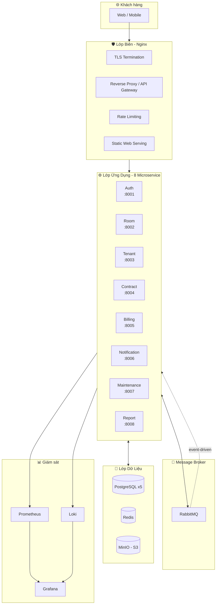

# HỆ THỐNG QUẢN LÝ PHÒNG TRỌ (QLPT)
## Kiến trúc Microservice trên nền tảng Điện toán đám mây — triển khai bằng Docker trên Ubuntu Server

---

## 1. Đây là gì?

Đây là **mô hình triển khai hệ thống quản lý phòng trọ** theo kiến trúc Microservice,
đóng gói bằng Docker và chạy trên một Ubuntu Server duy nhất, mô phỏng đầy đủ các đặc trưng
của Điện toán đám mây (Cloud Computing).

| | |
|---|---|
| **Kiến trúc** | Microservice (Database-per-Service, Event-driven) |
| **Nền tảng** | Self-hosted Private Cloud trên Ubuntu Server 24.04 LTS |
| **Công nghệ** | Python 3.12 · FastAPI · PostgreSQL 16 · Redis 7 · RabbitMQ 3 · MinIO · Nginx · Prometheus · Grafana · Docker Compose |
| **Quy mô mục tiêu** | 1 host 8 vCPU / 16 GB RAM / 200 GB SSD — phục vụ 200–500 phòng, ~2.000 người thuê |

---

## 2. Bắt đầu từ đâu (đọc theo thứ tự)

```
Bước 0  →  docs/01-tong-quan-bai-toan.md        Hiểu bài toán & nghiệp vụ
Bước 1  →  docs/02-thiet-ke-microservice.md     Tách domain thành 8 microservice
Bước 2  →  docs/03-kien-truc-trie-khai-dam-may.md  Kiến trúc triển khai + ánh xạ đám mây
Bước 3  →  docs/04-docker-tren-ubuntu-server.md  Cài server, Docker, chạy thử
Bước 4  →  docs/05-du-lieu-sao-luu.md            Sao lưu & khôi phục
Bước 5  →  docs/06-bao-mat.md                    Bảo mật
Bước 6  →  docs/07-van-hanh-hieu-nang-mo-rong.md Giám sát, load test, mở rộng
Bước 7  →  docs/08-ke-hoach-trien-khai.md         Lộ trình 6 tuần (đồ án)
Bước 8  →  docs/09-slide-thuyet-trinh.md         Chuẩn bị thuyết trình & bảo vệ
Bonus   →  docs/10-tai-lieu-tham-khao.md          Trích dẫn tài liệu gốc
```

---

## 3. Chạy thử trong 15 phút (nếu bạn đã có Ubuntu Server)

```bash
# 0. Chuẩn bị server (cài Docker + Compose v2, UFW, swap) — chạy 1 lần
sudo bash scripts/01-bootstrap-ubuntu.sh

# 1. Cấu hình
cp .env.example .env
nano .env                # đặt PUBLIC_IP, DOMAIN, REDIS_PASSWORD
make secrets             # sinh bí mật ngẫu nhiên vào secrets/ (quyền 600)
make certs               # sinh chứng chỉ TLS tự ký — nginx cần để chạy HTTPS

# 2. Khởi động toàn bộ hệ thống
make prod-up             # PRODUCTION (restart: always + resource guarantee)
# hoặc: make up          # môi trường dev / triển khai giả lập
# hoặc: make laptop-up   # 💻 máy RAM hạn chế (VD WSL2 8 GB): tạm bỏ loki/
#                        #    promtail/cAdvisor/node-exporter + hạ trần RAM
#                        #    → chạy: docker compose -f docker-compose.yml
#                        #      -f docker-compose.laptop.yml up -d

# 3. Nạp dữ liệu mẫu & kiểm tra
make seed                # nạp "một câu chuyện" dữ liệu + tự đối chiếu read model
make health              # 9/9 service trả HTTP 200
make urls                # in toàn bộ đường dẫn truy cập

# 4. Kiểm chứng chất lượng cuối cùng (1 lệnh gom MỌI kiểm tra)
bash scripts/07-verify-final.sh         # từ WSL/Linux: 16 container + gateway
                                        #   + 2 tài khoản demo + 26 smoke test
powershell -ExecutionPolicy Bypass \
    -File scripts\verify-windows.ps1    # từ Windows: https://localhost + 8 cổng
                                        #   + đăng nhập admin (đọc secret từ WSL)

# 5. Mở giao diện
#   https://localhost/          Ứng dụng web (SPA) — hoặc https://<IP-LAN>/ (xem mục LAN)
#   http://localhost:3000       Grafana (admin / mật khẩu trong secrets/admin_password.txt)
#                               ⭐ chế độ laptop CHỈ bind 127.0.0.1 — vào từ xa thì SSH tunnel:
#                                  ssh -L 3000:localhost:3000 <user>@<server>
#   MinIO console (chỉ nội bộ):  ssh -L 9001:localhost:9001 <user>@<server>
```

### Chạy lại mỗi ngày (sau khi tắt máy / khởi động lại Windows)

Trên **máy demo WSL2**, hệ thống đã được cài sẵn trong `/opt/qlpt`. Sau khi tắt
máy hoặc WSL ngủ, chỉ cần **1 thao tác**:

```powershell
# Cách 1 (khuyến nghị) — nhấp đúp file .bat ở thư mục dự án:
#   START-QLPT.bat   (bản tiện dụng ở Desktop/Downloads: KHOI-DONG-QLPT.bat)
#
# Cách 2 — gõ lệnh trong PowerShell:
powershell -ExecutionPolicy Bypass -File scripts\start-windows.ps1
```

Script tự làm hết: **bật WSL → khởi động 16 container (chế độ laptop, KHÔNG build
lại) → đợi `https://localhost/` trả 200 → mở trình duyệt + in tài khoản demo.**
Sau đó vào **https://localhost/** là dùng được.

Muốn chạy tay trong WSL (Ubuntu):

```bash
cd /opt/qlpt
make laptop-up      # hoặc: docker compose -f docker-compose.yml -f docker-compose.laptop.yml up -d
make health         # kỳ vọng 9/9 ✅
make reload-nginx   # chỉ cần khi vừa recreate backend (tránh 502 Bad Gateway)
```

> 💡 Mọi container đặt `restart: unless-stopped`, nên **chỉ cần WSL bật** là Docker
> + toàn bộ container tự chạy lại (chờ ~1 phút). Nếu gặp **502**, chạy `make reload-nginx`.

### Hết cảnh báo "Your connection is not private" (chứng chỉ tự ký)

Trình duyệt báo `NET::ERR_CERT_AUTHORITY_INVALID` vì nginx dùng **chứng chỉ tự ký**
(`CN=qlpt.local`, có SAN `localhost` + `127.0.0.1`) — đây là điều bình thường với
môi trường demo/nội bộ, **không phải lỗi hệ thống**.

- **Cách nhanh:** bấm **Advanced** → **Proceed to localhost (unsafe)**.
- **Cách hết hẳn:** cài chứng chỉ vào kho tin cậy của Windows, rồi đóng/mở lại trình duyệt:

```powershell
powershell -ExecutionPolicy Bypass -File scripts\trust-cert-windows.ps1
# nếu Chrome/Edge vẫn chặn sau khi mở lại: chạy bằng quyền Admin với -AllUsers
```

### Chia sẻ cho máy khác trong cùng WiFi (LAN) — Windows + WSL2

WSL2 chạy sau **NAT** nên máy khác **không** vào được `https://<IP-LAN>/` nếu chưa
mở "cầu nối". Chạy **1 lệnh** (sẽ hiện hộp thoại **UAC → bấm Yes**):

```powershell
powershell -ExecutionPolicy Bypass -File scripts\lan-expose-windows.ps1
```

Script tự làm:

1. Mở **firewall Windows** cho **TCP 80/443 — CHỈ từ dải mạng nội bộ
   (`LocalSubnet`)**, nên vẫn an toàn khi mang máy ra WiFi quán.
2. Cài **`portproxy`** `0.0.0.0:80/443 → WSL2` (WSL2 NAT nên Windows đóng vai cầu nối).
4. Đảm bảo **chứng chỉ có SAN = IP LAN hiện tại** (tự tạo lại + tin cậy lại nếu cần).

Sau đó máy khác trong WiFi vào **`https://<IP-LAN>/`**. Trên máy đó, để hết cảnh báo
cert thì import chứng chỉ công khai (`infra/nginx/certs/fullchain.pem`) hoặc bấm
**Advanced → Proceed**.

> ⭐ **Chạy lại script này mỗi khi bật máy** (IP của WSL2 đổi) **hoặc đổi WiFi**.
> Nếu IP LAN của Windows đổi (DHCP), script tự phát hiện và tạo lại cert có SAN mới.
> Grafana **không** được mở ra LAN (chỉ `127.0.0.1`) — dùng SSH tunnel nếu cần.

### Lỗi "Failed to fetch" / "HTTP 4xx" khi mở tab trong web

Ba nguyên nhân đã từng gặp (repo đã sửa sẵn — đừng vô tình tái tạo):

1. **`location` API có dấu `/` ở cuối** (VD `location /api/v1/rooms/`): nginx trả `301`
   cho đúng `/api/v1/rooms` (thêm `/`), service lại trả `307` ngược lại (bỏ `/`) →
   **lặp redirect vô hạn** → trình duyệt báo `Failed to fetch` (`ERR_TOO_MANY_REDIRECTS`).
   → Sửa: **bỏ dấu `/` cuối** trong `infra/nginx/conf.d/app.conf`.
2. **nginx route sai prefix**: mỗi service phơi theo "domain" (`/api/v1/invoices`,
   `/api/v1/incidents`, `/api/v1/properties`…) chứ **không** phải `/api/v1/<tên-service>`.
   → Xem bảng 20 prefix trong `infra/nginx/conf.d/app.conf` (khớp `APIRouter(prefix=…)`).
3. **`page_size` vượt giới hạn**: service cho tối đa **100** (`le=100`) → 422.
   → SPA (`web/index.html`) phải dùng `page_size=100`, không phải 200.

Kiểm tra nhanh (endpoint API **không** được trả 301/HTML):

```bash
curl -sk -o /dev/null -w '%{http_code} %{content_type}\n' https://localhost/api/v1/rooms
# kỳ vọng: 401 application/json   (KHÔNG phải 301 / text/html)
```

Xem `docs/04-docker-tren-ubuntu-server.md` để có hướng dẫn đầy đủ kèm hardening.

> ⚠️ **Ghi chú vật lý (2026):** MinIO đã xóa toàn bộ image `minio/minio` khỏi Docker Hub.
> Dự án dùng image Chainguard `cgr.dev/chainguard/minio@sha256:…` (vẫn là MinIO
> upstream, chứa sẵn `mc` cho healthcheck) — xem comment trong `docker-compose.yml`.

> ⚠️ **Ghi chú WSL2 (demo trên máy 8 GB):** WSL mặc định tự tắt *instance* sau
> **15 s** và tắt *VM* sau **60 s** khi không còn tiến trình nào → mỗi lần bạn ngừng
> gõ lệnh >15 s, Docker daemon + toàn bộ container bị dừng. Container tự bật lại nhờ
> `restart: unless-stopped`, nhưng mất 1–2 phút. Dự án đã đặt trong `.wslconfig`:
> `vmIdleTimeout=-1` + `instanceIdleTimeout=-1` để giữ WSL chạy liên tục.
> Nếu `/api/v1/*` trả **502 Bad Gateway** (nginx cache IP upstream lúc khởi động,
> còn backend vừa recreate thì IP đổi) → chạy `make reload-nginx`.

---

## 4. Cấu trúc thư mục dự án

```
ql-phong-tro/
├── README.md                       ← file bạn đang đọc
├── Makefile                        ← lệnh tắt: up, down, logs, backup, test
├── docker-compose.yml              ← môi trường phát triển/triển khai giả lập
├── docker-compose.prod.yml         ← LỚP production (overlay): restart: always,
│                                     resource guarantee, init — dùng kèm
│                                     `docker compose -f docker-compose.yml -f docker-compose.prod.yml` hay `make prod-up`
├── docker-compose.laptop.yml       ← LỚP laptop demo (overlay): tạm bỏ loki/
│                                     promtail/cAdvisor/node-exporter (profile
│                                     full-monitor) + hạ trần RAM — `make laptop-up`
├── .env.example                    ← mẫu biến môi trường & bí mật
│
├── docs/                           ← 10 tài liệu nghiên cứu (báo cáo đồ án)
│
├── infra/
│   ├── docker/                     Dockerfile dùng chung + requirements
│   ├── nginx/                      Reverse proxy / API Gateway / WAF-lite
│   ├── postgres/init/              Tạo nhiều database (database-per-service)
│   ├── prometheus/                 Cấu hình thu thập metrics
│   ├── grafana/                    Dashboard tự động provision
│   └── loki/                       Hệ thống gom log tập trung
│
├── services/                       ← 8 microservice (FastAPI)
│   ├── common/                     Thư viện dùng chung: DB, JWT, event bus, telemetry
│   ├── auth-service/               Đăng nhập, RBAC, phát hành token
│   ├── room-service/               Danh mục phòng, tầng, tiện ích
│   ├── tenant-service/             Hồ sơ người thuê
│   ├── contract-service/           Hợp đồng thuê, gia hạn
│   ├── billing-service/            Điện nước, biểu giá, hóa đơn
│   ├── notification-service/       Email/SMS/Zalo, nhắc hạn & nhắc tiền
│   ├── maintenance-service/        Sự cố, bảo trì
│   └── report-service/             Báo cáo doanh thu, dashboard tổng hợp
│
├── web/                            ← Giao diện web (SPA tĩnh, không cần build)
├── scripts/                        ← Script vận hành: bootstrap, deploy, backup, restore
└── k6/                             ← Kịch bản kiểm thử tải
```

---

## 5. Kiến trúc tổng quan



---

## 6. 8 Microservice và trách nhiệm

| # | Service | Cổng | Trách nhiệm | Database riêng |
|---|---------|------|-------------|----------------|
| 1 | `auth-service` | 8001 | Đăng nhập, JWT, RBAC, refresh token | `db_auth` |
| 2 | `room-service` | 8002 | Phòng, tầng, tiện ích, trạng thái phòng | `db_room` |
| 3 | `tenant-service` | 8003 | Hồ sơ người thuê, hồ sơ bạn cùng phòng | `db_tenant` |
| 4 | `contract-service` | 8004 | Hợp đồng thuê, gia hạn, tiền cọc | `db_contract` |
| 5 | `billing-service` | 8005 | Chỉ số điện nước, biểu giá, hóa đơn, thanh toán | `db_billing` |
| 6 | `notification-service` | 8006 | Email/SMS/Zalo, nhắc hạn hợp đồng, nhắc trả tiền | `db_notify` |
| 7 | `maintenance-service` | 8007 | Báo hư hỏng, lịch bảo trì | `db_maintenance` |
| 8 | `report-service` | 8008 | Báo cáo doanh thu, tỷ lệ lấp đầy, dashboard | `db_report` |

> **Điểm cốt lõi của kiến trúc:** Mỗi service có **database riêng**, **không dùng chung schema**.
> Giao tiếp **đồng bộ** qua REST (khi cần kết quả ngay), **bất đồng bộ** qua RabbitMQ
> (khi chỉ cần thông báo). Đây là điểm khác biệt căn bản với kiến trúc Monolith.

---

## 7. Bản đồ ánh xạ sang đặc trưng Cloud Computing

| Đặc trưng đám mây (NIST SP 800-145) | Thể hiện trong hệ thống này |
|---|---|
| **On-demand self-service** | `docker compose up -d` — tự phục vụ, không cần CNTT can thiệp |
| **Broad network access** | Nginx + Let's Encrypt phục vụ HTTPS mọi thiết bị |
| **Resource pooling** | 8 container dùng chung 1 host, công suất gộp lại (CPU/RAM/disk) |
| **Rapid elasticity** | Scale service bằng `--scale billing=4` + `deploy.replicas` trong Compose |
| **Measured service** | Prometheus thu thập metrics, Grafana hiển thị, hóa đơn "ảo" theo request |
| **Ảo hóa (Virtualization)** | Container = lightweight OS-level virtualization, cùng công nghệ với AWS EC2 |
| **Tách biệt tài nguyên (Multi-tenancy)** | Namespaces + mạng Docker riêng cho từng lớp (edge/app/data) |

---

## 8. Lệnh tắt (Makefile)

```bash
make up          # Khởi động toàn bộ
make prod-up     # Khởi động PRODUCTION (thêm docker-compose.prod.yml: restart: always + resource guarantee)
make laptop-up   # Khởi động chế độ LAPTOP (docker-compose.laptop.yml: gọn nhẹ cho máy 8 GB / WSL2)
make down        # Dừng
make status      # Xem trạng thái
make logs        # Theo dõi log
make secrets     # Tạo bí mật ngẫu nhiên (JWT, mật khẩu DB…)
make certs       # Tạo chứng chỉ TLS tự ký cho nginx (bắt buộc lần đầu)
make seed        # Nạp dữ liệu mẫu
make health      # Kiểm tra /health của 9 service (9/9)
make test        # Chạy unit test (trong container)
make test-int    # Smoke test 26 kiểm tra tích hợp toàn hệ thống
make reload-nginx # Nạp lại nginx (sửa 502 khi backend recreate, đổi IP)
make backup      # Sao lưu
make restore     # Khôi phục
make loadtest    # Kiểm thử tải bằng k6
make security    # Quét bảo mật
```

> **Kiểm chứng cuối cùng (1 lệnh, 6 bước):**
> `bash scripts/07-verify-final.sh` (từ WSL) và
> `powershell -File scripts\verify-windows.ps1` (từ Windows).
>
> **Lưu ý quyền:** `make test-int` và `07-verify-final.sh` phải đọc mật khẩu admin
> trong `secrets/` (thư mục `700`, chỉ root đọc được). Hãy chạy bằng **root**:
> `sudo make test-int` · `wsl -u root -e bash scripts/07-verify-final.sh`, hoặc
> truyền thẳng: `QLPT_ADMIN_PWD="$(sudo cat secrets/admin_password.txt)" make test-int`.

> Chế độ laptop: `laptop-down`, `laptop-restart S=<svc>`, `laptop-logs S=<svc>`,
> `laptop-monitor` (bật thêm loki/promtail/cAdvisor/node-exporter qua profile `full-monitor`).

---

## 9. Ghi chú học thuật

- Dùng làm **báo cáo/đồ án môn Điện toán đám mây**.
- Sơ đồ trong `docs/` dùng cú pháp **Mermaid** — render trực tiếp trên GitHub, VS Code
  (extension *Markdown Preview Mermaid Support*), Obsidian, hay [mermaid.live](https://mermaid.live).
- Tài liệu tham khảo chuẩn (NIST, Fowler, Richardson, NGINX, Prometheus…) ở `docs/10-tai-lieu-tham-khao.md`.
