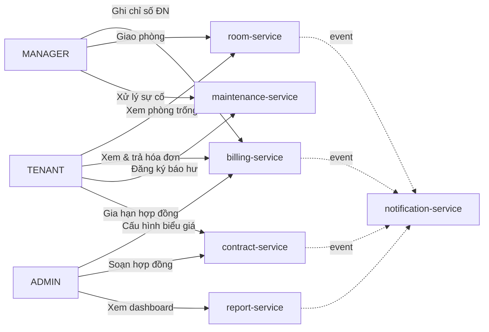
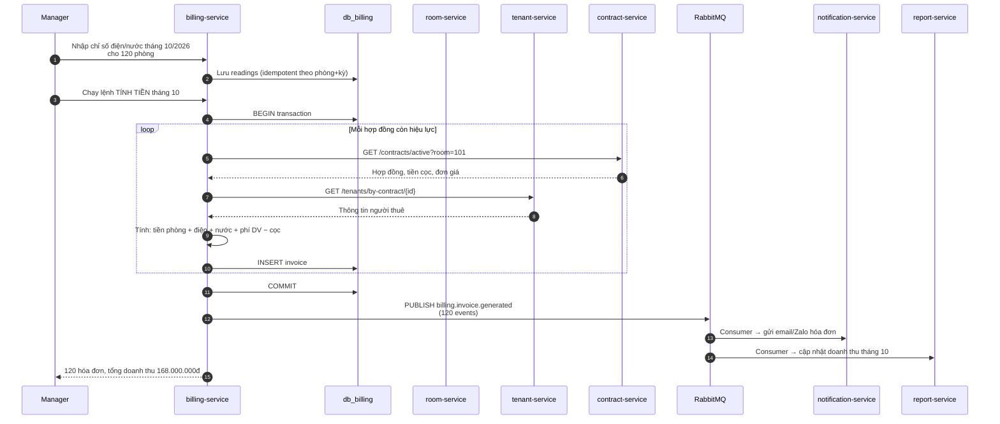

# CHƯƠNG 1 — TỔNG QUAN BÀI TOÁN

## 1.1. Bối cảnh

Quản lý nhà trọ (phòng trọ cho học sinh, sinh viên, công nhân) tại Việt Nam vẫn phần lớn
được vận hành bằng **sổ tay, Excel, hoặc Zalo**. Quy trình này gặp các vấn đề:

| Vấn đề | Biểu hiện | Hậu quả |
|---|---|---|
| Không kiểm soát được phòng trống | Chủ nhà không biết phòng nào còn trống | Mất doanh thu ~8–12% |
| Tính tiền thủ công | Nhân viên gõ tay từng dòng tiền điện nước | Sai sót, mất niềm tin người thuê |
| Nhắc hạn hợp đồng bằng trí nhớ | Quên gia hạn → phòng trống 1–2 tháng | Gián đoạn doanh thu |
| Không lịch sử giao dịch | Không biết ai trả tiền tháng nào | Khó truy vết khiếu nại |
| Không mở rộng được | Mở thêm nhà trọ → phải copy nguyên hệ thống | Chi phí tăng tuyến tính |

## 1.2. Mục tiêu hệ thống

### 1.2.1. Mục tiêu chức năng

Hệ thống phải bao phủ 6 nhóm nghiệp vụ:

```
┌─────────────────────────────────────────────────────────────────────┐
│  1. QUẢN LÝ PHÒNG & HỢP ĐỒNG THUÊ                                  │
│     • Danh mục tòa nhà / tầng / phòng                              │
│     • Tiện ích gắn liền phòng (điều hòa, bếp, máy giặt, wifi...)   │
│     • Vòng đời phòng: TRỐNG → ĐANG THUÊ → BẢO TRÌ → TRỐNG          │
│     • Hợp đồng thuê: tạo, gia hạn, chấm dứt, tiền cọc            │
├─────────────────────────────────────────────────────────────────────┤
│  2. QUẢN LÝ NGƯỜI THUÊ & THANH TOÁN                                │
│     • Hồ sơ người thuê (CCCD, số điện thoại, email, địa chỉ)      │
│     • Bạn cùng phòng (nhiều người/phòng)                            │
│     • Hóa đơn tháng, ghi nhận thanh toán, công nợ                  │
├─────────────────────────────────────────────────────────────────────┤
│  3. ĐIỆN NƯỚC & TÍNH TIỀN TỰ ĐỘNG                                │
│     • Ghi chỉ số điện / nước theo kỳ                                │
│     • Biểu giá nhiều bậc (bậc thang), giá dịch vụ cố định          │
│     • Phí sinh hoạt: internet, vệ sinh, rác, xe                     │
│     • Tính tiền tự động theo công thức                               │
├─────────────────────────────────────────────────────────────────────┤
│  4. THÔNG BÁO & BÁO CÁO                                            │
│     • Gửi hóa đơn qua email / Zalo ZNS                               │
│     • Nhắc trả tiền trước hạn (T-3, T-1)                            │
│     • Nhắc gia hạn hợp đồng (T-30, T-7)                              │
│     • Dashboard doanh thu, tỷ lệ lấp đầy, phòng trống theo tháng   │
├─────────────────────────────────────────────────────────────────────┤
│  5. QUẢN LÝ SỰ CỐ / BẢO TRÌ                                        │
│     • Người thuê báo hư (thủy vỹ, điện, bản lề cửa...)             │
│     • Phân công kỹ thuật viên, đánh giá, đóng                      │
│     • Lịch bảo trì định kỳ theo mùa                                │
├─────────────────────────────────────────────────────────────────────┤
│  6. PHÂN QUYỀN & XÁC THỰC                                          │
│     • 3 vai trò: ADMIN / MANAGER / TENANT                            │
│     • JWT access token (15 phút) + refresh token (7 ngày)            │
│     • RBAC trên từng endpoint                                        │
└─────────────────────────────────────────────────────────────────────┘
```

### 1.2.2. Mục tiêu phi chức năng (phiên bản phi chuẩn cho đồ án)

| Yêu cầu | Chỉ tiêu đo lường được |
|---|---|
| Hiệu năng | p95 của API đọc < 300 ms; API ghi < 500 ms |
| Khả dụng | Uptime ≥ 99,5% (cho phép 3,6 giờ downtime/tháng) |
| Mở rộng | Hỗ trợ tăng gấp đôi số phòng mà không phải viết lại code |
| Bảo mật | Không có lỗ hổng Critical/High; mọi request có audit log |
| Khôi phục | RPO ≤ 24h, RTO ≤ 2h |
| Triển khai lại | Toàn bộ hệ thống dựng lại từ script trong ≤ 30 phút |
| Chi phí | 1 VPS 8 vCPU / 16 GB — không tốn tiền đám mây công cộng |

## 1.3. Đối tượng người dùng và ca sử dụng chính

| Vai trò | Mô tả | Ca sử dụng chính |
|---|---|---|
| **ADMIN** (Chủ nhà) | Toàn quyền, cấu hình biểu giá, quản lý tài khoản | Cuối tháng: chốt hóa đơn; Hàng ngày: kiểm tra sự cố |
| **MANAGER** (Quản lý trọ) | Vận hành hằng ngày, không sửa biểu giá | Ngày: ghi chỉ số điện nước, giao phòng trống |
| **TENANT** (Người thuê) | Xem hóa đơn, đăng ký sự cố, trả tiền | Đầu tháng: xem & trả hóa đơn; Khi sự cố: báo hư |
| **SYSTEM** (Cron/Broker) | Job tính tiền, job gửi nhắc | 23:00 hằng ngày |

### Sơ đồ Use-case tổng quát



## 1.4. Quy trình nghiệp vụ cốt lõi: Tính tiền hằng tháng

Đây là quy trình **phức tạp nhất** — dùng để chứng minh kiến trúc Microservice xử lý
nghiệp vụ chéo nhiều service:



**Điểm nhấn kiến trúc:** Quy trình này **xuyên qua 5 service và 3 database**.
Nhờ đó ta thấy rõ:
- Vì sao dùng **event-driven** cho phần thông báo (fail 1 dịch vụ email không được làm
  hỏng cả quy trình tính tiền) — đây là lý do dùng **Outbox Pattern** (mục 2.5).
- Vì sao **không** dùng distributed transaction 2PC (phức tạp, hiệu năng kém, dễ deadlock).

## 1.5. Ranh giới phạm vi (Scope)

### ✅ In scope
- Toàn bộ 6 nhóm nghiệp vụ ở mục 1.2.1
- Quản lý **nhiều cơ sở** nhà trọ trong cùng hệ thống (multi-tenant theo *property*)
- Web responsive (dùng được trên điện thoại)
- Tiếng Việt, múi giờ Asia/Ho_Chi_Minh, tiền tệ VND
- Hệ thống chạy **1 Ubuntu Server** (mô phỏng private cloud)

### ❌ Out of scope
- Thanh toán trực tuyến qua cổng ngân hàng (giả lập webhook, không gọi API thật)
- Ứng dụng mobile native
- Nhận diện khuôn mặt / camera an ninh
- Kế toán tổng hợp, tích hợp kê khai thuế
- Kubernetes (giải thích ở mục 3.7 như một bước nâng cấp)

## 1.6. Các ràng buộc nghiệp vụ quan trọng

| # | Ràng buộc | Cách kiểm tra |
|---|---|---|
| R1 | Một hợp đồng chỉ có **1 người đứng tên chính**, tối đa **3 bạn cùng phòng** | `contract-service` validation |
| R2 | Không được giao phòng đã **đang có hợp đồng hiệu lực** | `room-service` + kiểm tra ở `contract-service` |
| R3 | Tiền cọc được **trừ dần** vào hóa đơn, không trừ quá giá trị cọc | `billing-service` |
| R4 | Chỉ số điện/nước phải **monotonic tăng**; số mới ≥ số cũ | Trigger DB + validate |
| R5 | Hợp đồng nhắc gia hạn tại **T-30 ngày**; hóa đơn nhắc trả tại **T-3 ngày** | Cron job trong `notification-service` |
| R6 | Mọi thao tác ghi dữ liệu đều ghi **audit log** (ai, lúc nào, thay đổi gì) | Middleware chung trong `common/` |
| R7 | Xóa phòng/người thuê dùng **soft delete** để giữ dữ liệu lịch sử | `deleted_at` |
| R8 | Hóa đơn đã `PAID` **không được sửa**, chỉ hủy rồi tạo lại | State machine |

## 1.7. Tổng kết chương

Chương 1 đã xác định:
1. Bối cảnh và **6 nhóm nghiệp vụ** cần bao phủ.
2. **Mục tiêu phi chức năng** đo được bằng số liệu cụ thể (p95, uptime, RPO/RTO).
3. **Quy trình tính tiền hằng tháng** — trường hợp dùng để đánh giá kiến trúc.
4. **Ranh giới phạm vi** và 8 ràng buộc nghiệp vụ sẽ được mã hóa thành validation.

→ Chương 2 phân tích cách **tách 6 nhóm nghiệp vụ này thành 8 microservice** độc lập.
