# CHƯƠNG 2 — THIẾT KẾ KIẾN TRÚC MICROSERVICE

## 2.1. Vì sao chọn Microservice? (So sánh với Monolith)

| Tiêu chí | Monolith | Microservice | Chọn |
|---|---|---|---|
| Triển khai | 1 lần cho toàn hệ thống | 8 lần độc lập | ✅ MS |
| Mở rộng | Scale cả hệ thống | Scale đúng service nghẽn (billing) | ✅ MS |
| Cô lập lỗi | Sập 1 chỗ = sập hết | Sập notification không ảnh hưởng tính tiền | ✅ MS |
| Công nghệ | 1 stack duy nhất | Linh hoạt từng service | ✅ MS |
| Giao dịch liên service | 1 transaction ACID | Khó hơn, cần Saga/Outbox | ❌ MS |
| DevOps | Đơn giản | Cần CI/CD, monitoring, service discovery | ❌ MS |
| Quản lý dữ liệu | 1 schema | N+1 database, truy vấn phức tạp | ❌ MS |
| Chi phí vận hành | Thấp | Cao hơn (nhiều container) | ❌ MS |

**Kết luận:** Với hệ thống có **6 nhóm nghiệp vụ tách biệt rõ rệt** (quản lý phòng ≠ tính
tiền ≠ gửi email) và có **tính chất tải rất khác nhau** (billing cao điểm cuối tháng,
notification chạy nền liên tục), Microservice là lựa chọn phù hợp. Ở quy mô nhà trọ thực
tế, hệ thống **vẫn chạy tốt trên 1 máy** — đó là điểm cần lưu ý khi trình bày: kiến trúc
được thiết kế để *sẵn sàng* mở rộng, không phải để *buộc phải* mở rộng ngay.

## 2.2. Quy trình phân rã 4 bước

Chúng ta dùng **Domain-Driven Design (DDD)** — một trong các phương pháp phân rã
phổ biến nhất cho Microservice.

### Bước 1: Xác định miền nghiệp vụ (Subdomain)

```
HỆ THỐNG QUẢN LÝ NHÀ TRỌ
│
├── Core Domain (lõi, khác biệt, giá trị cao)
│   ├── Quản lý HỢP ĐỒNG THUÊ
│   └── TÍNH TIỀN ĐIỆN NƯỚC & HÓA ĐƠN
│
├── Supporting Domain (hỗ trợ, có thể mua/simplify)
│   ├── Quản lý PHÒNG
│   ├── Quản lý NGƯỜI THUÊ
│   └── Quản lý SỰ CỐ
│
└── Generic Domain (dùng chung, không khác biệt)
    ├── Xác thực & phân quyền  → dùng Keycloak/LDAP nếu có thể
    ├── Thông báo               → dùng dịch vụ email bên thứ ba
    └── Báo cáo                 → dùng công cụ BI
```

> **Bài học rút ra:** Chỉ nên **tách riêng** những phần *core domain*. Phần *generic domain*
> nên dùng giải pháp có sẵn — tách nó ra chỉ tốn công mà không tạo lợi thế cạnh tranh.
> Đây là điểm hay bị chấm điểm trong phần hỏi về bảo vệ đồ án.

### Bước 2: Xác định Bounded Context (Ngữ cảnh giới hạn)

Mỗi Bounded Context = **một ranh giới nhất quán** trong đó một thuật ngữ có **một nghĩa duy nhất**.

Điểm then chốt: cùng một khái niệm "phòng" có nghĩa khác nhau ở mỗi context:

| Context | Nghĩa của "Phòng" | Thuộc tính quan tâm |
|---|---|---|
| `room-service` | *Vật thể vật lý*: số phòng, tầng, diện tích, tiện ích, trạng thái | vật lý |
| `contract-service` | *Đơn vị tính tiền*: đang có hợp đồng ai, đơn giá, kỳ thanh toán | tài chính |
| `billing-service` | *Đơn vị ghi chỉ số*: nơi đặt đồng hồ điện/nước | chỉ số |

→ Vì vậy **không được dùng chung bảng `room`**. Mỗi service giữ bản sao riêng, cập nhật
qua **event**. Đây chính là nguồn gốc của mẫu **Shared Database → mỗi service một DB**
và mẫu **CQRS** (mục 2.6).

### Bước 3: Trích xuất Service từ Bounded Context

| Bounded Context | Service | Cơ sở trích xuất |
|---|---|---|
| Identity & Access | `auth-service` | Không cần thiết kế riêng → generic |
| Room Catalog | `room-service` | Nhất quán nội bộ mạnh, độc lập với hợp đồng |
| Tenant Registry | `tenant-service` | Chu kỳ thay đổi khác hợp đồng |
| Leasing | `contract-service` | **Core domain**, luật nghiệp vụ riêng biệt |
| Metering & Billing | `billing-service` | **Core domain**, tải cao điểm cuối tháng |
| Notification | `notification-service` | Chạy nền, tách để **cô lập lỗi** |
| Maintenance | `maintenance-service` | Nhịp độc lập với vòng đời phòng |
| Analytics/Reporting | `report-service` | Cần đọc nhiều nguồn → CQRS read-model |

**Quy tắc 1 service = 1 Bounded Context = 1 cơ sở dữ liệu = 1 tiến trình (process).**

### Bước 4: Xác định cách giao tiếp

| Loại | Giao thức | Khi nào dùng | Ví dụ trong hệ thống |
|---|---|---|---|
| **Đồng bộ (Synchronous)** | REST / gRPC | Cần **kết quả ngay** để tiếp tục | Manager ghi chỉ số → cần biết phòng có tồn tại không |
| **Bất đồng bộ (Asynchronous)** | RabbitMQ (AMQP) | Chỉ cần **thông báo**, không cần kết quả | Gửi email hóa đơn, cập nhật dashboard |

**Quy tắc vàng:** *"Synchronous for the immediate, asynchronous for the eventual."*
(Hỏi đồng bộ khi cần kết quả ngay; hỏi bất đồng bộ khi kết quả đến sau cũng được.)

## 2.3. Danh mục 8 Microservice — Thiết kế chi tiết

### 2.3.1. `auth-service` (Cổng 8001) — Identity & Access Management

**Trách nhiệm:** Đăng nhập, phát hành token, quản lý người dùng, phân quyền.

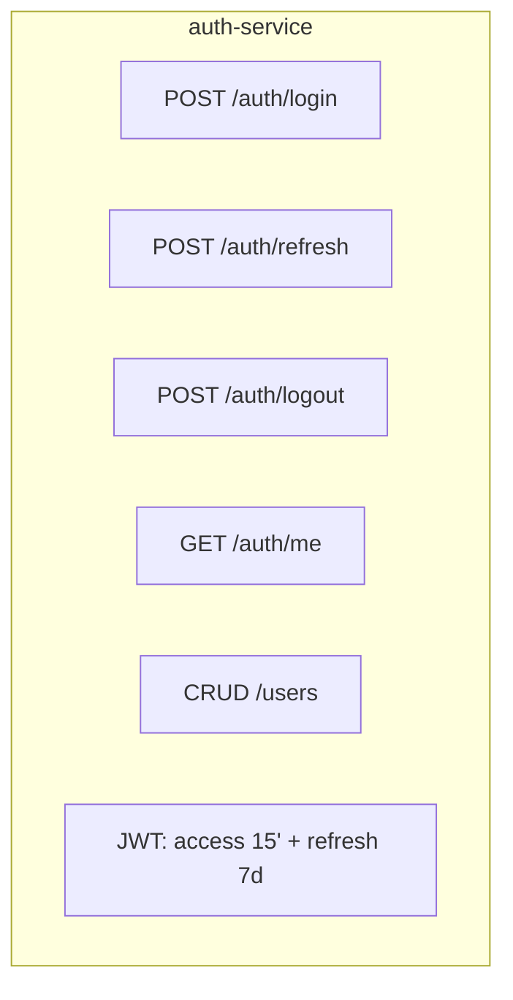

| Endpoint | Method | Mô tả | RBAC |
|---|---|---|---|
| `/auth/login` | POST | Đăng nhập → trả access + refresh token | Public |
| `/auth/refresh` | POST | Đổi refresh token lấy access token mới | Public |
| `/auth/logout` | POST | Thu hồi refresh token (thêm vào denylist Redis) | Auth |
| `/auth/me` | GET | Thông tin user hiện tại + quyền | Auth |
| `/users` | GET/POST | Danh sách / tạo tài khoản | ADMIN |
| `/users/{id}/roles` | PUT | Gán vai trò | ADMIN |

**Mô hình dữ liệu `db_auth`:**

```sql
CREATE TABLE users (
    id              UUID PRIMARY KEY DEFAULT gen_random_uuid(),
    username        VARCHAR(50)  UNIQUE NOT NULL,
    email           VARCHAR(150) UNIQUE NOT NULL,
    password_hash   VARCHAR(255) NOT NULL,     -- Argon2id
    full_name       VARCHAR(100) NOT NULL,
    phone           VARCHAR(15),
    role            VARCHAR(20)  NOT NULL
                    CHECK (role IN ('ADMIN','MANAGER','TENANT')),
    property_id     UUID,                       -- NULL = quản trị nhiều cơ sở
    is_active       BOOLEAN DEFAULT TRUE,
    created_at      TIMESTAMPTZ DEFAULT now(),
    updated_at      TIMESTAMPTZ DEFAULT now(),
    deleted_at      TIMESTAMPTZ                 -- soft delete (R7)
);

-- Lưu refresh token dạng hash, cho phép thu hồi (revoke)
CREATE TABLE refresh_tokens (
    id           UUID PRIMARY KEY DEFAULT gen_random_uuid(),
    user_id      UUID NOT NULL REFERENCES users(id) ON DELETE CASCADE,
    token_hash   VARCHAR(255) NOT NULL,
    expires_at   TIMESTAMPTZ NOT NULL,
    revoked_at   TIMESTAMPTZ,
    user_agent   VARCHAR(255),
    ip_address   VARCHAR(45)
);

-- Ghi nhận đăng nhập bất thường
CREATE TABLE login_attempts (
    id BIGSERIAL PRIMARY KEY,
    username   VARCHAR(50),
    ip_address VARCHAR(45),
    success    BOOLEAN,
    created_at TIMESTAMPTZ DEFAULT now()
);
```

**Cơ chế RBAC:**

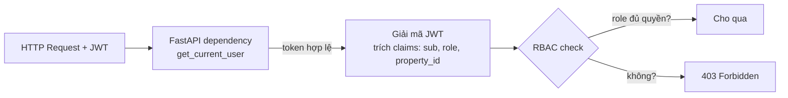

JWT payload:
```json
{
  "sub": "0f3a...-uuid",
  "username": "quanly.truong",
  "role": "MANAGER",
  "property_id": "a71c...-uuid",
  "exp": 1767300000,
  "iat": 1767299100,
  "iss": "qlpt-auth-service"
}
```

> **Quan sát bảo mật:** access token 15 phút ngắn → giảm thời gian cửa sổ khi token bị lộ.
> Refresh token lưu dạng **hash** trong DB → nếu DB bị lấy cũng không dùng được để đăng nhập.
> `login_attempts` cho phép phát hiện **brute-force** (khóa tài khoản sau 5 lần sai).

---

### 2.3.2. `room-service` (Cổng 8002) — Danh mục phòng

**Trách nhiệm:** Thực thể vật lý của phòng, tầng, tiện ích, vòng đời.

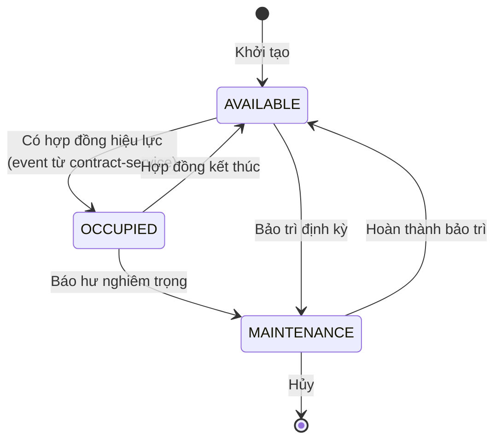

**Mô hình dữ liệu `db_room`:**

```sql
CREATE TABLE properties (              -- Cơ sở nhà trọ
    id        UUID PRIMARY KEY DEFAULT gen_random_uuid(),
    name      VARCHAR(150) NOT NULL,
    address   TEXT NOT NULL,
    owner_name VARCHAR(100),
    phone     VARCHAR(15)
);

CREATE TABLE buildings (
    id          UUID PRIMARY KEY DEFAULT gen_random_uuid(),
    property_id UUID NOT NULL REFERENCES properties(id),
    name        VARCHAR(50) NOT NULL
);

CREATE TABLE rooms (
    id           UUID PRIMARY KEY DEFAULT gen_random_uuid(),
    property_id  UUID NOT NULL REFERENCES properties(id),
    building_id  UUID NOT NULL REFERENCES buildings(id),
    room_number  VARCHAR(20) NOT NULL,        -- "101", "201A"
    floor        SMALLINT NOT NULL,
    area_m2      NUMERIC(6,2),
    base_price   NUMERIC(12,0) NOT NULL,     -- đơn giá/tháng, VND
    max_occupants SMALLINT DEFAULT 1,
    status       VARCHAR(20) NOT NULL DEFAULT 'AVAILABLE'
                 CHECK (status IN ('AVAILABLE','OCCUPIED','MAINTENANCE','RESERVED')),
    -- Bản sao cục bộ, cập nhật qua event
    current_contract_id UUID,
    -- CHỐNG TRÙNG LẶP: cùng 1 cơ sở, không có 2 phòng trùng số
    UNIQUE (property_id, building_id, room_number)
);

CREATE TABLE amenities (                 -- Tiện ích
    id    UUID PRIMARY KEY DEFAULT gen_random_uuid(),
    code  VARCHAR(30) UNIQUE NOT NULL,   -- AC, WIFI, KITCHEN, WASHER...
    name  VARCHAR(100) NOT NULL,
    monthly_fee NUMERIC(12,0) DEFAULT 0  -- phí tháng nếu có
);

CREATE TABLE room_amenities (            -- N-N
    room_id     UUID REFERENCES rooms(id) ON DELETE CASCADE,
    amenity_id  UUID REFERENCES amenities(id) ON DELETE CASCADE,
    PRIMARY KEY (room_id, amenity_id)
);
```

**Các endpoint chính:**

| Endpoint | Method | Mô tả |
|---|---|---|
| `/rooms` | GET | Danh sách, lọc theo `property_id`, `status`, `building`, `min_price`, `max_price`; phân trang |
| `/rooms/available` | GET | **Phòng trống** — dùng cho trang công khai tìm phòng |
| `/rooms/{id}` | GET/PUT/DELETE | Chi tiết / cập nhật / soft delete |
| `/rooms/{id}/status` | PATCH | Chuyển trạng thái (chỉ nhận qua event hoặc ADMIN) |
| `/rooms/{id}/amenities` | GET/PUT | Tiện ích của phòng |
| `/rooms/stats` | GET | Tổng hợp: bao nhiêu trống/đang thuê/bảo trì |
| `/rooms` | POST | Tạo mới (yêu cầu 409 nếu trùng `room_number`) |

**Endpoint đặc biệt — tìm phòng theo tiêu chí (công khai):**

```
GET /api/v1/rooms/available
    ?property_id=<uuid>
    &min_price=1500000&max_price=3000000
    &min_area=18
    &amenities=AC,WIFI
    &available_from=2026-11-01
    &sort=price_asc
```

Trả về kèm **bảng giá đã bao gồm điện nước ước tính** — tính bằng
`billing-service` (qua event cache trong Redis, không gọi đồng bộ để giữ p95 thấp).

---

### 2.3.3. `tenant-service` (Cổng 8003) — Hồ sơ người thuê

**Trách nhiệm:** Thông tin cá nhân, hộ chiếu, bạn cùng phòng, lịch sử thuê.

```sql
CREATE TABLE tenants (
    id             UUID PRIMARY KEY DEFAULT gen_random_uuid(),
    property_id    UUID NOT NULL,
    full_name      VARCHAR(100) NOT NULL,
    date_of_birth  DATE,
    gender         VARCHAR(10) CHECK (gender IN ('M','F','OTHER')),
    id_card_number VARCHAR(20) UNIQUE,      -- CCCD 12 số
    id_card_front  TEXT,                    -- MinIO object key
    id_card_back   TEXT,
    phone          VARCHAR(15) NOT NULL,
    email          VARCHAR(150),
    address        TEXT,                    -- quê
    occupation     VARCHAR(100),
    emergency_contact_name  VARCHAR(100),
    emergency_contact_phone VARCHAR(15),
    zalo_oa_id     VARCHAR(50),             -- để gửi tin nhắn Zalo
    created_at     TIMESTAMPTZ DEFAULT now(),
    deleted_at     TIMESTAMPTZ
);

-- Bạn cùng phòng (R1: tối đa 3)
CREATE TABLE roommates (
    id        UUID PRIMARY KEY DEFAULT gen_random_uuid(),
    room_id   UUID NOT NULL,
    full_name VARCHAR(100) NOT NULL,
    phone     VARCHAR(15) NOT NULL,
    is_primary BOOLEAN DEFAULT FALSE        -- người đứng tên chính
);

-- Lịch sử (không xóa)
CREATE TABLE tenant_history (
    id         BIGSERIAL PRIMARY KEY,
    tenant_id  UUID NOT NULL,
    room_id    UUID,
    event_type VARCHAR(30) NOT NULL,        -- MOVED_IN / MOVED_OUT / RENEWED
    event_data JSONB,
    created_at TIMESTAMPTZ DEFAULT now()
);
```

**Điểm bảo mật quan trọng:** `id_card_number` là dữ liệu nhạy cảm theo
Nghị định 13/2023/NĐ-CP. Yêu cầu:
- Mã hóa cột ở tầng ứng dụng (AES-256-GCM) — xem `docs/06-bao-mat.md` mục 6.5
- Chỉ ADMIN/MANAGER của đúng `property_id` được đọc
- Mọi lần đọc ghi vào `audit_log`
- Không bao giờ trả về trong response tổng quát; cần endpoint riêng có kiểm tra quyền

---

### 2.3.4. `contract-service` (Cổng 8004) — Hợp đồng thuê *(Core Domain)*

**Trách nhiệm:** Vòng đời hợp đồng thuê, tiền cọc, gia hạn, chấm dứt.

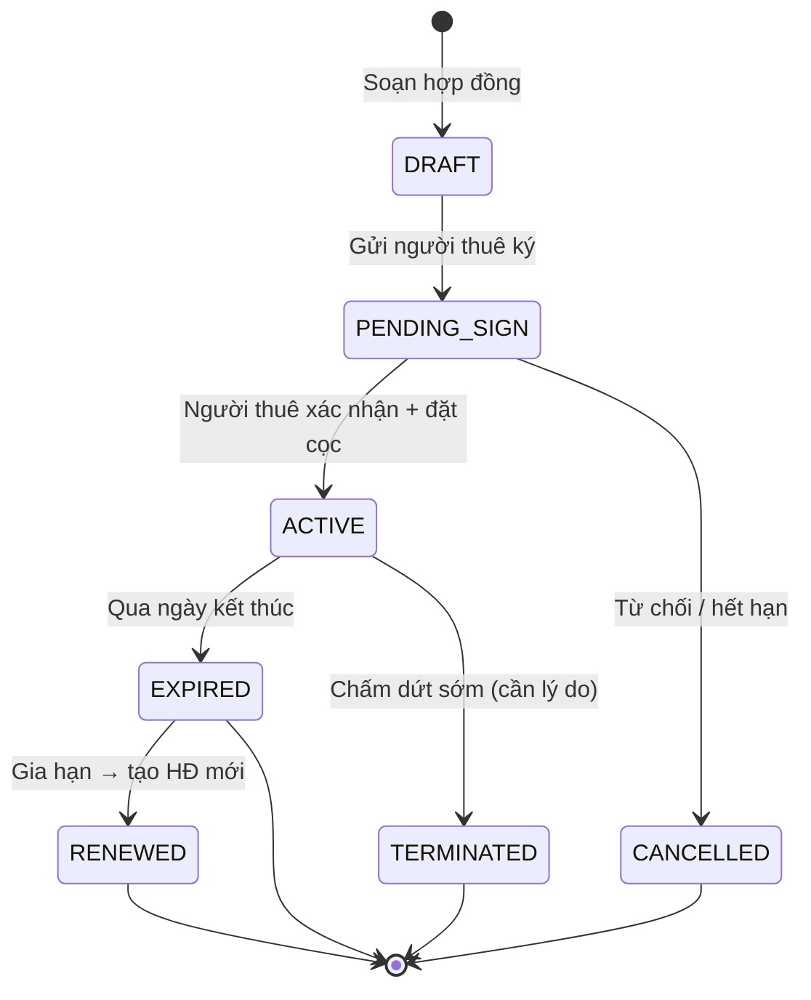

**Mô hình dữ liệu `db_contract`:**

```sql
CREATE TABLE contracts (
    id               UUID PRIMARY KEY DEFAULT gen_random_uuid(),
    contract_no      VARCHAR(30) UNIQUE NOT NULL,  -- HD-2026-000123
    property_id      UUID NOT NULL,
    room_id          UUID NOT NULL,
    primary_tenant_id UUID NOT NULL,               -- người đứng tên chính (R1)
    start_date       DATE NOT NULL,
    end_date         DATE NOT NULL,
    monthly_price    NUMERIC(12,0) NOT NULL,      -- đơn giá/tháng
    deposit_amount   NUMERIC(12,0) NOT NULL DEFAULT 0,  -- tiền cọc
    deposit_paid_at  TIMESTAMPTZ,
    deposit_deducted NUMERIC(12,0) DEFAULT 0,     -- R3: đã trừ dần bao nhiêu
    payment_cycle    VARCHAR(20) DEFAULT 'MONTHLY'
                     CHECK (payment_cycle IN ('MONTHLY','QUARTERLY','YEARLY')),
    status           VARCHAR(20) NOT NULL DEFAULT 'DRAFT'
                     CHECK (status IN ('DRAFT','PENDING_SIGN','ACTIVE','EXPIRED',
                                      'TERMINATED','CANCELLED','RENEWED')),
    terminated_reason TEXT,
    terms            JSONB,                        -- điều khoản riêng
    created_by       UUID NOT NULL,
    created_at       TIMESTAMPTZ DEFAULT now(),
    -- R2: không cho 2 hợp đồng ACTIVE cho cùng 1 phòng
    CONSTRAINT chk_date CHECK (end_date > start_date)
);

-- Chỉ 1 hợp đồng ACTIVE mỗi phòng (partial unique index)
CREATE UNIQUE INDEX uq_contract_active_room
    ON contracts(room_id) WHERE status = 'ACTIVE';

-- R1: tối đa 3 bạn cùng phòng
CREATE TABLE contract_roommates (
    id          UUID PRIMARY KEY DEFAULT gen_random_uuid(),
    contract_id UUID NOT NULL REFERENCES contracts(id) ON DELETE CASCADE,
    tenant_id   UUID REFERENCES tenants_snapshot(id),
    full_name   VARCHAR(100) NOT NULL,
    phone       VARCHAR(15) NOT NULL,
    id_card_number VARCHAR(20)
);

CREATE TABLE contract_payments (     -- lịch sử đặt cọc
    id          UUID PRIMARY KEY DEFAULT gen_random_uuid(),
    contract_id UUID NOT NULL,
    amount      NUMERIC(12,0) NOT NULL,
    method      VARCHAR(30),         -- CASH / BANK_TRANSFER / MOMO
    receipt_no  VARCHAR(50),
    paid_at     TIMESTAMPTZ DEFAULT now()
);
```

**Luật nghiệp vụ được mã hóa:**

```python
# R2 — Một phòng chỉ có 1 hợp đồng ACTIVE (đã đảm bảo bằng partial unique index ở DB)
#     Nhưng cần check sớm để trả lỗi 409 rõ ràng thay vì lỗi DB 500
async def activate_contract(contract_id: str):
    contract = await repo.get(contract_id)
    if contract.status != "PENDING_SIGN":
        raise ConflictError(f"Hợp đồng đang ở trạng thái {contract.status}, không thể kích hoạt")

    active = await repo.find_active_by_room(contract.room_id)
    if active:
        raise ConflictError(f"Phòng {contract.room_id} đang có hợp đồng {active.contract_no}")

    contract.status = "ACTIVE"
    await repo.update(contract)

    # Phát event → room-service đổi trạng thái, notification gửi cho người thuê
    await event_bus.publish("contract.activated", {
        "contract_id": contract.id,
        "room_id":    contract.room_id,
        "tenant_id":  contract.primary_tenant_id,
        "end_date":   contract.end_date.isoformat(),
    })
```

**Tính ngày gia hạn tự động:**

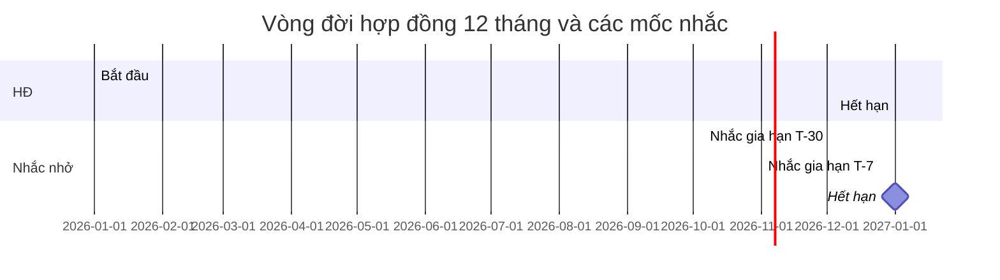

---

### 2.3.5. `billing-service` (Cổng 8005) — Tính tiền *(Core Domain)*

**Đây là service phức tạp nhất và là tải cao nhất** — là ví dụ để chứng minh
"scale được đúng chỗ".

#### a) Công thức tính tiền

```
┌──────────────────────────────────────────────────────────────────────┐
│  HÓA ĐƠN THÁNG = TỔNG_CHI_PHÍ − GIẢM_TRỪ                            │
│                                                                      │
│  TỔNG_CHI_PHÍ =                                                      │
│    (1) TIỀN_PHÒNG                                                   │
│        = monthly_price × (số ngày thuê / số ngày trong tháng)        │
│        [Hỗ trợ thuê ngày / thuê nửa tháng]                            │
│                                                                      │
│    (2) TIỀN_ĐIỆN                                                    │
│        = (chỉ_số_mới − chỉ_số_cũ) × đơn_giá_theo_bậc                 │
│        Bậc thang điện (VND/kWh) — ví dụ:                             │
│          0–50 kWh:  1.800                                            │
│          51–100:   2.500                                             │
│          101–200:  3.100                                             │
│          >200:     3.500                                             │
│        → Áp dụng theo từng bậc (lũy tiến, không phải bậc đơn)        │
│                                                                      │
│    (3) TIỀN_NƯỚC                                                    │
│        = (chỉ_số_mới − chỉ_số_cũ) × đơn_giá_nước                     │
│          (đơn giản hơn điện, ví dụ 15.000đ/m³)                      │
│                                                                      │
│    (4) PHÍ_DỊCH_VỤ                                                  │
│        = internet + vệ sinh + rác + gửi xe + phí tiện ích gắn phòng │
│                                                                      │
│    (5) PHÍ_TRỄ_HẠN (nếu quá hạn thanh toán)                         │
│        = 0.05 × TIỀN_PHÒNG × số ngày trễ (tối đa 30 ngày)           │
│                                                                      │
│  GIẢM_TRỪ =                                                          │
│    + TRỪ_CỌC_TỰ_DỘNG = MIN( deposit_còn_lại, TỔNG_CHI_PHÍ )        │
│    + KHUYẾN_MÃI (coupon)                                             │
│                                                                      │
│  ⚠ R3: deposit_còn_lại = deposit_amount − deposit_deducted            │
│     Tuyệt đối không trừ quá giá trị cọc đã đặt.                     │
└──────────────────────────────────────────────────────────────────────┘
```

#### b) Triển khai công thức bậc thang (bằng code, tránh lỗi làm tròn)

```python
from decimal import Decimal, ROUND_HALF_UP
from dataclasses import dataclass

MONEY = Decimal("1")  # VND là số nguyên, không dùng float!

@dataclass(frozen=True)
class Tier:
    """Một bậc: từ đến bao nhiêu kWh, giá mỗi kWh."""
    up_to_kwh: Decimal        # trần của bậc (Decimal("inf") cho bậc cuối)
    price_per_unit: Decimal

def graduated_charge(usage: Decimal, tiers: list[Tier]) -> Decimal:
    """
    Tính tiền theo biểu giá bậc thang (lũy tiến).
    Ví dụ: dùng 220 kWh, bậc 0-50:1800, 51-100:2500, 101-200:3100, >200:3500
      = 50×1800 + 50×2500 + 100×3100 + 20×3500
      =  90000 + 125000 + 310000 +  70000  = 595.000đ
    """
    if usage < 0:
        raise ValueError("Chỉ số sử dụng không thể âm")

    total = Decimal("0")
    remaining = usage
    for tier in sorted(tiers, key=lambda t: t.up_to_kwh):
        if remaining <= 0:
            break
        # Số lượng rơi vào bậc này
        lower_bound = 0 if tier is sorted(tiers, key=lambda t: t.up_to_kwh)[0] else prev_up_to
        in_tier = min(remaining, tier.up_to_kwh - lower_bound)
        total += in_tier * tier.price_per_unit
        remaining -= in_tier
        prev_up_to = tier.up_to_kwh
    return total.quantize(MONEY, rounding=ROUND_HALF_UP)
```

#### c) Mô hình dữ liệu `db_billing`

```sql
-- Biểu giá (có hiệu lực theo thời gian — versioning, không sửa giá cũ)
CREATE TABLE price_tiers (
    id             UUID PRIMARY KEY DEFAULT gen_random_uuid(),
    property_id    UUID NOT NULL,
    utility_type   VARCHAR(10) NOT NULL CHECK (utility_type IN ('ELECTRIC','WATER')),
    tier_index     SMALLINT NOT NULL,          -- bậc thứ mấy
    up_to_qty      NUMERIC(10,2),              -- NULL = không giới hạn
    unit_price     NUMERIC(12,0) NOT NULL,
    effective_from DATE NOT NULL,
    effective_to   DATE,                       -- NULL = đang hiệu lực
    UNIQUE (property_id, utility_type, tier_index, effective_from)
);

-- Phí dịch vụ cố định hằng tháng
CREATE TABLE service_fees (
    id          UUID PRIMARY KEY DEFAULT gen_random_uuid(),
    property_id UUID NOT NULL,
    code        VARCHAR(30) NOT NULL,          -- INTERNET, CLEANING, TRASH, PARKING
    name        VARCHAR(100) NOT NULL,
    amount      NUMERIC(12,0) NOT NULL,
    is_mandatory BOOLEAN DEFAULT TRUE,
    UNIQUE (property_id, code)
);

-- Chỉ số điện nước (R4: chỉ số phải tăng)
CREATE TABLE meter_readings (
    id           UUID PRIMARY KEY DEFAULT gen_random_uuid(),
    property_id  UUID NOT NULL,
    room_id      UUID NOT NULL,
    utility_type VARCHAR(10) NOT NULL,
    period       DATE NOT NULL,                -- kỳ dạng YYYY-MM-01
    reading_value NUMERIC(12,2) NOT NULL,
    previous_value NUMERIC(12,2),
    -- COALESCE: kỳ đầu tiên previous_value IS NULL. Nếu để trừ thuần thì
    -- consumption = NULL, vi phạm NOT NULL và cả lô chỉ số tháng đầu bị
    -- từ chối. Với COALESCE → kỳ đầu cho consumption = 0.
    consumption   NUMERIC(12,2) GENERATED ALWAYS AS
                  (reading_value - COALESCE(previous_value, reading_value))
                  STORED,
    read_by      UUID NOT NULL,
    read_at      TIMESTAMPTZ DEFAULT now(),
    -- Idempotency: cùng 1 phòng + cùng 1 kỳ chỉ nhập 1 lần
    UNIQUE (room_id, utility_type, period),
    CONSTRAINT chk_reading CHECK (reading_value >= 0)
);

-- Hóa đơn
CREATE TABLE invoices (
    id            UUID PRIMARY KEY DEFAULT gen_random_uuid(),
    invoice_no    VARCHAR(30) UNIQUE NOT NULL,  -- HD-202610-0001
    property_id   UUID NOT NULL,
    contract_id   UUID NOT NULL,                -- KHÔNG có FK (database-per-service)
    room_id       UUID NOT NULL,
    period        DATE NOT NULL,
    rent_amount       NUMERIC(12,0) DEFAULT 0,
    electric_amount   NUMERIC(12,0) DEFAULT 0,
    water_amount      NUMERIC(12,0) DEFAULT 0,
    service_amount    NUMERIC(12,0) DEFAULT 0,
    late_fee_amount   NUMERIC(12,0) DEFAULT 0,
    discount_amount   NUMERIC(12,0) DEFAULT 0,
    deposit_deducted  NUMERIC(12,0) DEFAULT 0,
    total_amount      NUMERIC(12,0) NOT NULL,
    paid_amount       NUMERIC(12,0) DEFAULT 0,
    status        VARCHAR(20) NOT NULL DEFAULT 'PENDING'
                  CHECK (status IN ('DRAFT','PENDING','PAID','OVERDUE','CANCELLED')),
    due_date      DATE NOT NULL,
    paid_at       TIMESTAMPTZ,
    created_at    TIMESTAMPTZ DEFAULT now(),
    UNIQUE (contract_id, period)   -- mỗi hợp đồng 1 hóa đơn/kỳ
);

CREATE TABLE invoice_details (   -- bảng chi tiết, giúp in hóa đơn
    id          UUID PRIMARY KEY DEFAULT gen_random_uuid(),
    invoice_id  UUID NOT NULL REFERENCES invoices(id) ON DELETE CASCADE,
    item_type   VARCHAR(30) NOT NULL,   -- RENT / ELECTRIC / WATER / SERVICE / LATE_FEE
    description VARCHAR(255) NOT NULL,
    quantity    NUMERIC(12,2),
    unit_price  NUMERIC(12,0),
    amount      NUMERIC(12,0) NOT NULL
);

CREATE TABLE payments (          -- thanh toán (R8: hóa đơn PAID không sửa được)
    id          UUID PRIMARY KEY DEFAULT gen_random_uuid(),
    invoice_id  UUID NOT NULL,
    amount      NUMERIC(12,0) NOT NULL,
    method      VARCHAR(20) NOT NULL CHECK (method IN
                  ('CASH','BANK_TRANSFER','MOMO','VNPAY','CARD')),
    reference   VARCHAR(100),
    received_by UUID NOT NULL,
    received_at TIMESTAMPTZ DEFAULT now()
);
```

> **Không có FOREIGN KEY** giữa `db_billing` và `db_contract`. Đó là hệ quả trực tiếp
> của mẫu *Database-per-Service*: mỗi service tự chịu trách nhiệm tính toàn vẹn dữ liệu
> của mình, tính nhất quán xuyên service được đảm bảo bằng **Saga** (mục 2.5) chứ
> không bằng ràng buộc toàn vẹn.

#### d) Tính tiền 1 hợp đồng

```python
async def generate_invoice(contract_snapshot: ContractSnapshot, period: date) -> Invoice:
    """Tính & tạo hóa đơn cho 1 hợp đồng trong kỳ `period` (ngày 1 của tháng)."""

    # (1) TIỀN PHÒNG — tính theo số ngày thực tế (hỗ trợ dọn phòng giữa tháng)
    billable_days = _billable_days(contract.start_date, contract.end_date, period)
    days_in_month = _days_in_month(period)
    rent = _round(contract.monthly_price * Decimal(billable_days) / Decimal(days_in_month))

    # (2)(3) ĐIỆN NƯỚC — lấy chỉ số của kỳ này và kỳ trước
    elec = await _charge_utility(contract.room_id, "ELECTRIC", period, electric_tiers)
    water = await _charge_utility(contract.room_id, "WATER", period, water_tiers)

    # (4) PHÍ DỊCH VỤ + tiện ích gắn phòng (tránh gọi room-service đồng bộ → dùng bản sao cached)
    services = _sum_mandatory_fees(property_id) + _sum_room_amenity_fees(room_id)

    # (5) PHÍ TRỄ HẠN — nếu thanh toán trễ so với hạn cũ
    late_fee = _calc_late_fee(contract, period)

    subtotal = rent + elec + water + services + late_fee

    # (6) TRỪ CỌC (R3) — KHÔNG được âm
    remaining_deposit = contract.deposit_amount - contract.deposit_deducted
    deposit_used = min(remaining_deposit, subtotal)     # ← min() bảo đảm R3
    if deposit_used < 0:
        deposit_used = Decimal("0")

    total = subtotal - deposit_used
    if total < 0:      # cọc dư → chuyển sang kỳ sau
        total = Decimal("0")

    invoice = Invoice(
        invoice_no=await _next_invoice_no(property_id, period),
        contract_id=contract.id, room_id=contract.room_id, period=period,
        rent_amount=rent, electric_amount=elec, water_amount=water,
        service_amount=services, late_fee_amount=late_fee,
        deposit_deducted=deposit_used, total_amount=total,
        status="PENDING", due_date=period + relativedelta(months=1, days=3),
    )
    return await repo.create_with_details(invoice, details=[
        _detail("RENT",     f"Tiền phòng {billable_days}/{days_in_month} ngày", rent),
        _detail("ELECTRIC", f"Điện {usage} kWh", elec),
        _detail("WATER",    f"Nước {usage} m³", water),
        *_service_details(services),
        *([_detail("LATE_FEE", "Phí trễ hạn", late_fee)] if late_fee else []),
        *([_detail("DEPOSIT", "Trừ tiền cọc", -deposit_used)] if deposit_used else []),
    ])
```

#### e) Xử lý tải cao điểm cuối tháng

Cuối tháng có thể **200 hóa đơn được yêu cầu cùng lúc**. Ba kỹ thuật giảm tải:

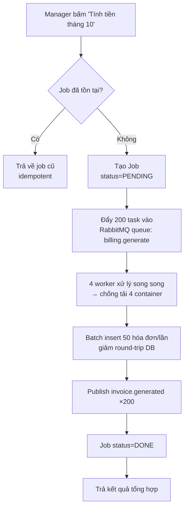

1. **Idempotency**: `UNIQUE (contract_id, period)` — bấm nút 2 lần không sinh trùng hóa đơn.
2. **Hàng đợi + worker song song**: scale `billing` container không cần sửa code.
3. **Batch insert**: giảm ~200 round-trip xuống còn ~4.
4. **Giảm tiền trong hàng đợi** (idempotency key theo event) — tránh xử lý trùng khi RabbitMQ redeliver.

---

### 2.3.6. `notification-service` (Cổng 8006) — Thông báo

**Trách nhiệm:** Gửi email/SMS/Zalo, chạy job nhắc nhở theo lịch.

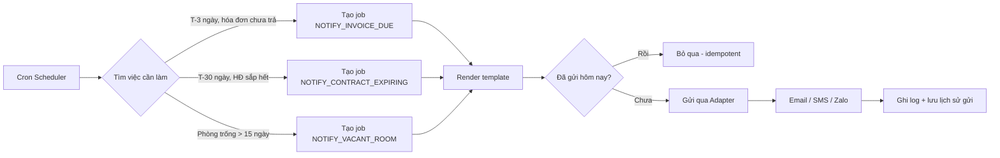

**Chiến lược Adapter Pattern** — cho phép đổi nhà cung cấp không sửa code:

```python
class NotificationChannel(Protocol):
    async def send(self, recipient: str, template: str, ctx: dict) -> MessageResult: ...

class EmailChannel:      # SMTP / SES
class SmsChannel:        # Twilio / FPT SMS / Zalo
class ZaloChannel:       # Zalo OA API
class InAppChannel:      # lưu vào db_notify, hiện trong web

# Chọn channel theo cấu hình — thêm channel mới = thêm 1 class, không sửa service
CHANNELS: dict[str, NotificationChannel] = {
    "EMAIL": EmailChannel(), "SMS": SmsChannel(),
    "ZALO": ZaloChannel(), "IN_APP": InAppChannel(),
}
```

**Mô hình dữ liệu `db_notify` (chỉ giữ template + lịch sử gửi, KHÔNG giữ nội dung nghiệp vụ):**

```sql
CREATE TABLE templates (
    code       VARCHAR(50) PRIMARY KEY,   -- INVOICE_ISSUED, CONTRACT_EXPIRING
    channel    VARCHAR(10) NOT NULL,
    subject    VARCHAR(255),
    body       TEXT NOT NULL,             -- Jinja2 template
    is_active  BOOLEAN DEFAULT TRUE
);

CREATE TABLE notifications (
    id          UUID PRIMARY KEY DEFAULT gen_random_uuid(),
    tenant_id   UUID NOT NULL,
    channel     VARCHAR(10) NOT NULL,
    template_code VARCHAR(50) NOT NULL,
    recipient   VARCHAR(150) NOT NULL,
    subject     VARCHAR(255),
    body        TEXT,
    status      VARCHAR(15) NOT NULL DEFAULT 'QUEUED'
                CHECK (status IN ('QUEUED','SENT','DELIVERED','FAILED','READ')),
    attempts    SMALLINT DEFAULT 0,
    error       TEXT,
    sent_at     TIMESTAMPTZ,
    -- Idempotency: cùng template + tenant + kỳ chỉ gửi 1 lần
    dedupe_key  VARCHAR(255) UNIQUE,
    created_at  TIMESTAMPTZ DEFAULT now()
);
```

---

### 2.3.7. `maintenance-service` (Cổng 8007) — Sự cố & bảo trì

```sql
CREATE TABLE incidents (
    id           UUID PRIMARY KEY DEFAULT gen_random_uuid(),
    ticket_no    VARCHAR(20) UNIQUE NOT NULL,   -- SC-0001
    property_id  UUID NOT NULL,
    room_id      UUID NOT NULL,
    reported_by  UUID NOT NULL,                 -- người thuê báo
    category     VARCHAR(30) NOT NULL,          -- PLUMBING/ELECTRIC/APPLIANCE/OTHER
    priority     VARCHAR(10) NOT NULL DEFAULT 'NORMAL'
                 CHECK (priority IN ('LOW','NORMAL','HIGH','URGENT')),
    title        VARCHAR(200) NOT NULL,
    description  TEXT,
    photos       TEXT[],                        -- MinIO keys
    status       VARCHAR(20) NOT NULL DEFAULT 'OPEN'
                 CHECK (status IN ('OPEN','ASSIGNED','IN_PROGRESS','RESOLVED','CLOSED','CANCELLED')),
    assigned_to  UUID,
    assigned_at  TIMESTAMPTZ,
    resolved_at  TIMESTAMPTZ,
    resolution   TEXT,
    cost         NUMERIC(12,0) DEFAULT 0,      -- chi phí sửa
    rating       SMALLINT CHECK (rating BETWEEN 1 AND 5),
    created_at   TIMESTAMPTZ DEFAULT now()
);

CREATE TABLE maintenance_schedules (          -- bảo trì định kỳ
    id            UUID PRIMARY KEY DEFAULT gen_random_uuid(),
    property_id   UUID NOT NULL,
    scope         VARCHAR(20) NOT NULL,        -- BUILDING / ROOM / EQUIPMENT
    target_id     UUID,
    title         VARCHAR(200) NOT NULL,
    task_template JSONB NOT NULL,              -- danh sách việc cần làm
    frequency     VARCHAR(20) NOT NULL,        -- MONTHLY/QUARTERLY/SEASONAL
    next_due_date DATE NOT NULL,
    last_done_at  TIMESTAMPTZ,
    is_active     BOOLEAN DEFAULT TRUE
);
```

**Mẫu Saga "Báo hư nghiêm trọng → Phòng tạm ngừng khai thác"** (xem mục 2.5):

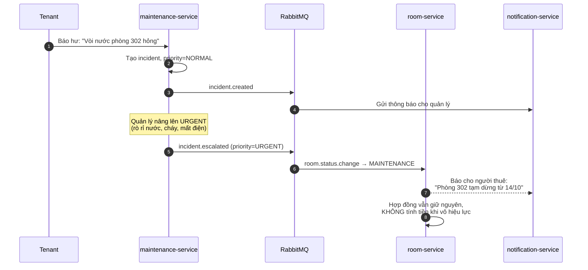

---

### 2.3.8. `report-service` (Cổng 8008) — Báo cáo & phân tích *(CQRS Read Model)*

**Trách nhiệm:** Tổng hợp dữ liệu từ nhiều service, dựng dashboard.

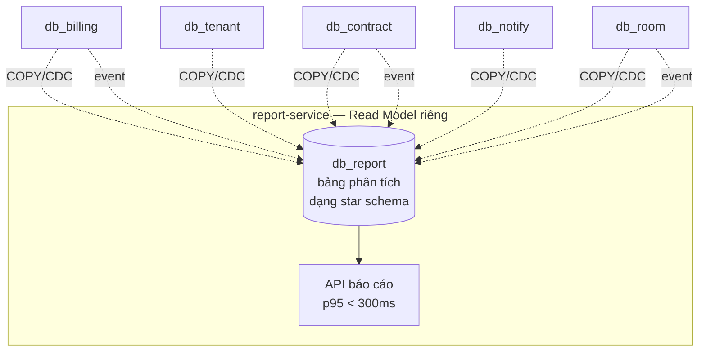

> **Vì sao không query thẳng vào `db_billing`?**
> 1. Báo cáo cần **dữ liệu của cả 5 nguồn** → join xuyên database là phá vỡ ranh giới service
>    và sẽ chậm dần khi số bảng tăng.
> 2. Báo cáo là **đọc nhiều, ghi ít** → tách riêng để **scale độc lập**, không ảnh hưởng
>    `billing-service` lúc đang cao điểm cuối tháng.
> 3. Đây chính là mẫu **CQRS**: mô hình ghi (write) tối ưu cho cập nhật; mô hình đọc
>    (read) tối ưu cho truy vấn phân tích.

**Các báo cáo cung cấp:**

| Báo cáo | Nội dung | Nguồn dữ liệu |
|---|---|---|
| Doanh thu theo tháng | Tổng, theo cơ sở, tăng trưởng % | `db_billing` + `db_report` |
| Tỷ lệ lấp đầy | Phòng trống / tổng phòng theo ngày | `db_room` |
| Tỷ lệ thu hồi tiền | % hóa đơn trả đúng hạn | `db_billing` |
| Phân tích khách | Người thuê ở lâu bao lâu, churn | `db_contract` |
| Phân tích sự cố | Top loại sự cố, MTTR, tỷ lệ lặp lại | `db_maintenance` |
| Công nợ | Ai còn nợ, bao lâu | `db_billing` |
| Ước tính lợi nhuận | Doanh thu − chi phí vận hành | `db_billing` + `db_maintenance` |

---

## 2.4. Bản đồ giao tiếp giữa các service

### 2.4.1. Sơ đồ tổng thể

```mermaid
graph TB
    CLI[Client Web] --> GW[nginx / API Gateway]

    GW --> AU[auth<br/>:8001]
    GW --> RM[room<br/>:8002]
    GW --> TN[tenant<br/>:8003]
    GW --> CT[contract<br/>:8004]
    GW --> BL[billing<br/>:8005]
    GW --> NT[notification<br/>:8006]
    GW --> MT[maintenance<br/>:8007]
    GW --> RP[report<br/>:8008]

    %% ---- Giao tiếp ĐỒNG BỘ (REST, cần kết quả ngay) ----
    CT -->|GET /rooms/{id}<br/>kiểm tra phòng có trống| RM
    CT -->|GET /tenants/{id}| TN
    BL -->|GET /contracts/{id}| CT
    BL -->|GET /rooms/{id}/amenities| RM
    BL -->|GET /tenants/{id}| TN
    RP -->|GET /rooms/stats| RM
    RP -->|GET /contracts/summary| CT
    MT -->|GET /rooms/{id}| RM

    %% ---- Giao tiếp BẤT ĐỒNG BỘ (RabbitMQ) ----
    CT -.->|contract.activated<br/>contract.expiring| NT
    CT -.->|contract.activated<br/>→ đổi trạng thái phòng| RM
    BL -.->|invoice.issued<br/>payment.received| NT
    BL -.->|invoice.issued<br/>payment.received| RP
    RM -.->|room.status_changed| NT
    RM -.->|room.created / updated| RP
    MT -.->|incident.created<br/>incident.urgent| NT
    MT -.->|incident.urgent<br/>→ tạm ngừng phòng| RM
    AU -.->|user.registered| NT
```

### 2.4.2. Danh mục event (Event Catalog)

| Tên event | Producer | Consumer | Payload chính |
|---|---|---|---|
| `user.registered` | auth | notification | user_id, email, full_name, role |
| `room.created` | room | report | room_id, property_id, base_price, status |
| `room.status_changed` | room | notification, report | room_id, from, to, reason |
| `contract.activated` | contract | room, notification | contract_id, room_id, tenant_id, end_date |
| `contract.expiring` | contract | notification | contract_id, room_id, tenant_id, days_left |
| `contract.terminated` | contract | room, billing, report | contract_id, room_id, reason |
| `invoice.issued` | billing | notification, report | invoice_id, invoice_no, room_id, total, due_date |
| `payment.received` | billing | notification, report | payment_id, invoice_id, amount, method |
| `invoice.overdue` | billing (cron) | notification | invoice_id, days_overdue |
| `incident.created` | maintenance | notification | incident_id, room_id, title, priority |
| `incident.urgent` | maintenance | room, notification | incident_id, room_id |

**Quy ước bắt buộc cho event:**

1. **Bất biến (immutable)** — sau khi phát, không sửa. Sai thì phát event mới.
2. **Có `event_id` UUID** — để consumer khử trùng lặp.
3. **Có `occurred_at`** và `schema_version` — để tương thích ngược.
4. **Chứa dữ liệu tối thiểu cần thiết** — không gửi cả entity.
5. **Không chứa dữ liệu bí mật** — không gửi mật khẩu, CCCD đầy đủ.

```json
{
  "event_id": "9a1c4e77-...",
  "event_type": "invoice.issued",
  "schema_version": 1,
  "occurred_at": "2026-10-01T02:00:00+07:00",
  "producer": "billing-service",
  "correlation_id": "c4f8-...",           // xuyên suốt 1 luồng nghiệp vụ
  "causation_id": "job-2026-10-01-001",  // event cha sinh ra event này
  "data": {
    "invoice_id": "b30d...",
    "invoice_no": "HD-202610-0042",
    "room_id": "f21a...",
    "contract_id": "c7e9...",
    "total_amount": 2350000,
    "due_date": "2026-11-04"
  }
}
```

### 2.4.3. Xử lý lỗi và độ bền (Reliability Patterns)

```mermaid
graph TB
    A[Service publish event] --> B[transaction: INSERT vào<br/>bảng outbox]
    B --> C[COMMIT]
    C --> D[Outbox Publisher<br/>(cron mỗi 5s)]
    D --> E{RabbitMQ<br/>nhận OK?}
    E -->|OK| F[UPDATE outbox<br/>status=SENT]
    E -->|Lỗi mạng| G[Để nguyên<br/>status=NEW]
    G --> D
    G --> H[Retry với<br/>exponential backoff]

    I[Consumer nhận event] --> J{Đã xử lý<br/>event_id này chưa?}
    J -->|Rồi| K[ACK - bỏ qua<br/>tránh trùng]
    J -->|Chưa| L[Xử lý trong<br/>1 transaction]
    L --> M{Ghi processed_event<br/>+ cập nhật nghiệp vụ<br/>cùng lúc}
    M --> N[ACK]
    L -->|Lỗi| O[NACK + requeue<br/>hoặc DLQ nếu quá 3 lần]
```

Ba mẫu then chốt (giải quyết đúng 2 vấn đề lớn nhất của Microservice):

| Vấn đề | Mẫu giải pháp | Cách hoạt động |
|---|---|---|
| **Dual-write problem** — ghi DB xong thì chết, event chưa phát | **Outbox Pattern** | Ghi event vào cùng transaction với dữ liệu; publisher đọc bảng `outbox` và gửi đi. Hoặc gửi mất event, hoặc gửi trùng — **không bao giờ mất**. |
| **Consumer nhận trùng event** (at-least-once) | **Idempotent Consumer** | Bảng `processed_events(event_id UNIQUE)`, insert trong cùng transaction xử lý → insert trùng = bỏ qua. |
| **Lỗi chuỗi làm hỏng cả luồng** | **Dead Letter Queue** | Thử 3 lần rồi đẩy vào `dlq`, cảnh báo admin. Không chặn cả hệ thống. |

### 2.4.4. Chiến lược timeout & circuit breaker

Không có "timeout mặc định" — phải đặt rõ từng cấp:

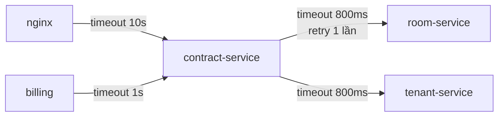

| Lớp | Connect timeout | Read timeout | Số lần retry | Backoff |
|---|---|---|---|---|
| nginx → service | 5s | 10s | 0 | — |
| service → service | 1s | **800 ms** (p95 = 300ms) | 1 | 100ms → 400ms |
| service → RabbitMQ | 1s | 5s | 3 | 1s → 2s → 4s |
| service → PostgreSQL | 2s | 10s | 1 | 200ms |

**Circuit Breaker** — khi `room-service` lỗi liên tiếp, ngắt luôn để không làm cạn connection pool:

```yaml
# Trong cấu hình service
resilience4j:
  circuitbreaker:
    instances:
      room-service:
        slidingWindowSize: 20          # xét 20 request gần nhất
        failureRateThreshold: 50       # quá 50% lỗi thì mở circuit
        waitDurationInOpenState: 30000 # mở 30s rồi thử lại nửa mở
        permittedNumberOfCallsInHalfOpenState: 5
        fallback: return_cached_availability   # fallback dùng cache Redis
```

**Quan trọng:** Retry chỉ dùng cho **idempotent GET**. Retry POST "tạo hợp đồng" sẽ tạo
trùng nếu request thực ra đã thành công nhưng response bị mất. Thay vào đó dùng
**Idempotency-Key** header.

## 2.5. Saga — Xử lý giao dịch phân tán

Không dùng 2PC (two-phase commit) vì: giảm tính sẵn sàng, nghẽn cổ chai, và nhiều DB
hiện đại (DynamoDB, MongoDB, Kafka) không hỗ trợ. Thay vào đó dùng **Saga Pattern**.

Hệ thống có 2 loại Saga:

### 2.5.1. Saga đồng bộ (Orchestration) — luồng "Nhận phòng mới"

Đây là Saga chính, điều phối bởi `contract-service`:

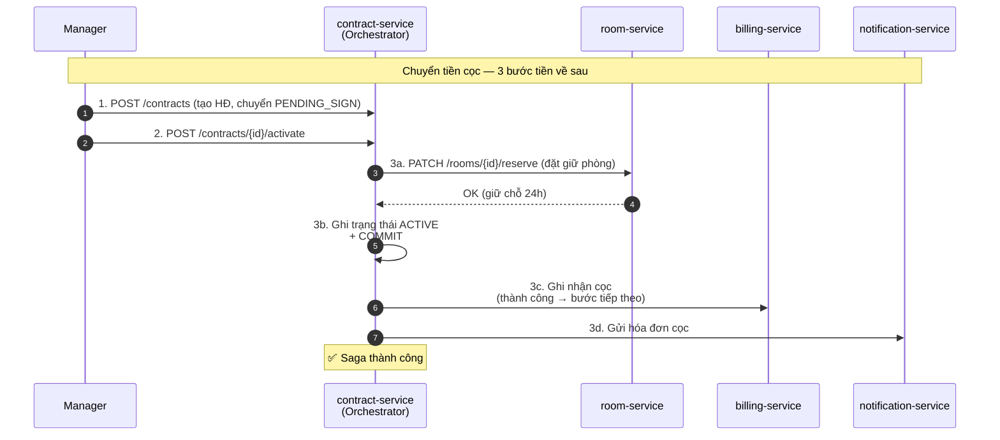

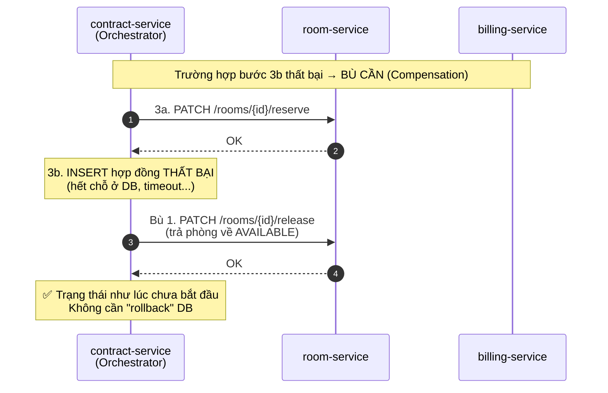

> **Điểm mấu chốt:** Saga **không rollback dữ liệu** mà **bù đắp tác dụng**
> (forward recovery). Bản ghi hợp đồng thất bại được đánh dấu `CANCELLED` (giữ lại để
> truy vết) chứ không bị `DELETE`.

### 2.5.2. Saga bất đồng bộ (Choreography) — luồng "Gửi hóa đơn"

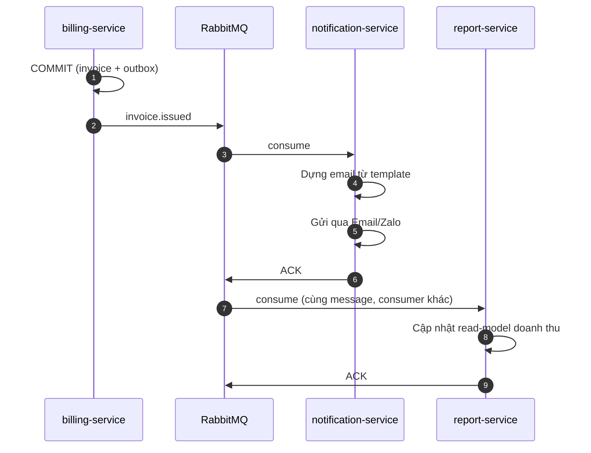

| | Choreography (không điều phối) | Orchestration (có điều phối) |
|---|---|---|
| Ràng buộc giữa service | **Yếu** — không biết ai làm gì | Mạnh |
| Thêm service mới | Dễ, chỉ cần subscribe | Phải sửa orchestrator |
| Hiểu luồng nghiệp vụ | **Khó** — rải rác ở nhiều chỗ | Dễ — nhìn 1 orchestrator |
| Debug khi lỗi | Khó | Dễ |
| Dùng khi | Luồng đơn giản, ≤3 bước, phát tán | Luồng phức tạp, nhiều bước, cần bù đắp |

Hệ thống này dùng **cả hai**: `contract.activated` (luồng 4 bước) dùng Orchestration;
`invoice.issued` (luồng 2 bước) dùng Choreography.

## 2.6. CQRS — Tách mô hình ghi và mô hình đọc

Áp dụng cho `billing-service` và `report-service`:

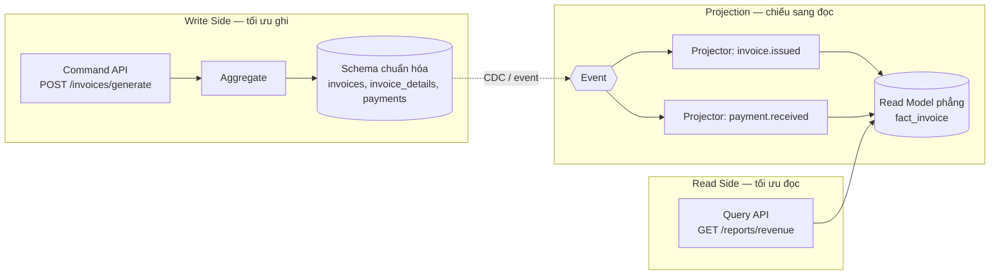

| | Write Model | Read Model |
|---|---|---|
| Mục tiêu | Tính nhất quán, xử lý nghiệp vụ | Truy vấn nhanh, tổng hợp |
| Schema | Chuẩn hóa 3NF, có ràng buộc FK | Phẳng, phi chuẩn hóa, pre-aggregated |
| Ghi | Nhiều, phức tạp | Không được ghi trực tiếp |
| Đọc | Ít, đơn giản | Nhiều, phức tạp, nhiều chiều |
| Độ trễ | — | Vài giây (eventual consistency) |
| Ví dụ | `invoices` + `invoice_details` | `fact_invoice_daily` |

> **Đánh đổi:** Hệ thống chuyển từ **strong consistency** sang **eventual consistency**.
> Người dùng có thể thấy "hóa đơn chưa hiện" trong 1–2 giây. Đây là đánh đổi
> **bắt buộc** khi đi đa service, và cần nói rõ với người dùng.

## 2.7. Lựa chọn công nghệ và lý do

### 2.7.1. Ngôn ngữ & framework

| Công nghệ | Vai trò | Lý do chọn |
|---|---|---|
| **Python 3.12** | Ngôn ngữ chính | Cú pháp gọn, hệ sinh thái data/ML phong phú, tuyển dụng dễ, chạy nhẹ trên VPS giá rẻ |
| **FastAPI** | Web framework | Bất đồng bộ native, **tự sinh tài liệu OpenAPI/Swagger** (có sẵn cho đồ án), validate bằng Pydantic, hỗ trợ WebSocket |
| **SQLAlchemy 2.0** | ORM | Type-safe, hỗ trợ async, migration bằng Alembic |
| **Pydantic v2** | Validation | Đảm bảo dữ liệu đúng schema trước khi vào DB — hỗ trợ R1–R8 |
| **RabbitMQ** | Message broker | Quản lý routing key, DLQ, ack từng message. Nhẹ hơn Kafka, đủ cho tải này |
| **Redis 7** | Cache + hỗ trợ | Cache phòng trống, denylist token, khóa idempotency, rate limit |
| **MinIO** | Object storage | API **tương thích S3** → có thể chuyển sang AWS S3/Azure Blob chỉ bằng đổi endpoint |
| **Nginx** | Reverse proxy + Gateway | Làm TLS, rate limit, static, cache, điều hướng `/api/v1/...` |
| **Prometheus + Grafana** | Monitoring | Chuẩn de-facto, mô hình pull đơn giản |
| **Loki + Promtail** | Logging | Nhẹ hơn ELK, kết hợp tốt với Grafana |

> **Ghi chú học thuật:** Nếu giảng viên yêu cầu stack khác, kiến trúc trong chương này
> **không phụ thuộc ngôn ngữ**. Ánh xạ tương đương:
> FastAPI → Spring Boot / ASP.NET Core / NestJS; RabbitMQ → Kafka / NATS;
> Redis → Memcached; MinIO → S3/Azure Blob; Docker Compose → Kubernetes.

### 2.7.2. Cơ sở dữ liệu

| DB | Vì sao chọn | Dùng ở đâu |
|---|---|---|
| **PostgreSQL 16** | Mạnh về dữ liệu quan hệ, chỉ số, JSONB, partial index, `INSERT ... ON CONFLICT`; mã nguồn mở; miễn phí | 6 database của 6 service có dữ liệu quan hệ |
| **Redis 7** | In-memory, độ trễ < 1ms, hỗ trợ cấu trúc phức tạp | Cache, session, rate limit, idempotency |
| **MinIO** | Lưu file nhị phân (ảnh CCCD, ảnh sự cố) | `maintenance`, `tenant` |

**Vì sao KHÔNG dùng MongoDB?** Dữ liệu hợp đồng, hóa đơn, chỉ số có **quan hệ rõ ràng**
và **ràng buộc toàn vẹn quan trọng** (1 hóa đơn/kỳ/hợp đồng, cọc không âm, chỉ số không giảm).
PostgreSQL thể hiện tốt hơn. MongoDB chỉ hữu ích nếu dữ liệu schema-free — không đúng ở đây.

**Cấu hình PostgreSQL cho 1 VPS dùng chung 6 DB:**

```ini
# postgresql.conf
shared_buffers = 2GB              # ~25% RAM
effective_cache_size = 4GB        # ~50% RAM
work_mem = 8MB                    # tránh cấp phát đột ngột
maintenance_work_mem = 512MB
max_connections = 200             # quan trọng: 8 service × 20 pool + admin

# Tối ưu cho SSD NVMe
random_page_cost = 1.1            # mặc định 4.0 — SSD rẻ hơn nhiều so với HDD
effective_io_concurrency = 200

# WAL & sao lưu
wal_level = replica
max_wal_size = 2GB
checkpoint_timeout = 15min
log_min_duration_statement = 500  # log truy vấn chậm hơn 500ms
```

## 2.8. Tổng hợp: ma trận service × trách nhiệm

| | Auth | Room | Tenant | Contract | Billing | Notify | Maint. | Report |
|---|:---:|:---:|:---:|:---:|:---:|:---:|:---:|:---:|
| **Database** | db_auth | db_room | db_tenant | db_contract | db_billing | db_notify | db_maint | db_report |
| **Cổng** | 8001 | 8002 | 8003 | 8004 | 8005 | 8006 | 8007 | 8008 |
| **Số endpoint** | 8 | 14 | 11 | 12 | 18 | 6 | 12 | 9 |
| **Có sở hữu nghiệp vụ** | User | Phòng, Tòa nhà | Người thuê | HĐ, Cọc | HĐĐN, Cọc | Template | Sự cố | Metric |
| **Phát event** | 1 | 3 | 1 | 3 | 4 | 2 | 2 | 0 |
| **Tiêu thụ event** | 0 | 3 | 0 | 2 | 2 | 8 | 1 | 6 |
| **Ghi DB nhiều nhất** | Thấp | TB | Thấp | TB | **Rất cao** | TB | Thấp | Rất cao |
| **Cần scale** | Thấp | TB | Thấp | TB | **Cao** | Trung bình | Thấp | Trung bình |
| **SLA p95** | 200ms | 200ms | 250ms | 400ms | 500ms | 1s (bất đồng bộ) | 400ms | 800ms |
| **Độ sẵn sàng cần** | 99.9% | 99.9% | 99.5% | 99.9% | 99.9% | 99.0% | 99.0% | 99.0% |

> **Quan sát thiết kế:** `billing-service` là nút thắt duy nhất cần **scale mạnh**
> (tải bùng đột 1 ngày/tháng), trong khi `notification-service` chỉ chạy nền
> và `report-service` chịu được độ trễ vài giây. Nhờ đó tài nguyên được phân bổ đúng
> chỗ thay vì nâng cả hệ thống — đây là lợi ích cốt lõi của Microservice.

## 2.9. Tổng kết chương

Chương 2 đã trả lời:
1. **Vì sao chọn Microservice** — 6 nhóm nghiệp vụ tách biệt, tải rất khác nhau.
2. **Cách phân rã** theo DDD: Subdomain → Bounded Context → Service → Database.
3. **Thiết kế chi tiết 8 service**: chức năng, endpoint, schema DB, state machine, luật nghiệp vụ.
4. **Bản đồ giao tiếp**: 11 event, mẫu Outbox / Idempotent Consumer / DLQ.
5. **Saga** (cả Orchestration lẫn Choreography) để thay thế distributed transaction.
6. **CQRS** cho phần báo cáo.
7. **Lý do chọn công nghệ** — và cách thay thế nếu giảng viên yêu cầu stack khác.

→ Chương 3 chuyển từ *thiết kế logic* sang **mô hình triển khai trên nền tảng đám mây**
với Docker và Ubuntu Server.
