# CHƯƠNG 3 — MÔ HÌNH TRIỂN KHAI TRÊN NỀN TẢNG ĐIỆN TOÁN ĐÁM MÂY

> **Chương trọng tâm của đề tài.** Chương 2 trả lời "hệ thống gồm những gì",
> chương 3 trả lời "**đặt những thứ đó lên đám mây như thế nào**".

---

## 3.1. Nền tảng đám mây là gì? (Cơ sở lý thuyết)

### 3.1.1. Định nghĩa

Theo **NIST SP 800-145 (2011)**, Điện toán đám mây (Cloud Computing) là mô hình phục vụ
cho phép truy cập **qua mạng** vào **nhóm tài nguyên dùng chung** (pooled resources)
**có thể cấp phát và giải phóng nhanh chóng**, với **chi phí và mức sử dụng
được đo lường**.

Năm đặc trưng bắt buộc (Essential Characteristics):

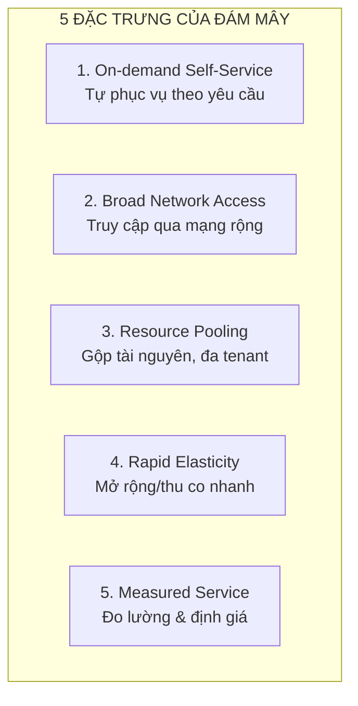

Ba mô hình dịch vụ (Service Models):

| Mô hình | Ai quản lý gì | Ai chịu trách nhiệm khi hỏng |
|---|---|---|
| **IaaS** — Infrastructure as a Service | Cơ sở hạ tầng (máy chủ, ổ đĩa, mạng) | **Khách hàng** |
| **PaaS** — Platform as a Service | Nền tảng chạy ứng dụng (runtime, DB) | **Nhà cung cấp** |
| **SaaS** — Software as a Service | Cả phần mềm | **Nhà cung cấp** |

Hệ thống này nằm ở **giữa IaaS và PaaS** — một mô hình lai gọi là **Container-as-a-Service (CaaS)**:

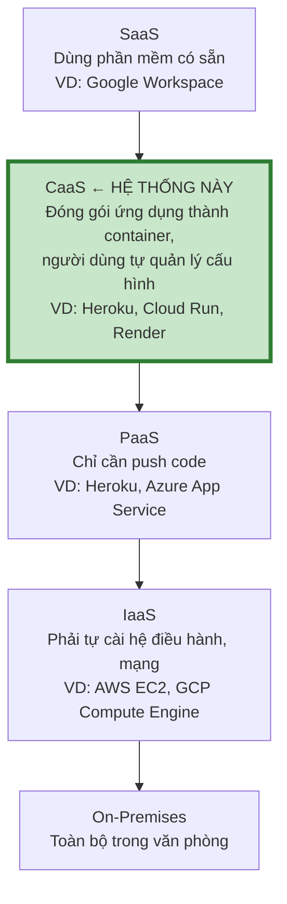

> **Lập luận quan trọng khi trình bày:** Container đặt hệ thống ở đúng giữa IaaS và PaaS.
> Giống IaaS, người dùng **toàn quyền** trên hệ điều hành và mạng (nên linh hoạt, có thể
> tự sửa mọi thứ). Giống PaaS, việc **đóng gói và triển khai được chuẩn hóa** nhờ
> Dockerfile + Compose (nên không cần học cách cài từng thành phần thủ công).
> Đây là lý do container được xem là "chất keo" kết nối on-premises với đám mây.

### 3.1.2. Ba mô hình triển khai đám mây

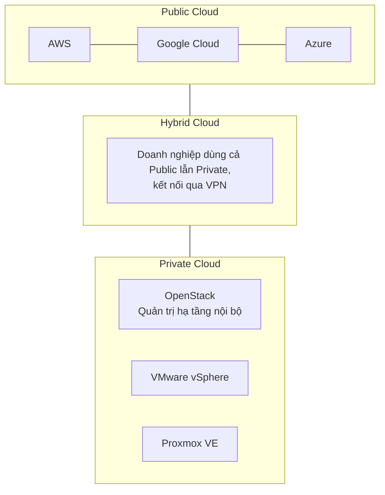

**Dự án này chọn mô hình nào?**

| Mô hình | Đánh giá |
|---|---|
| Public Cloud (AWS/GCP/Azure) | Hiện thực nhất, nhưng **mất tiền**, sinh viên khó tiếp cận, khó chứng minh khi offline |
| Private Cloud (OpenStack/vSphere/Proxmox) | Đúng chuẩn "đám mây", nhưng **cần 2–3 máy vật lý** để ảo hóa, nặng cho đồ án |
| **Self-hosted Cloud trên Ubuntu Server** ✅ | 1 máy, **mô phỏng đầy đủ** đặc trưng đám mây, **chi phí 0**, tái lập được, dễ demo trước giảng viên |

**Đây là lựa chọn có chủ đích:** mục tiêu của đồ án là **nghiên cứu mô hình triển khai**,
không phải chứng minh khả năng chi trả hàng triệu đồng/tháng cho hạ tầng. Hệ thống được
thiết kế để **chuyển đổi sang AWS/GCP chỉ bằng cách thay file cấu hình** — chứng minh
"đám mây là mô hình triển khai, không phải hãng sản phẩm cụ thể" (mục 3.9).

### 3.1.3. Nguyên lý cơ bản của mô hình triển khai

| Nguyên lý | Ý nghĩa | Áp dụng trong dự án |
|---|---|---|
| **Ảo hóa (Virtualization)** | Tách tài nguyên vật lý thành đơn vị logic độc lập | Container là ảo hóa ở tầng OS (không cần hypervisor) |
| **Đóng gói (Packaging)** | Mọi thứ kèm dependency vào 1 đơn vị di động | Docker Image chứa app + runtime + lib |
| **Đồng nhất (Standardization)** | Mọi ứng dụng triển khai giống nhau | Cùng 1 Dockerfile cho cả 8 service |
| **Tách biệt (Isolation)** | Một thành phần hỏng không ảnh hưởng thành phần khác | Container riêng + network riêng + rate limit |
| **Không trạng thái (Stateless)** | Ứng dụng không giữ dữ liệu trong bộ nhớ | Token lưu DB, file lưu MinIO, cache lưu Redis |
| **Tự phục vụ (Self-service)** | Người dùng tự triển khai, không cần admin | `make up` là toàn bộ quy trình |
| **Đo lường (Metering)** | Ghi nhận mức sử dụng để tính phí | Prometheus + billing-theo-request giả lập |
| **Mở rộng (Scalability)** | Tăng tài nguyên khi tải tăng | `--scale`, `deploy.replicas` |

## 3.2. Kiến trúc triển khai tổng thể

### 3.2.1. Sơ đồ 4 tầng

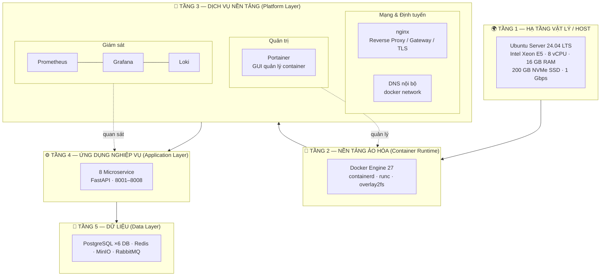

### 3.2.2. Sơ đồ chi tiết đầy đủ (C4 Level 2)

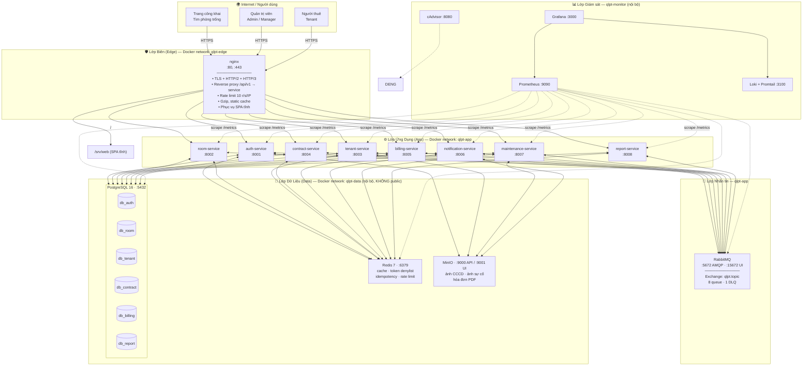

### 3.2.3. Phân vùng mạng (Network Segmentation)

Mạng **không phải mạng phẳng**. Tách 3 vùng theo nguyên tắc *zero trust* — mỗi vùng chỉ
nhìn thấy vùng cần thiết:

| Vùng | Mạng Docker | Nội bộ | Được public | Được vào từ | Quy tắc |
|---|---|---|---|---|---|
| **Edge** | `qlpt-edge` | nginx | 80, 443 | Internet | Chỉ nhận từ Internet, chỉ gửi tới App |
| **App** | `qlpt-app` | 8 service, RabbitMQ | ❌ | Edge, Monitor | Chỉ nhận từ Edge/Monitor; gửi tới App + Data |
| **Data** | `qlpt-data` | PG, Redis, MinIO | ❌ | App, Monitor | **Không điều khiển từ Internet, không điều khiển từ Edge** |
| **Monitor** | `qlpt-monitor` | Grafana (public), Prometheus | 3000, 8080 | Internet (Grafana) | Grafana có auth; Prometheus chỉ nội bộ |

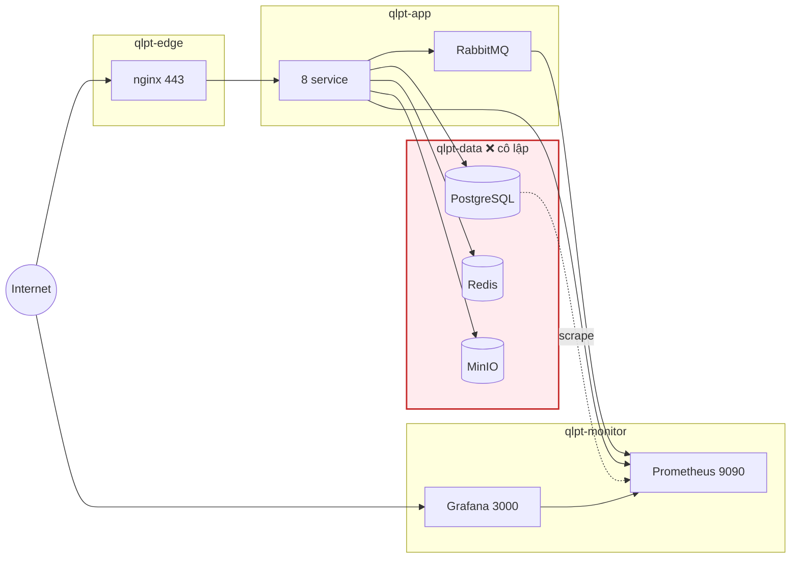

**Kết quả:** Nếu attacker thắng được `nginx` và đẩy được code lên container web,
họ vẫn **không chạm được** PostgreSQL — vì container đó không nằm trong network
`qlpt-data` và không có route tới đó. Đây là nguyên tắc **defense in depth**.

## 3.3. Ánh xạ từng thành phần sang dịch vụ đám mây thật

Bảng này là **phần quan trọng nhất khi bảo vệ đồ án** — chứng minh mô hình self-hosted
thực sự tương đương đám mây công cộng:

| Thành phần trong dự án | Dịch vụ đám mây công cộng tương đương | AWS | GCP | Azure |
|---|---|---|---|---|
| Ubuntu Server (1 host) | Máy chủ ảo | EC2 | Compute Engine | Virtual Machines |
| Docker Engine | Công cụ ảo hóa mức OS | (dùng ECS/ECR) | (dùng GKE) | (dùng AKS) |
| Docker Compose | Bộ điều phối container | ECS / Docker Compose plugin | Cloud Run / GKE | Container Apps |
| nginx | Load Balancer + CDN | ALB + CloudFront | Cloud Load Balancing + Cloud CDN | Application Gateway + CDN |
| 8 Microservice | Các service đơn lẻ | ECS Service | Cloud Run service | Container Apps |
| PostgreSQL (6 DB) | CSDL quan hệ | RDS / Aurora | Cloud SQL / AlloyDB | Azure Database for PostgreSQL |
| Redis | Cache quản lý | ElastiCache | Memorystore | Azure Cache for Redis |
| RabbitMQ | Message broker | Amazon MQ | Pub/Sub | Service Bus |
| MinIO | Lưu trữ đối tượng | S3 | Cloud Storage | Blob Storage |
| Prometheus | Giám sát + cảnh báo | Managed Prometheus / CloudWatch | Cloud Monitoring | Azure Monitor |
| Grafana | Bảng điều khiển | Grafana Cloud | Cloud Monitoring dashboards | Azure Managed Grafana |
| Loki + Promtail | Quản lý log | CloudWatch Logs | Cloud Logging | Azure Monitor Logs |
| Portainer | Bảng điều khiển quản trị | ECS Console | Cloud Console | Portal + Arc |
| Docker Secrets (file) | Quản lý bí mật | Secrets Manager | Secret Manager | Key Vault |
| Let's Encrypt | Chứng thư TLS | ACM | Certificate Manager | Key Vault |
| Tài khoản Ubuntu | IAM / định danh | IAM | IAM | Entra ID |
| Ước lượng tài nguyên | Máy phẩm hệ (instance types) | t3.xlarge | n2-standard-8 | D8s v5 |
| Hệ thống tệp gắn thêm | Ổ đĩa khối | EBS | Persistent Disk | Managed Disks |
| Máy ảo/ảo chụp | Snapshot | EBS Snapshot | Disk Snapshot | Disk Snapshot |

**Bài học rút ra cần nhấn mạnh:** *đám mây là mô hình phục vụ và phần mềm trừu tượng
hóa hạ tầng — không phải tên của một hãng cung cấp.* Khi đã thiết kế đúng kiến trúc,
chuyển từ self-hosted sang AWS chỉ là thay tệp cấu hình, **không phải viết lại code**.

## 3.4. Cân bằng tải (Load Balancing)

### 3.4.1. Cơ chế 3 tầng

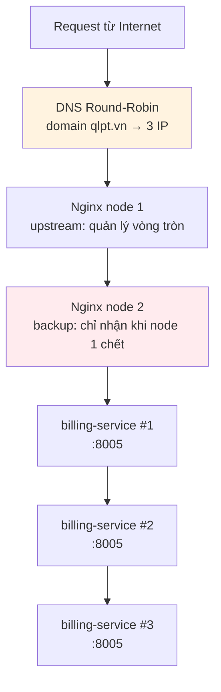

| Cơ chế | Công cụ | Cách hoạt động | Phạm vi áp dụng |
|---|---|---|---|
| **DNS Round-Robin** | `/etc/hosts` hoặc Cloudflare | Nhiều bản ghi A trỏ cùng domain | Phân tán **ở cấp domain**, rẻ nhất |
| **Reverse Proxy L7** | **nginx `upstream`** | Phân tán theo thuật toán, health check, retry | **Hạt nhân của dự án** |
| **L4 Load Balancer** | HAProxy, iptables | Phân phối theo port, không hiểu HTTP | Khi cần throughput rất cao |

### 3.4.2. Cấu hình nginx upstream (trọng tâm)

```nginx
# Ý tưởng: định nghĩa "nhóm" các bản sao của cùng một service
upstream billing_backend {
    least_conn;                            # gửi tới máy ít kết nối nhất
    # Phương án thay thế:
    # ip_hash;                             # giữ 1 client → 1 backend (cho session)
    # random two least_conn;               # chọn ngẫu nhiên 2, thử từng cái

    server billing-1:8005 max_fails=3 fail_timeout=30s;
    server billing-2:8005 max_fails=3 fail_timeout=30s;
    server billing-3:8005 max_fails=3 fail_timeout=30s backup;   # dự phòng

    keepalive 32;                          # tái sử dụng connection, giảm overhead
    keepalive_requests 1000;
    keepalive_timeout 60s;
}
```

**Ý nghĩa từng tham số:**

| Tham số | Ý nghĩa | Tại sao chọn giá trị này |
|---|---|---|
| `least_conn` | Chọn backend có ít kết nối nhất | Tốt hơn `round_robin` khi request có thời gian xử lý khác nhau |
| `max_fails=3` | Sau 3 lần lỗi thì tạm loại | Không nhạy cảm với lỗi mạng thoáng qua |
| `fail_timeout=30s` | Loại trong 30 giây rồi thử lại | Cho backend thời gian phục hồi |
| `backup` | Chỉ dùng khi tất cả server chính đã chết | Dự phòng, không tốn tài nguyên lúc bình thường |
| `keepalive 32` | Giữ 32 connection mở | Tránh bắt tay TCP lặp lại → giảm p95 đáng kể |

### 3.4.3. Reverse proxy + định tuyến tới microservice

```nginx
server {
    listen 443 ssl;
    http2 on;
    server_name qlpt.vn www.qlpt.vn;

    ssl_certificate     /etc/letsencrypt/live/qlpt.vn/fullchain.pem;
    ssl_certificate_key /etc/letsencrypt/live/qlpt.vn/privkey.pem;
    ssl_protocols TLSv1.2 TLSv1.3;
    add_header Strict-Transport-Security "max-age=31536000" always;

    # ---- Tăng tốc: nén & cache tài nguyên tĩnh ----
    gzip on;
    gzip_types text/css application/javascript application/json image/svg+xml;
    gzip_min_length 1024;

    location ~* \.(js|css|woff2|png|jpg|svg)$ {
        expires 30d;                    # cache 30 ngày
        add_header Cache-Control "public, immutable";
    }

    # ---- Phục vụ web SPA ----
    location / {
        root /srv/web;
        try_files $uri $uri/ /index.html;    # hỗ trợ client-side routing
    }

    # ---- Định tuyến API: pattern → service ----
    # Giữ nguyên path để Swagger docs dễ hiểu hơn là rewrite

    location /api/v1/auth          { proxy_pass http://auth_backend;       include proxy_common.conf; }
    location /api/v1/users         { proxy_pass http://auth_backend;       include proxy_common.conf; }
    location /api/v1/rooms         { proxy_pass http://room_backend;       include proxy_common.conf; }
    location /api/v1/rooms/available { proxy_pass http://room_backend;     include proxy_common.conf; }
    location /api/v1/properties    { proxy_pass http://room_backend;       include proxy_common.conf; }
    location /api/v1/buildings     { proxy_pass http://room_backend;       include proxy_common.conf; }
    location /api/v1/amenities     { proxy_pass http://room_backend;       include proxy_common.conf; }
    location /api/v1/tenants       { proxy_pass http://tenant_backend;     include proxy_common.conf; }
    location /api/v1/roommates     { proxy_pass http://tenant_backend;     include proxy_common.conf; }
    location /api/v1/contracts     { proxy_pass http://contract_backend;   include proxy_common.conf; }
    location /api/v1/invoices      { proxy_pass http://billing_backend;    include proxy_common.conf; }
    location /api/v1/pricing       { proxy_pass http://billing_backend;    include proxy_common.conf; }
    location /api/v1/meter-readings { proxy_pass http://billing_backend;   include proxy_common.conf; }
    location /api/v1/billing-jobs  { proxy_pass http://billing_backend;    include proxy_common.conf; }
    location /api/v1/estimates     { proxy_pass http://billing_backend;    include proxy_common.conf; }
    location /api/v1/notifications { proxy_pass http://notify_backend;     include proxy_common.conf; }
    location /api/v1/templates     { proxy_pass http://notify_backend;     include proxy_common.conf; }
    location /api/v1/incidents     { proxy_pass http://maintenance_backend; include proxy_common.conf; }
    location /api/v1/maintenance-schedules { proxy_pass http://maintenance_backend; include proxy_common.conf; }
    location /api/v1/reports       { proxy_pass http://report_backend;     include proxy_common.conf; }
}

# ---- Lỗi toàn cục: luôn trả JSON, không trả HTML lỗi ----
error_page 502 503 504 /error.html;
location = /error.html { internal; return 503 '{"error":"Dịch vụ tạm thời không sẵn sàng"}'; }
```

**`proxy_common.conf` — cấu hình dùng chung cho mọi service:**

```nginx
proxy_http_version 1.1;
proxy_set_header Connection "";                # cần cho keepalive

# --- QUAN TRỌNG: phải truyền đúng IP thật của client ---
# Nếu thiếu, mọi request sẽ ghi log là đến từ IP của nginx,
# khiến rate limit và nhật ký không dùng được.
proxy_set_header Host              $host;
proxy_set_header X-Real-IP         $remote_addr;
proxy_set_header X-Forwarded-For   $proxy_add_x_forwarded_for;
proxy_set_header X-Forwarded-Proto $scheme;
proxy_set_header X-Request-ID      $request_id;   # truy vết 1 request xuyên nhiều service

# --- Timeout khác nhau theo tính chất nghiệp vụ ---
proxy_connect_timeout 5s;
proxy_send_timeout    10s;
proxy_read_timeout    15s;

# --- Retry CHỈ trên lỗi kết nối, KHÔNG retry khi đã nhận response ---
proxy_next_upstream error timeout http_502 http_503 http_504;
proxy_next_upstream_tries 2;

# --- Buffer: đẩy băng thông tối đa sang tầng nginx ---
proxy_buffering on;
proxy_buffer_size 16k;
proxy_buffers 8 16k;
proxy_busy_buffers_size 32k;
```

> **Khuyến nghị quan trọng:** Không dùng `proxy_pass` có `rewrite` cắt bỏ tiền tố
> domain (VD `/api/v1/invoices`). Giữ nguyên path giúp:
> (1) tài liệu Swagger hiển thị đúng URL thật,
> (2) log nginx dễ đối chiếu với log service,
> (3) tránh lỗi cấu hình dễ sai khi có nhiều service.
>
> ⚠️ **Tuyệt đối không viết `location` API kèm dấu `/` ở cuối** (VD
> `location /api/v1/invoices/`): nginx sẽ trả `301` cho đúng `/api/v1/invoices`
> (thêm `/`), rồi service lại trả `307` ngược lại (bỏ `/`) → **lặp redirect vô
> hạn** → trình duyệt báo `Failed to fetch` (`ERR_TOO_MANY_REDIRECTS`).

## 3.5. Tính sẵn sàng (High Availability) và chịu lỗi (Fault Tolerance)

### 3.5.1. Bốn cấp độ HA

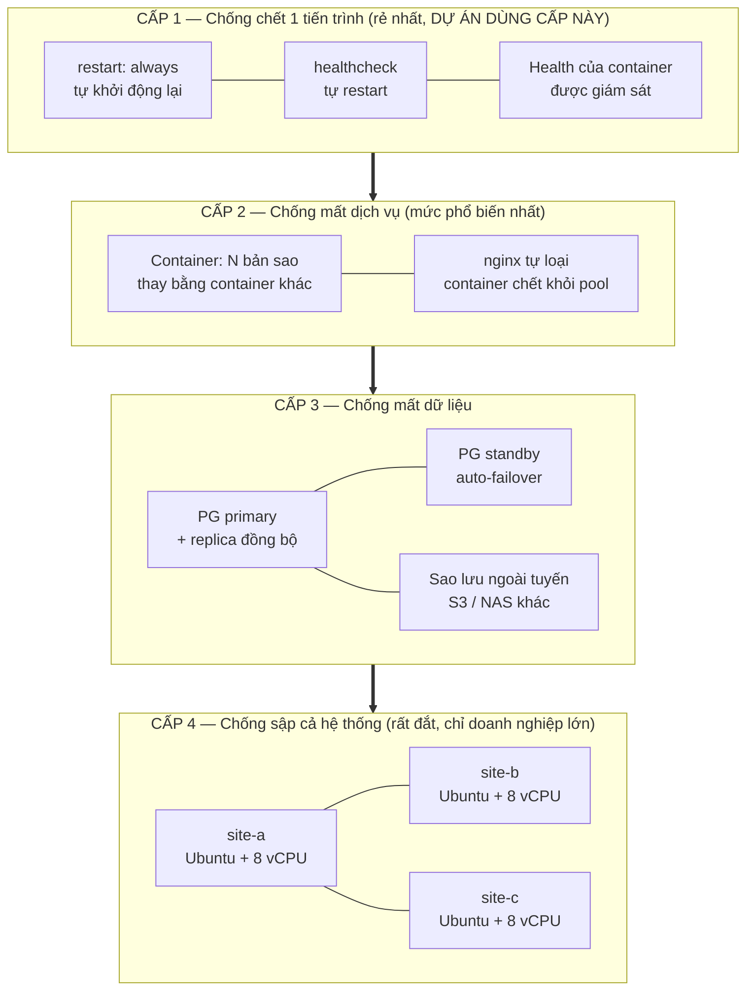

**Dự án này hiện thực CẤP 1 + CẤP 2, mô tả CẤP 3–4 như hướng mở rộng.**
Đây là câu trả lời trung thực: *với quy mô nhà trọ, chi phí HA cấp 3–4 không đáng*.

### 3.5.2. Cấp 1: Healthcheck & tự phục hồi

```yaml
# docker-compose.yml
services:
  billing:
    restart: unless-stopped          # tự khởi động lại khi container chết
    healthcheck:
      test: ["CMD", "curl", "-fsS", "http://localhost:8005/health"]
      interval: 30s                  # kiểm tra mỗi 30s
      timeout: 5s                    # quá 5s coi là chết
      retries: 3                     # 3 lần liên tiếp thất bại → unhealthy
      start_period: 40s              # 40s đầu chờ app khởi động (không tính lỗi)
```

**Ba trạng thái của container:** `starting` → `healthy` / `unhealthy` → `exited`

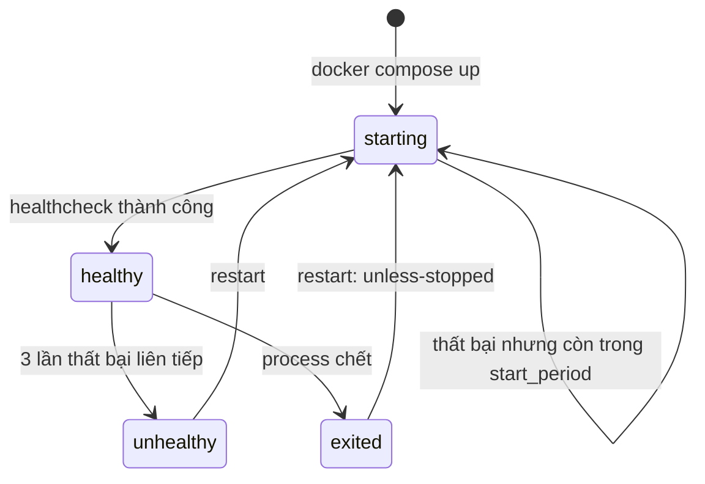

**Vì sao `start_period` quan trọng?** Nếu không có, lúc khởi động PostgreSQL mất
10–15 giây, healthcheck sẽ báo lỗi và restart container → **vòng lặp khởi động vô hạn**
(circular dependency). Đây là lỗi phổ biến nhất khi triển khai Docker.

### 3.5.3. Cấp 2: Thay thế bằng container

```yaml
billing:
  deploy:
    replicas: 3                      # 3 bản sao, mỗi bản 1 container
    resources:
      limits:
        cpus: '1.0'                  # giới hạn CPU: tránh 1 container chiếm hết host
        memory: 768M
    update_config:
      order: start-first              # dựng container mới TRƯỚC, rồi mới tắt container cũ
      parallelism: 1
      delay: 10s
      failure_action: rollback        # lỗi thì quay lại bản cũ
```

> **Lưu ý quan trọng về Docker Compose:** Cờ `deploy.replicas` **chỉ có tác dụng thật
> trong Docker Swarm**, không phải trong `docker compose up` thông thường. Để nhân bản
> trong Compose thuần, dùng:
> ```bash
> docker compose up -d --scale billing=3
> ```
> Sự khác biệt này rất hay bị hỏi khi bảo vệ — nhớ nói rõ đây là **giới hạn của
> Compose so với Swarm/Kubernetes**, và cũng là lý do phải chuyển sang orchestrator
> khi hệ thống lớn hơn.

## 3.6. Quản lý bí mật (Secrets Management)

### 3.6.1. Nguyên tắc: không bao giờ hard-code

```python
# ❌ SAI — lộ mật khẩu khi ai đó đọc code
DB_PASSWORD = "123456"
JWT_SECRET  = "my-secret-key"

# ❌ SAI — lộ qua git log, qua lịch sử CI, qua image layer
IMAGE = os.getenv("DB_PASSWORD", "123456")   # fallback mặc định là mật khẩu thật

# ✅ ĐÚNG — bắt buộc phải có, không có thì service KHÔNG KHỞI ĐỘNG
JWT_SECRET: SecretStr = Field(..., min_length=32)
DB_PASSWORD: SecretStr = Field(..., min_length=12)
```

```python
# services/common/config.py — fail fast
class Settings(BaseSettings):
    model_config = SettingsConfigDict(env_file="/run/secrets/.env", extra="ignore")

    jwt_secret: SecretStr = Field(..., min_length=32, description="Bắt buộc ≥32 ký tự")
    db_password: SecretStr = Field(..., min_length=12)

    def __init__(self, **data):
        super().__init__(**data)
        # Chỉ log dạng che, KHÔNG BAO GIỜ log giá trị thật
        logger.info("config loaded: db_host=%s jwt_secret=***%s",
                    self.db_host, self.jwt_secret.get_secret_value()[-4:])
```

### 3.6.2. Cơ chế secret của Docker

```bash
# 1. Tạo file bí mật (KHÔNG commit vào git)
echo "dB_password_9f2a1c8e7b6d5a4f" > secrets/db_password.txt
echo "jwt_secret_a1b2c3d4e5f6..." > secrets/jwt_secret.txt
chmod 600 secrets/*.txt

# 2. Tham chiếu trong compose
services:
  billing:
    secrets:
      - db_password
      - jwt_secret

secrets:
  db_password:
    file: ./secrets/db_password.txt
  jwt_secret:
    file: ./secrets/jwt_secret.txt
```

```bash
# 3. Trong container, secret được mount ở /run/secrets/<tên> (chỉ ĐỌC)
ls -la /run/secrets/
# -r--r--r--  db_password.txt
# -r--r--r--  jwt_secret.txt

# 4. Đọc trong code
DB_PASSWORD = Path("/run/secrets/db_password").read_text().strip()
```

**So sánh các tầng bảo mật của bí mật:**

| Cơ chế | An toàn | Độ phức tạp | Khi nào dùng |
|---|---|---|---|
| File `.env` | ❌ Thấp (dễ commit nhầm vào git) | Thấp | Chỉ phát triển local |
| Docker Secrets (file) | 🟡 Khá (chỉ container cần mới đọc được) | Thấp | **Dự án này** |
| Docker Secrets (swarm, mã hóa) | 🟢 Cao | Trung bình | Swarm |
| HashiCorp Vault | 🟢 Rất cao (mã hóa, xoay vòng, audit) | Cao | Doanh nghiệp |
| AWS Secrets Manager / GCP Secret Manager | 🟢 Rất cao (đồng bộ xoay vòng) | Trung bình | Trên đám mây |

### 3.6.3. Quy trình xoay vòng bí mật

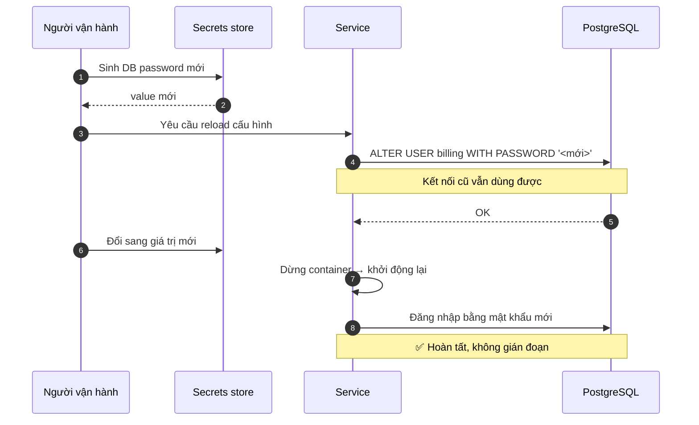

## 3.7. Bảo mật container

### 3.7.1. Ba loại rủi ro chính

| Rủi ro | Mô tả | Biện pháp |
|---|---|---|
| **Lỗ hổng image** | Image chứa thư viện/OS có CVE | Quét bằng Trivy, rebuild định kỳ |
| **Container escape** | Container thoát ra host | Không chạy `privileged`, giới hạn capability |
| **Tài nguyên bị chiếm** | 1 container ngốn hết RAM/CPU → sập cả hệ thống | Đặt `limits` |

### 3.7.2. Hardening Dockerfile

```dockerfile
# ---- Giai đoạn 1: BUILD ----
FROM python:3.12-slim AS builder
WORKDIR /build
ENV PYTHONDONTWRITEBYTECODE=1 PYTHONUNBUFFERED=1

# Cài dependency vào venv riêng
RUN python -m venv /opt/venv
ENV PATH="/opt/venv/bin:$PATH"
COPY requirements.txt .
RUN pip install --no-cache-dir -r requirements.txt

# ---- Giai đoạn 2: RUNTIME (ảnh nhỏ hơn nhiều) ----
FROM python:3.12-slim AS runtime
WORKDIR /app

# Tạo user KHÔNG phải root
RUN groupadd -r app && useradd -r -g app -u 10001 app

# Cài chứng thư CA cho HTTPS outbound
RUN apt-get update && apt-get install -y --no-install-recommends \
        curl ca-certificates \
    && rm -rf /var/lib/apt/lists/*

COPY --from=builder /opt/venv /opt/venv
ENV PATH="/opt/venv/bin:$PATH"

COPY --chown=app:app . .
USER app                          # ← chạy bằng user thường

EXPOSE 8000
HEALTHCHECK --interval=30s --timeout=3s --start-period=20s --retries=3 \
    CMD curl -fsS http://localhost:8000/health || exit 1

# Chạy bằng Uvicorn 1 worker (nhiều worker = nhiều container, đó là cách đúng)
CMD ["uvicorn", "main:app", "--host", "0.0.0.0", "--port", "8000", \
     "--workers", "1", "--proxy-headers", "--forwarded-allow-ips", "*"]
```

**Giải thích 6 quyết định quan trọng:**

| Quyết định | Lý do |
|---|---|
| **Multi-stage build** | Ảnh runtime không chứa trình biên dịch (`gcc`, header) → nhỏ hơn 40–60%, giảm bề mặt tấn công |
| **Không chạy `root`** | Nếu attacker chiếm được container, không có quyền ghi `/etc`, không cài `sudo` |
| **Không `apt-get upgrade` ngay trong `RUN`** | Dễ lộ, khó tái lập. Bảo mật bằng Trivy + rebuild thay vì vá tay |
| **`curl` cho HEALTHCHECK** | Nhẹ hơn cài `wget` hay dùng `python -c` |
| **Không `COPY . .` trước khi cài dep** | Cache Docker chỉ invalidate khi đổi code, **không** invalidate khi đổi `requirements.txt` → build nhanh hơn nhiều |
| **1 Uvicorn worker** | Nhiều worker × nhiều container = quá nhiều tiến trình, khó scale. Đúng cách: 1 worker/container, scale **container** |

> **Điểm hay bị hỏi:** Tại sao không dùng `--workers 4`?
> Trả lời: worker là **tiến trình**, container là **đơn vị triển khai**. Mở rộng bằng
> nhiều container giúp dễ **cân bằng tải, health check, rolling update, giới hạn tài nguyên**
> hơn. Nhiều worker trong 1 container là tối ưu sai.

### 3.7.3. Giới hạn tài nguyên (rất quan trọng)

```yaml
services:
  nginx:
    deploy:
      resources:
        limits:   { cpus: '0.50', memory: 256M }
        reservations: { cpus: '0.25', memory: 128M }   # đảm bảo luôn đủ

  billing:
    deploy:
      resources:
        limits:   { cpus: '2.00', memory: 1024M }
        reservations: { cpus: '0.50', memory: 512M }
```

```bash
# Áp dụng giới hạn NGAY khi dùng docker compose (ngoài Swarm)
docker update --memory 1g --cpus 2.0 billing-1
```

> **Vì sao bắt buộc phải giới hạn?** Nếu 1 service bị rò rỉ bộ nhớ và không giới hạn,
> nó có thể chiếm **toàn bộ 16 GB** → **Linux OOM Killer giết các container khác** →
> hệ thống sập. Giới hạn tài nguyên là "vùng an toàn" (blast radius) cho từng
> container — cùng một tư duy multi-tenant của đám mây.

### 3.7.4. Tính sẵn sàng của Security Option

```yaml
services:
  billing:
    security_opt:
      - no-new-privileges:true        # ⭐ quan trọng: process KHÔNG thể nâng quyền
    cap_drop:
      - ALL                           # bỏ TOÀN BỘ Linux capability
    cap_add:
      - NET_BIND_SERVICE              # thêm lại duy nhất cái cần (bind port <1024)
    read_only: true                   # hệ thống tệp gốc chỉ đọc
    tmpfs:
      - /tmp: size=64M                # ghi tạm vào RAM, tự xóa khi khởi động lại
    volumes:
      - billing_cache:/tmp/app
```

| Security option | Chặn được gì |
|---|---|
| `no-new-privileges` | Chặn setuid/setgid binary — lỗ hổng kinh điển để leo thang đặc quyền |
| `cap_drop: ALL` | Bỏ `CAP_SYS_ADMIN`, `CAP_NET_RAW`… — chặn thoát container |
| `read_only: true` | Malware không thể ghi vào FS, không cài persistence |
| Không `privileged: true` | Chặn truy cập `/dev`, host network — **không bao giờ** bật trong production |

## 3.8. Sao lưu, khôi phục và Khả dụng dữ liệu (Data Availability)

### 3.8.1. Phân tích RPO / RTO

| Thuật ngữ | Định nghĩa | Hệ quả thực tế |
|---|---|---|
| **RPO** (Recovery Point Objective) | Mất tối đa bao nhiêu phút dữ liệu khi sự cố | "Mất dữ liệu 1 ngày" → RPO 24h |
| **RTO** (Recovery Time Objective) | Mất bao lâu để phục hồi hệ thống | "Sửa trong 2 giây" → RTO 2s |

**Phân tích mức chấp nhận được:**

| Loại sự cố | RPO chấp nhận | RTO mục tiêu | Cách đạt |
|---|---|---|---|
| Xóa nhầm 1 hợp đồng | 5 phút | 15 phút | WAL/PITR |
| Server hỏng ổ cứng | 1 giờ | 1 giờ | Sao lưu mỗi giờ + cây lệnh |
| Hỏng toàn bộ VPS | 24 giờ | 4 giờ | Sao lưu đêm + dựng lại từ script |
| Rò rỉ dữ liệu (tấn công) | Không giới hạn | 1 giờ | **Sao lưu bất biến (immutable)** |

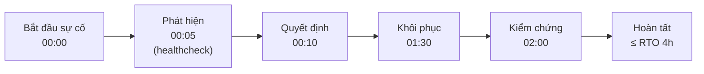

### 3.8.2. Chiến lược sao lưu 3-2-1

```mermaid
graph TB
    subgraph P["📍 Trên cùng máy (bảo vệ rẻ, chống lỗi người dùng)"]
        L1[("Bản sao hằng ngày<br/>14 ngày")]
    end
    subgraph R["🌐 Ngoài máy (chống hỏng ổ cứng / rò rỉ)"]
        L2[("Bản sao hằng tuần<br/>8 tuần")]
    end
    subgraph O[("🗄️ Lưu trữ bất biến<br/>chống xóa cố ý")]
        L3[("Off-site / Object storage<br/>12 tháng<br/>WORM — chỉ ghi")]
    end
    P --> R --> O
```

```bash
#!/usr/bin/env bash
# scripts/03-backup.sh — sao lưu toàn diện
set -Eeuo pipefail                      # dừng ngay khi có lỗi; -u: biến chưa gán là lỗi

BACKUP_DIR="/backup/qlpt"
STAMP="$(date +%Y%m%d_%H%M%S)"
RETENTION_DAILY=14; RETENTION_WEEKLY=8
export PGPASSWORD="$(cat /run/secrets/db_password)"

mkdir -p "$BACKUP_DIR"/{daily,weekly}

# --- 1. PostgreSQL: 6 database, mỗi DB 1 file .dump ---
for db in db_auth db_room db_tenant db_contract db_billing db_report db_notify; do
    echo "[$(date +%T)] Sao lưu $db ..."
    docker exec qlpt-postgres pg_dump \
        -U qlpt -d "$db" -Fc -Z6 \                    # custom format + nén
        > "$BACKUP_DIR/daily/${db}_${STAMP}.dump"
done

# Gộp thành 1 file tar.gz cho dễ chuyển đi
tar -czf "$BACKUP_DIR/daily/qlpt_full_${STAMP}.tar.gz" -C "$BACKUP_DIR/daily" ./*.dump
sha256sum "$BACKUP_DIR/daily/qlpt_full_${STAMP}.tar.gz" > "$BACKUP_DIR/daily/qlpt_full_${STAMP}.tar.gz.sha256"

# --- 2. Object storage (MinIO) ---
docker run --rm --network qlpt-data -v qlpt_minio_data:/data:ro \
    -v "$BACKUP_DIR/daily:/backup" minio/mc \
    sh -c 'mc alias set local http://qlpt-minio:9000 "$MINIO_ROOT_USER" "$MINIO_ROOT_PASSWORD" \
         && mc mirror local/backup/bucket "$BACKUP_DIR/daily/minio" && mc mb local/backup/bucket' || true

# --- 3. Cấu hình hệ thống (để dựng lại từ đầu) ---
tar -czf "$BACKUP_DIR/daily/config_${STAMP}.tar.gz" \
    docker-compose.yml .env infra/ web/

# --- 4. Bản sao tuần (ngày 0 hôm) ---
if [ "$(date +%u)" -eq 7 ]; then cp "$BACKUP_DIR/daily/"qlpt_full_*.tar.gz "$BACKUP_DIR/weekly/"; fi

# --- 5. Dọn bản cũ ---
find "$BACKUP_DIR/daily"  -type f -mtime +$RETENTION_DAILY  -delete
find "$BACKUP_DIR/weekly" -type f -mtime +$((RETENTION_WEEKLY*7)) -delete

echo "[$(date +%T)] ✅ Sao lưu hoàn tất: $STAMP"
```

**Điểm quan trọng về sao lưu — Rất nhiều đồ án làm sai:**

> Một bản sao lưu **không được kiểm chứng** thì **không phải bản sao lưu**.
> Trong thực tế, 30–40% sự cố dữ liệu đến từ việc khôi phục thất bại. Bắt buộc:
> 1. **Tự động kiểm chứng hằng tuần** — dựng PostgreSQL tạm, `pg_restore` bản sao lưu,
>    chạy `SELECT count(*)` để xác nhận dữ liệu đúng.
> 2. **Đo RTO thực tế** — đo thời gian khôi phục thật, chứ không chỉ ước lượng trên giấy.
> 3. **Lưu mật khẩu sao lưu ở nơi khác** — mất ổ dữ liệu thì mất luôn mật khẩu sao lưu.

### 3.8.3. Point-in-Time Recovery (khôi phục theo thời điểm)

Cho phép khôi phục về **thời điểm bất kỳ**, kể cả giây phút trước khi xảy ra sự cố:

```bash
# Xem các mốc khôi phục có sẵn
docker exec qlpt-postgres psql -U qlpt -c "SELECT * FROM pg_stat_wal_receiver;"

# Khôi phục về đúng thời điểm trước khi xóa nhầm
docker exec qlpt-postgres pg_basebackup -D /restore -Fp -Xs -P
docker exec qlpt-postgres bash -c "
  echo \"restore_command = 'cp /wal-archive/%f %p'\" >> /restore/postgresql.auto.conf
  echo \"recovery_target_time = '2026-10-25 14:32:17+07'\"  >> /restore/postgresql.auto.conf
  echo 'recovery_target_action = pause'                    >> /restore/postgresql.auto.conf
  touch /restore/recovery.signal"
```

## 3.9. Khả năng di chuyển (Portability) — Từ self-hosted sang đám mây thật

**Đây là phần chứng minh giá trị lớn nhất của kiến trúc.** Hệ thống được viết theo
12factor để có thể chuyển đổi gần như chỉ bằng cấu hình:

| Yếu tố 12factor | Cách thực hiện trong dự án |
|---|---|
| **Codebase** | 1 repo duy nhất, mọi service dùng chung `common/` |
| **Deps** | `requirements.txt` ghim phiên bản + `poetry.lock` |
| **Config** | Biến môi trường + Docker Secrets — **không** nhúng vào code |
| **Backing services** | Gọi qua tên DNS, không đụng đĩa của nhau |
| **Build, release, run** | Tách rõ: build image → gắn tag → triển khai config |
| **Processes** | Stateless, mọi thứ qua API/event, không lưu ở đĩa local |
| **Port binding** | Mỗi service tự xuất `PORT` qua biến môi trường |
| **Dev/prod parity** | Cùng image, cùng compose file, chỉ khác config |
| **Disposability** | Container thay thế được trong vài giây |
| **Dev/prod separation** | Config qua `.env`, tách khỏi image |
| **Logs** | Ghi ra `stdout`, log collector thu thập — không ghi file trong container |
| **Admin processes** | Job chạy như 1 process/1 task, không phải daemon trong container |

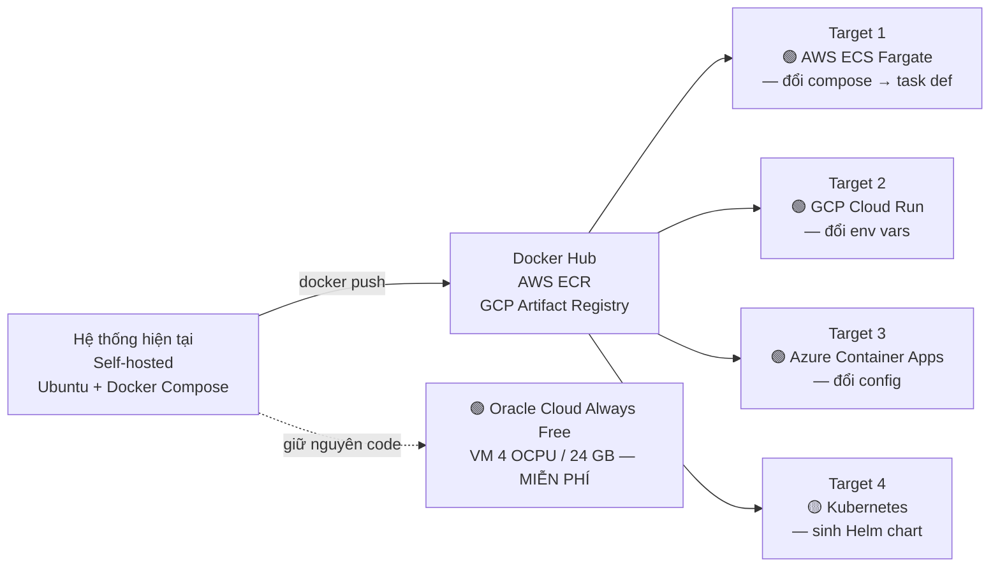

**Bảng chi phí so sánh (Việt Nam, 2026):**

| Hạ tầng | Chi phí/tháng | Ghi chú |
|---|---|---|
| **VPS 8 vCPU / 16 GB** (Hetzner, Vultr, Contabo) | ~$20–40 | Đủ chạy; khuyến nghị cho đồ án |
| **Oracle Cloud Always Free VM.Standard.E4.Flex** | **$0** | 4 OCPU / 24 GB RAM / 200 GB — MIỄN PHÍ VĨNH VIỄN, chỉ cần thẻ visa |
| **AWS EC2 t3.medium** | ~$30 | Bền vững, nhưng đắt hơn |
| **Google Cloud e2-medium** | ~$25 | Có $300 credit cho tài khoản mới |
| **GCP free tier** | $0 | Chỉ đủ instance nhỏ, DB hạn chế |

> **Gợi ý thực tế cho dự án:** Dùng **Oracle Cloud Always Free** nếu muốn "triển khai thật
> trên đám mây công cộng mà vẫn miễn phí" — cấu hình tương đương self-hosted, có public IP,
> đủ mạnh để chạy cả 8 service. Nhưng cần lưu ý Oracle hay hạn chứa tài khoản
> ở một số khu vực, nên phải sẵn sàng phương án dự phòng.

## 3.10. Ước lượng tài nguyên

### 3.10.1. Khối lượng tính toán

| Thành phần | Số lượng | RAM mỗi cái | Tổng RAM | CPU mỗi cái | Tổng CPU |
|---|---|---|---|---|---|
| nginx | 1 | 128 MB | 0.13 GB | 0.25 vCPU | 0.25 |
| auth-service | 1 | 256 MB | 0.25 GB | 0.25 vCPU | 0.25 |
| room-service | 1 | 384 MB | 0.38 GB | 0.5 vCPU | 0.5 |
| tenant-service | 1 | 384 MB | 0.38 GB | 0.5 vCPU | 0.5 |
| contract-service | 1 | 512 MB | 0.50 GB | 0.5 vCPU | 0.5 |
| billing-service | 1 | 1024 MB | 1.00 GB | 1.0 vCPU | 1.0 |
| notification-service | 1 | 384 MB | 0.38 GB | 0.25 vCPU | 0.25 |
| maintenance-service | 1 | 384 MB | 0.38 GB | 0.5 vCPU | 0.5 |
| report-service | 1 | 512 MB | 0.50 GB | 0.5 vCPU | 0.5 |
| PostgreSQL 16 (6 DB) | 1 | 3072 MB | 3.00 GB | 1.5 vCPU | 1.5 |
| Redis 7 | 1 | 512 MB | 0.50 GB | 0.25 vCPU | 0.25 |
| RabbitMQ 3 | 1 | 512 MB | 0.50 GB | 0.25 vCPU | 0.25 |
| MinIO | 1 | 512 MB | 0.50 GB | 0.5 vCPU | 0.5 |
| Prometheus | 1 | 512 MB | 0.50 GB | 0.25 vCPU | 0.25 |
| Grafana | 1 | 256 MB | 0.25 GB | 0.25 vCPU | 0.25 |
| Loki + Promtail | 2 | 384 MB | 0.38 GB | 0.25 vCPU | 0.25 |
| cAdvisor | 1 | 128 MB | 0.13 GB | 0.1 vCPU | 0.10 |
| **TỔNG** | **20** | | **≈ 10.5 GB** | | **≈ 7.3 vCPU** |

**Đệm an toàn (headroom) +25% cho burst và OS:**
→ **Cần: 13 GB RAM, 9 vCPU**
→ **Vận hành thực tế: chọn 16 GB / 8 vCPU** (đã tính sẵn đệm)

### 3.10.2. Dung lượng lưu trữ

| Loại | Dung lượng | Ghi chú |
|---|---|---|
| Docker images (~20) | 3 GB | Có thể prune |
| PostgreSQL data (6 DB) | 8 GB | 5 năm dữ liệu |
| WAL + backup tạm | 5 GB | PostgreSQL sinh WAL liên tục |
| MinIO (ảnh CCCD, sự cố) | 10 GB | 500 phòng × 20 MB/năm |
| **Bản sao lưu** (14 ngày + 8 tuần) | 25 GB | Đây là khoản lớn nhất! |
| Log (Loki) | 10 GB | Cần `retention_period` |
| OS + swap | 5 GB | |
| **TỔNG** | **≈ 66 GB** | → **chọn 100 GB SSD**, dùng LVM để mở rộng |

> **Bài học thực tế:** Sao lưu thường **chiếm nhiều dung lượng hơn dữ liệu gốc**.
> Nếu 6 DB chỉ 8 GB thì 14 bản sao + 8 bản tuần đã lên ~25 GB. Khi thiết kế, phải
 tính cả chi phí lưu trữ sao lưu, không chỉ dữ liệu chính.

### 3.10.3. Cấu hình máy khuyến nghị

| Quy mô | Phòng | Cấu hình | Chi phí ước tính |
|---|---|---|---|
| **Demo / đồ án** | ≤ 50 | 2 vCPU / 4 GB / 50 GB | ~$8–12/tháng |
| **Nhà trọ nhỏ** | ≤ 200 | 4 vCPU / 8 GB / 100 GB | ~$15–25/tháng |
| **Chuẩn đề tài** ✅ | 200–500 | **8 vCPU / 16 GB / 100 GB** | **~$25–45/tháng** |
| **Nhiều cơ sở** | 500–2000 | 16 vCPU / 32 GB / 300 GB + 1 worker | ~$80–150/tháng |

### 3.10.4. Cân bằng tải theo từng service

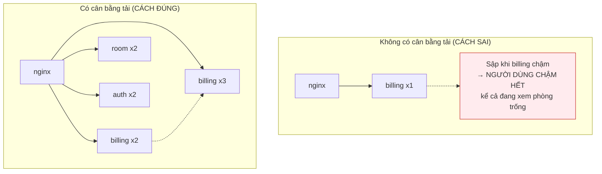

> Người dùng **xem phòng trống** không nên phải chờ vì `billing-service` đang bận
> tính 200 hóa đơn cuối tháng. Đây là lý do tách service rõ ràng rồi mới cân bằng tải —
> **không thể scale đúng chỗ nếu chưa tách đúng ranh giới**.

## 3.11. Mô hình ứng dụng Cloud-Native

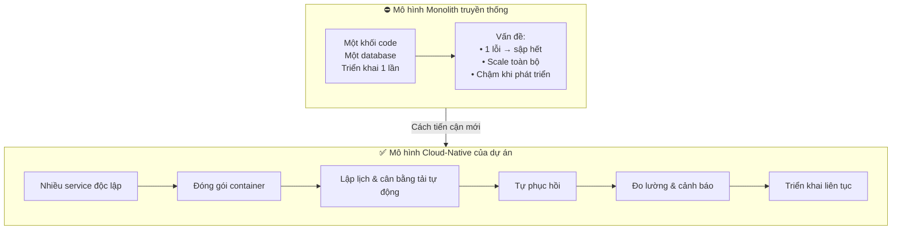

**12 đặc điểm của ứng dụng Cloud-Native (mỗi điểm đều có trong dự án):**

| # | Đặc điểm | Thể hiện trong dự án |
|---|---|---|
| 1 | **Lập lịch tự động** (scheduling) | Docker restart policy, RabbitMQ queue, cron job |
| 2 | **Quản lý tài nguyên hiệu quả** | `deploy.resources.limits` |
| 3 | **Tự phục hồi** (self-healing) | healthcheck + `restart: unless-stopped` |
| 4 | **Tự mở rộng** (auto-scaling) | `--scale`, `deploy.replicas` |
| 5 | **Liên tục** (continuous) | Rolling update, không cần dừng cả hệ thống |
| 6 | **Tự quản trị** (declarative) | docker-compose.yml là **bản mô tả trạng thái mong muốn** |
| 7 | **Cấu hình bên ngoài** (externalized) | Secrets + biến môi trường |
| 8 | **Bất độc lập với hạ tầng** | Chạy được trên máy bất kỳ có Docker |
| 9 | **Phân tích log tập trung** | Loki + Promtail + Grafana |
| 10 | **Quản lý bí mật** | Docker Secrets |
| 11 | **Hỗ trợ nhiều môi trường** | dev / staging / prod dùng chung image |
| 12 | **Dịch vụ ứng dụng** | 8 service đóng gói độc lập |

> **Điểm cốt lõi:** `docker-compose.yml` là **bản khai báo ý muốn** (declarative), không
> phải **chuỗi lệnh cần thực thi** (imperative). Muốn dựng lại hệ thống, chỉ cần đổi file
> rồi chạy `docker compose up -d` — Docker tự tính ra bước thực thi. Đây chính là ý nghĩa
> của "tự quản trị" trong 12 đặc điểm Cloud-Native.

## 3.12. Tổng kết chương

Chương 3 đã trình bày:
1. **Cơ sở lý thuyết** theo NIST: 5 đặc trưng, 3 mô hình dịch vụ, vị trí **CaaS** của dự án.
2. **Kiến trúc 4 tầng** và sơ đồ triển khai đầy đủ.
3. **Phân vùng mạng 4 vùng** theo zero-trust, data được cô lập.
4. **Bảng ánh xạ 18 thành phần** sang dịch vụ AWS/GCP/Azure tương đương.
5. **Cân bằng tải 3 tầng** với cấu hình nginx thực tế.
6. **4 cấp độ HA** — dự án thực hiện cấp 1–2, mô tả cấp 3–4.
7. **Quản lý bí mật** qua Docker Secrets + quy trình xoay vòng.
8. **Bảo mật container**: multi-stage build, non-root, capability drop, giới hạn tài nguyên.
9. **Sao lưu 3-2-1** với RPO/RTO cụ thể.
10. **Khả năng di chuyển** sang AWS/GCP/Azure + so sánh chi phí.
11. **Ước lượng tài nguyên** chi tiết (13 GB / 9 vCPU → chọn 16 GB / 8 vCPU).
12. **Mô hình Cloud-Native** với 12 đặc điểm.

→ Chương tiếp theo là **hướng dẫn thực hành**: cài Ubuntu Server, Docker, và chạy hệ thống.
