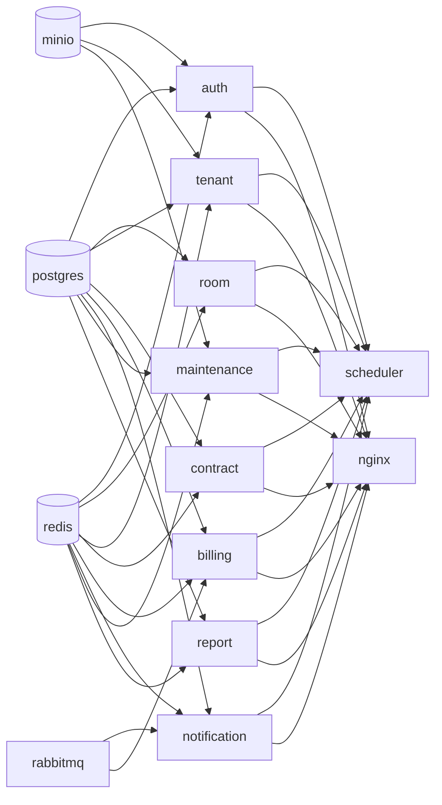

# CHƯƠNG 4 — TRIỂN KHAI TRÊN UBUNTU SERVER (RUNBOOK THỰC HÀNH)

> Chương 3 mô tả **kiến trúc**, chương này là **sổ tay thao tác** (runbook):
> từ lúc có 1 máy Ubuntu trống đến khi hệ thống chạy và được bảo vệ.
> Mọi lệnh chạy được, mọi file tồn tại trong thư mục dự án.

---

## 4.1. Chuẩn bị máy chủ

### 4.1.1. Cấu hình khuyến nghị

| Tiêu chí | Giá trị | Ghi chú |
|---|---|---|
| Hệ điều hành | **Ubuntu Server 24.04 LTS** | Ổn định, hỗ trợ đến 2029 |
| CPU / RAM | 8 vCPU / 16 GB | Vừa đủ cho 21 container (xem 3.10) |
| Ổ đĩa | 100 GB SSD (khuyến nghị LVM) | Sao lưu chiếm chỗ nhiều nhất |
| Mạng | 1 Gbps, IP tĩnh | Gán IP nội bộ riêng cho server |
| Vị trí | Có thể là VPS hoặc máy vật lý | Không khác gì nhau về cách triển khai |

### 4.1.2. SSH an toàn

```bash
# 1. Đăng nhập lần đầu bằng mật khẩu
ssh ubuntu@<IP-server>

# 2. Tạo user vận hành có quyền sudo (không dùng root trực tiếp)
sudo adduser ops
sudo usermod -aG sudo ops

# 3. Tạo khóa SSH cho máy cá nhân → copy lên server
ssh-keygen -t ed25519 -C "ops@office"      # chạy trên máy cá nhân
ssh-copy-id ops@<IP-server>

# 4. Chỉ cho phép khóa SSH đăng nhập (tắt mật khẩu)
sudo sed -i \
  -e 's/^#\?PasswordAuthentication.*/PasswordAuthentication no/' \
  -e 's/^#\?PermitRootLogin.*/PermitRootLogin no/' \
  /etc/ssh/sshd_config
sudo systemctl restart ssh

# 5. Tường lửa: chỉ mở cổng cần thiết
sudo ufw allow OpenSSH
sudo ufw allow 80/tcp     # HTTP (redirect → HTTPS)
sudo ufw allow 443/tcp    # HTTPS
sudo ufw allow 3000/tcp   # Grafana (có đăng nhập)
sudo ufw enable
```

> **Nguyên tắc bề mặt tấn công tối thiểu:** chỉ 4 cổng mở ra Internet.
> Cổng database, RabbitMQ UI, MinIO, Prometheus **không** mở — truy cập qua
> SSH tunnel khi cần (xem 4.5.4).

### 4.1.3. Cập nhật hệ thống

```bash
sudo apt update && sudo apt upgrade -y
sudo apt install -y git curl jq htop tmux unzip
```

---

## 4.2. Cài đặt Docker

### 4.2.1. Cài Docker Engine + Compose v2 (theo khuyến nghị chính thức)

```bash
# Cách 1 — gói chính thức (mới nhất)
curl -fsSL https://get.docker.com | sudo sh

# Cách 2 — từ kho Ubuntu (đơn giản, phiên bản hơi cũ hơn)
sudo apt install -y docker.io docker-compose-v2

# — Nhóm người dùng để chạy docker không cần sudo (đăng xuất rồi vào lại) —
sudo usermod -aG docker $USER

# Kiểm tra
docker --version
docker compose version
```

### 4.2.2. Cấu hình đúng cho production

```bash
# Bật Docker daemon tự khởi động khi reboot
sudo systemctl enable --now docker

# Log rotation cấp daemon (phòng log ngốn hết đĩa)
sudo tee /etc/docker/daemon.json >/dev/null <<'EOF'
{
  "log-driver": "json-file",
  "log-opts": { "max-size": "10m", "max-file": "3" },
  "storage-driver": "overlay2",
  "live-restore": true
}
EOF
sudo systemctl restart docker
```

> `live-restore: true` — khi upgrade Docker, container **không bị restart**,
> giữ phiên kết nối của người dùng. Điều này quan trọng với hệ thống chạy 24/7.

---

## 4.3. Chuẩn bị thư mục & bí mật

```bash
# 1. Copy dự án lên server
sudo mkdir -p /opt/qlpt
sudo chown $USER:$USER /opt/qlpt
scp -r ql-phong-tro/* ops@<IP-server>:/opt/qlpt/
# (hoặc: git clone <url-repo> /opt/qlpt)

cd /opt/qlpt

# 2. Tạo .env từ mẫu và SỬA giá trị
cp .env.example .env
nano .env        # đổi DOMAIN, PUBLIC_IP, REDIS_PASSWORD...

# 3. Sinh toàn bộ file bí mật ngẫu nhiên (xem scripts/02-generate-secrets.sh)
make secrets     # hoặc: bash scripts/02-generate-secrets.sh

# 3b. Tạo chứng chỉ TLS tự ký — ⭐ BẮT BUỘC trước lần up đầu
#     (nginx cấu hình HTTPS chặt; thiếu cert → nginx không khởi động được)
make certs       # hoặc: bash scripts/06-generate-cert.sh
#     Khi có domain thật, dùng Let's Encrypt (hướng dẫn trong script 06).

# 4. Kiểm tra môi trường đã đủ chưa
make check
```

**Các file sinh ra trong `secrets/`** (quyền 600, không commit lên git):

| File | Dùng cho | Nếu bị lộ / mất |
|---|---|---|
| `db_password.txt` | PostgreSQL | Mất → không đọc được DB sau restore |
| `jwt_secret.txt` | Ký/giải mã JWT | Mất → mọi token vô hiệu; lộ → giả mạo token |
| `admin_password.txt` | Mật khẩu admin + Grafana | Mất → không đăng nhập được |
| `minio_root_password.txt` | Object storage | Mất → không xem được ảnh minh chứng |
| `data_encryption_key` | Mã hóa CCCD (AES-256) | **Mất → không giải mã được số CCCD đã lưu** (xem chương 6) |
| `backup_passphrase.txt` | Mã hóa bản sao lưu secrets | Mất → không khôi phục được bí mật |

---

## 4.4. Khởi động & nạp dữ liệu mẫu

### 4.4.1. Lần chạy đầu tiên

```bash
# 1. Dựng toàn bộ 21 container (build image + khởi động + chờ healthy)
make up
#    — muốn chạy ở chế độ PRODUCTION (restart: always + resource guarantee):
#      make prod-up  (= docker compose -f docker-compose.yml -f docker-compose.prod.yml up -d --build)
#    — MÁY RAM HẠN CHẾ (8 GB / WSL2 trên laptop): dùng chế độ LAPTOP, tạm bỏ
#      loki/promtail/cAdvisor/node-exporter (profile full-monitor) + hạ trần RAM:
#      make laptop-up  (= docker compose -f docker-compose.yml -f docker-compose.laptop.yml up -d --build)
#      (muốn bật lại giám sát log/hệ thống: make laptop-monitor)

# 2. Xem trạng thái — tất cả phải "healthy"
make status

# 3. Nạp dữ liệu mẫu (5 script theo thứ tự, kèm reconcile cuối)
make seed
```

**Thứ tự khởi động được đảm bảo bằng `depends_on + condition: service_healthy`**
(thay vì `depends_on` đơn thuần chỉ chờ container *start*):



> **Vì sao không dùng `condition: service_started`?**
> Nếu chỉ chờ "container đã khởi động" mà chưa sẵn sàng, service con sẽ gọi
> PostgreSQL lúc nó vẫn đang khởi tạo → `Connection refused` → crash → restart.
> `service_healthy` buộc mỗi service con chỉ chạy khi dependency *đã sẵn sàng
> nhận việc*. Đây là nguyên nhân lớn nhất gây "lỗi khởi động ngẫu nhiên" khi
> triển khai Docker nếu làm cẩu thả.

### 4.4.2. Dữ liệu mẫu tạo ra những gì

| Cái gì | Số lượng | Ghi chú |
|---|---|---|
| Cơ sở / tòa nhà | 1 cơ sở, 2 tòa | A (tầng 1–5), B (tầng 1–3), 20 phòng |
| Phòng đang cho thuê | 9 / 20 | Trạng thái khớp 100% giữa 4 database |
| Hợp đồng | 11 | 9 ACTIVE · 1 EXPIRED · 1 DRAFT |
| Người thuê | 12 | CCCD mã hóa AES-256 |
| Hóa đơn | 27 (3 kỳ) | 2 quá hạn, 1 kỳ giữa có phạt trễ hạn 5%/ngày |
| Thanh toán | 17 | Tiền luôn Decimal/VND |
| Tài khoản | 14 | `admin`, `quanly`, `khach01…khach12` |

> ⭐ **Điểm thiết kế:** dữ liệu mẫu là một **câu chuyện khớp nhau** — hợp đồng
> đang ACTIVE thì phòng đang OCCUPIED, người thuê đang ở, và hóa đơn cùng kỳ
> đã phát. Nếu chỉ "chèn vài dòng vào từng DB" thì báo cáo doanh thu sẽ ra
> con số vô nghĩa. Cơ chế uuid5 tất định (`scripts/_seed_common.py`) đảm bảo
> chạy lại bao nhiêu lần cũng ra **cùng một bộ dữ liệu**.

### 4.4.3. Xác minh hệ thống đang chạy

```bash
make test-int          # smoke test: 9 service + đăng nhập + RBAC + reconcile
make health            # kiểm tra nhanh từng cổng
```

Kết quả mong đợi — tất cả dòng đều `✅ PASS` (chi tiết trong `scripts/smoke_test.py`).

---

## 4.5. Vòng đời vận hành hằng ngày

### 4.5.1. Bảng lệnh thường dùng

| Việc cần làm | Lệnh |
|---|---|
| Xem trạng thái | `make status` |
| Xem log tất cả | `make logs` |
| Xem log 1 service | `make logs-s S=billing` |
| Vào shell 1 service | `make shell S=billing` |
| Khởi động lại 1 service | `make restart S=billing` |
| Cập nhật hệ thống | `make update` (build + rolling) |
| Nhân bản service | `make scale S=billing N=3` |
| Sao lưu | `make backup` |
| Khôi phục | `make restore F=/backup/qlpt/daily/qlpt_full_....tar.gz` |
| Kiểm chứng bản sao lưu | `make verify-backup` |
| Chạy đối chiếu report | `make reconcile` |

### 4.5.2. Cron job bắt buộc

```bash
sudo crontab -e
# mẫu — chạy sao lưu 2h sáng hằng ngày, ghi log riêng
0 2 * * *  cd /opt/qlpt && bash scripts/03-backup.sh >> /var/log/qlpt/backup.log 2>&1
0 3 * * 0  cd /opt/qlpt && bash scripts/05-verify-backup.sh >> /var/log/qlpt/verify.log 2>&1
```

### 4.5.3. Cập nhật phiên bản (rolling update)

```bash
make update
# = docker compose build --pull
# = docker compose up -d --remove-orphans
# = chờ tất cả healthy
```

**Vì sao an toàn?** Mỗi service dùng `restart: unless-stopped` + healthcheck;
Compose dựng container mới rồi mới gỡ container cũ, nên trong thời gian deploy
vẫn có bản đang phục vụ. Không giống cách dừng hết rồi chạy lại.

### 4.5.4. Truy cập các trang nội bộ qua SSH tunnel

```bash
# Prometheus (9090) — chỉ bind localhost, không publish ra Internet
ssh -N -L 9090:127.0.0.1:9090 ops@<IP-server>
# xong mở: http://localhost:9090

# RabbitMQ UI (15672) và MinIO Console (9001) làm tương tự
ssh -N -L 15672:127.0.0.1:15672 ops@<IP-server>
ssh -N -L 9001:127.0.0.1:9001    ops@<IP-server>
```

> Kiến trúc docker-compose cố ý publish các cổng này về `127.0.0.1` **trên
> server** — kẻ đứng ngoài Internet không thấy được; người vận hành dùng SSH
> tunnel để "đưa cổng về máy mình". Đây là cách an toàn nhất cho UI nội bộ.

---

## 4.6. Xử lý sự cố thường gặp

### 4.6.1. Checklist khi service báo unhealthy

```bash
# 1. Service nào đang không healthy?
make status

# 2. Log có vẻ gì?
make logs-s S=<service>

# 3. Service có kết nối được DB không? (URL tên miền nội bộ)
docker compose exec <service> python -c "import urllib.request; print(urllib.request.urlopen('http://postgres:5432').status)" 2>&1 | head -5

# 4. Kiểm tra migration đã chạy chưa?
make migrate
```

### 4.6.2. Bảng sự cố ↔ cách xử lý

| Triệu chứng | Nguyên nhân có thể | Xử lý |
|---|---|---|
| Service crash loop lúc khởi động | DB chưa migrate / chưa seed | `make migrate` rồi `make seed` |
| Mọi service không healthy | Đĩa đầy (log/backup chiếm hết) | Kiểm tra `df -h`, dọn theo 3.10.2 |
| Reconcile báo stale | Scheduler chưa kịp chạy chu kỳ 6h | `make reconcile` |
| Không đăng nhập được | Thiếu `secrets/jwt_secret.txt` hoặc đổi secret | Sinh lại secret + `docker compose up -d` |
| Port bị đổi | Cấu hình MySQL cũ của host | Kiểm tra `ss -ltnp` có ai chiếm cổng không |
| Image cũ | Cache Docker | `docker compose build --no-cache <svc>` |

### 4.6.3. Xóa hết dữ liệu, làm lại từ đầu

```bash
# ⚠️ Xóa toàn bộ volume — dữ liệu KHÔNG thể khôi phục
make destroy
# … rồi: make up && make seed
```

---

## 4.7. Checklist trước khi bàn giao / chấm điểm

- [ ] `make check` — môi trường đủ (Docker, Compose v2, .env, secrets)
- [ ] `make up` — 21/21 container healthy trong vòng 3 phút
- [ ] `make seed` — chạy lần 2 vẫn idempotent (không lỗi trùng khóa)
- [ ] `make test-int` — toàn bộ smoke test PASS
- [ ] `make health` — 9/9 service trả 200
- [ ] `make backup` — tạo được `.tar.gz` có `.sha256`
- [ ] `make verify-backup` — khôi phục thử vào DB tạm thành công
- [ ] `curl -k https://localhost/` — trả về trang web QLPT
- [ ] `curl -k https://localhost/api/v1/auth/me` không token → **401**
- [ ] Quét Trivy image HIGH/CRITICAL = 0 lỗi mới phát sinh

> **Trước khi demo:** chạy `make test-int` ngay trước buổi bảo vệ — nó tự động
> chạy reconcile nên báo cáo luôn có số liệu mới nhất, không bị "ô số liệu
> trống" vì quên đồng bộ.

---

## 4.8. Tổng kết chương

- Máy chủ dọn theo nguyên tắc **bề mặt tấn công tối thiểu** (4 cổng mở).
- Docker Compose với `service_healthy` đảm bảo **thứ tự khởi động đúng**.
- Bí mật nằm trong `secrets/` — **không bao giờ** trong git hay image.
- Vận hành hằng ngày chỉ cần ~10 lệnh `make`.
- Sự cố được xử lý theo bảng tra cứu + checklist 10 mục.

→ Chương tiếp theo: **sao lưu & khôi phục** — bảo vệ thứ quý nhất: dữ liệu.