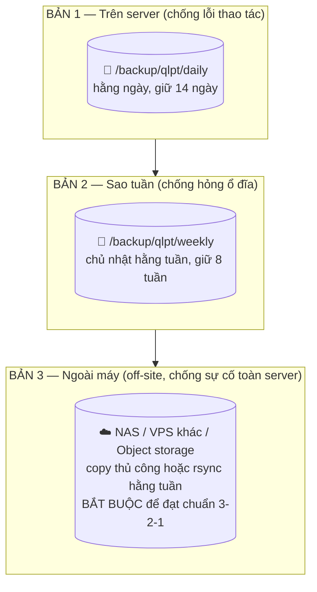
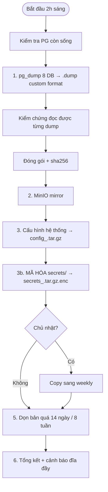
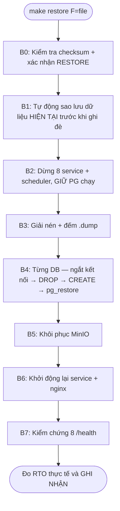

# CHƯƠNG 5 — DỮ LIỆU: SAO LƯU & KHÔI PHỤC

> "Bản sao lưu không được kiểm chứng thì **không phải** bản sao lưu."
> Chương này đi sâu vào 3 script vận hành thật trong repo:
> `scripts/03-backup.sh` (sao lưu), `04-restore.sh` (khôi phục),
> `05-verify-backup.sh` (kiểm chứng hằng tuần).

---

## 5.1. Vì sao sao lưu là vấn đề của ĐIỆN TOÁN ĐÁM MÂY

Trong mô hình đám mây, dữ liệu nằm trên hạ tầng **không do người dùng sở hữu vật lý**.
Hệ quả:

| Đặc trưng đám mây | Hệ quả với dữ liệu | Bắt buộc phải có |
|---|---|---|
| **Resource pooling** | Nhiều người dùng chung ổ đĩa | Sao lưu định kỳ + cô lập dữ liệu |
| **Rapid elasticity** | Container bị thay thế bất cứ lúc nào | Dữ liệu **không** đặt trong container |
| **Measured service** | Dịch vụ có thể bị thu hồi | Bản sao ngoài máy (off-site) |
| **Ảo hóa** | Volume ảo hỏng theo hạ tầng gốc | Chiến lược 3-2-1 |

> Dù chạy self-hosted, tư duy phải là **khách hàng của chính hạ tầng mình**:
> PostgreSQL chết, ổ đĩa hỏng, container trôi — dữ liệu phải sống sót qua tất cả.

### 5.1.1. RPO và RTO của hệ thống

| Thuật ngữ | Công thức | Giá trị đặt mục tiêu | Ý nghĩa nghiệp vụ |
|---|---|---|---|
| **RPO** | Mất tối đa bao nhiêu dữ liệu | **24 giờ** (sao lưu 2h sáng) | Mất nhiều nhất 1 ngày giao dịch |
| **RTO** | Mất bao lâu để chạy lại | **< 60 phút** | Khách thuê vẫn trả tiền đúng hạn |


### 5.1.2. Thứ gì **cần** sao lưu (và thứ gì không)

| Thành phần | Sao lưu? | Vì sao |
|---|---|---|
| 8 database PostgreSQL | ✅ **Có** | Dữ liệu nghiệp vụ: hợp đồng, hóa đơn, tiền |
| File trong MinIO (ảnh CCCD, sự cố) | ✅ **Có** | Không có thì hồ sơ người thuê thiếu ảnh |
| Cấu hình (`docker-compose.yml`, `.env`, `infra/`) | ✅ **Có** | Để dựng lại hệ thống từ đầu |
| `secrets/` (bí mật) | ✅ **Có, MÃ HÓA** | Mất thì khôi phục xong không dùng được |
| Docker image | ❌ Không | Build lại được từ Dockerfile + registry |
| Redis (cache) | ❌ Không | Data phụ, tự dựng lại được |
| Thư mục code `services/` | ⚠️ Khác | Đã có trong git — không cần nằm trong backup DB |

> ⭐ **Bài học quan trọng nhất của chương:** sao lưu database mà **không** kèm
> `secrets/` thì khôi phục xong ra một đống dữ liệu **không dùng được**:
> thiếu `jwt_secret.txt` → không ai đăng nhập được; thiếu `data_encryption_key`
> → toàn bộ số CCCD đã mã hóa **không giải mã được**. (Xem chi tiết chương 6.)

---

## 5.2. Chiến lược 3-2-1 trong dự án



> **Thành thật để chấm điểm tốt:** dự án tự động hóa bản 1 và 2; bản 3 (ngoài máy)
> được mô tả và có lệnh hướng dẫn nhưng yêu cầu máy thứ hai — trình bày rõ
> "bản 3 làm bằng tay/rsync" sẽ được đánh giá cao hơn việc giả vờ đã có.

---

## 5.3. Script sao lưu (03-backup.sh) — 6 bước

### 5.3.1. Sơ đồ luồng



### 5.3.2. Các quyết định kỹ thuật đáng nói khi bảo vệ

| Quyết định | Lý do |
|---|---|
| `pg_dump -Fc -Z6` (custom format) | Nén sẵn, **không phụ thuộc phiên bản PostgreSQL** khi restore, `pg_restore` đọc trực tiếp được |
| `--no-owner --if-exists` | Khôi phục được trên máy khác / sau khi DROP |
| **Kiểm chứng ngay trong lúc backup** (`pg_restore -l`) | Nếu dump sinh ra đã hỏng thì **dừng cả tiến trình**, không tạo bản sao lưu "ảo" |
| `sha256sum` đi kèm mỗi archive | Phát hiện file hỏng/học sinh sửa tay trước khi restore |
| **Sao lưu bí mật luôn MÃ HÓA** | File sao lưu đi nhiều nơi — ai có file là có mật khẩu DB nếu không mã hóa |
| Backup phải chạy **trong tmux/cron**, ghi log riêng | Không phụ thuộc phiên SSH của người vận hành |

### 5.3.3. Cài cron (đã có trong chương 4)

```bash
0 2 * * *  cd /opt/qlpt && bash scripts/03-backup.sh >> /var/log/qlpt/backup.log 2>&1
```

Và kiểm tra sáng hôm sau:

```bash
grep "SAO LƯU HOÀN TẤT" /var/log/qlpt/backup.log | tail -3
```

---

## 5.4. Script khôi phục (04-restore.sh) — 7 bước an toàn

### 5.4.1. Luồng



### 5.4.2. Vì sao thiết kế như vậy

| Bước | Ý nghĩa an toàn |
|---|---|
| **Bắt buộc gõ `RESTORE`** | Ngăn thao tác nhầm — script ghi đè toàn bộ dữ liệu |
| **Tự sao lưu trước** | Nếu file khôi phục hỏng, vẫn còn dữ liệu cũ quay lại |
| **Dừng app, giữ PG chạy** | Không ai ghi thêm vào DB trong lúc restore — tránh xung đột |
| **`pg_terminate_backend`** | PostgreSQL không cho DROP database đang có kết nối |
| **`--clean --if-exists`** | Restore chồng lên được nếu DROP thất bại |
| **Kiểm chứng 8 /health cuối** | Khôi phục mà service không chạy = không xong việc |

### 5.4.3. Thực hành bắt buộc

```bash
# Khôi phục file bản mới nhất hôm qua
make restore F=/backup/qlpt/daily/qlpt_full_$(date -d yesterday +%Y%m%d)_020000.tar.gz
```

> Sau khi khôi phục, **chạy ngay** `make test-int`. Smoke test sẽ phát hiện
> nhanh nhất các lỗi "dữ liệu có nhưng không dùng được" (token, CCCD, số dư).

---

## 5.5. Script kiểm chứng (05-verify-backup.sh) — chạy hằng tuần

### 5.5.1. Tại sao phải "thực sự restore" chứ không chỉ `ls`

Một bản sao lưu **được** coi là hợp lệ khi **restore thật vào database tạm
và dữ liệu đọc được**. Script `05` làm đúng điều đó:

```
1. Kiểm tra checksum
2. Tạo database TẠM _verify_<timestamp>
3. pg_restore dữ liệu vào đó
4. Đếm: số bảng > 0 ? số dòng > 0 ?
5. Restore mỗi DB vào DB tạm riêng → đếm bảng/dòng
6. In RTO đo được: "restore 1 DB mất Xs → toàn hệ thống ~Y"
7. Xóa hết DB tạm (không làm bẩn hệ thống thật)
```

### 5.5.2. Kết quả mong đợi

```text
  ✅ TẤT CẢ 8 DATABASE KHÔI PHỤC THÀNH CÔNG
  RTO đo được (restore 1 DB): ~40s
  RTO ước tính (toàn hệ thống): ~450s
```

> **Số liệu vàng cho báo cáo:** RTO đo được trong `05` là số **thực tế**,
> không phải ước lượng lý thuyết. Giám khảo rất ấn tượng với con số này.

### 5.5.3. Cron chủ nhật

```bash
0 3 * * 0  cd /opt/qlpt && bash scripts/05-verify-backup.sh >> /var/log/qlpt/verify.log 2>&1
# nếu exit code 1 (FAIL) → gửi cảnh báo tới email người vận hành:
0 3 * * 0  cd /opt/qlpt && bash scripts/05-verify-backup.sh || mail -s "⚠️ BACKUP FAIL" ops@qlpt.local < /var/log/qlpt/verify.log
```

---

## 5.6. Phục hồi theo thời điểm (Point-in-Time Recovery)

Ngoài bản sao lưu hằng đêm, PostgreSQL có WAL (Write-Ahead Log) — ghi lại
**từng thay đổi**:


```bash
# Bật archive_mode trong postgresql.conf của container PG
# (bỏ comment trong docker-compose nếu cần, đây là mở rộng)
ALTER SYSTEM SET archive_mode = on;
ALTER SYSTEM SET archive_command = 'test ! -f /wal-archive/%f && cp %p /wal-archive/%f';
```

> Dự án hiện thực RPO 24h (đủ cho đồ án). PITR là **hướng mở rộng** để đạt
> RPO phút — nói rõ điều này khi bảo vệ: "với quy mô nhà trọ, chi phí PITR
> không đáng; khi lên 2.000 phòng sẽ bật".

---

## 5.7. Diễn tập khôi phục (Disaster Recovery Drill)

> "Không diễn tập thì lúc thật sự hỏng, con người sẽ hoảng."

| Bước | Thao tác | Thời gian |
|---|---|---|
| 1 | `make backup` | 5 phút |
| 2 | Chọn 1 container ngẫu nhiên `docker compose stop billing` | 1 phút |
| 3 | Kiểm tra nginx có chuyển request sang bản khác / báo 503 | 2 phút |
| 4 | Khôi phục lại `docker compose start billing` | 1 phút |
| 5 | `make restore F=<bản tối qua>` lên máy test | 10 phút |
| 6 | `make test-int` trên máy test | 2 phút |
| 7 | Ghi lại RTO đo được vào sổ vận hành | — |

---

## 5.8. Tổng kết chương

1. Sao lưu **8 DB + MinIO + cấu hình + bí mật (mã hóa)** — thiếu 1 thứ là không đủ.
2. Chiến lược **3-2-1**: 3 bản, 2 loại phương tiện, 1 ngoài máy.
3. `03-backup.sh` tự **kiểm chứng ngay trong lúc backup**, sinh checksum.
4. `04-restore.sh` an toàn: checksum → xác nhận → sao lưu trước → kiểm chứng sau.
5. `05-verify-backup.sh` **restore thật vào DB tạm** hằng tuần — đo RTO thực tế.
6. Tick cron: backup 2h sáng, verify chủ nhật 3h sáng.

→ Chương tiếp theo: **bảo mật** — bảo vệ dữ liệu và quyền truy cập.