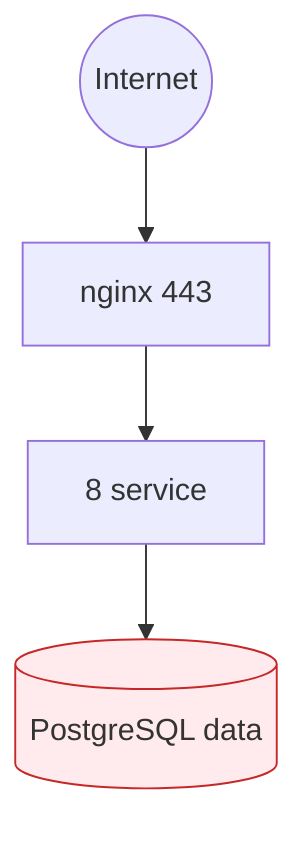
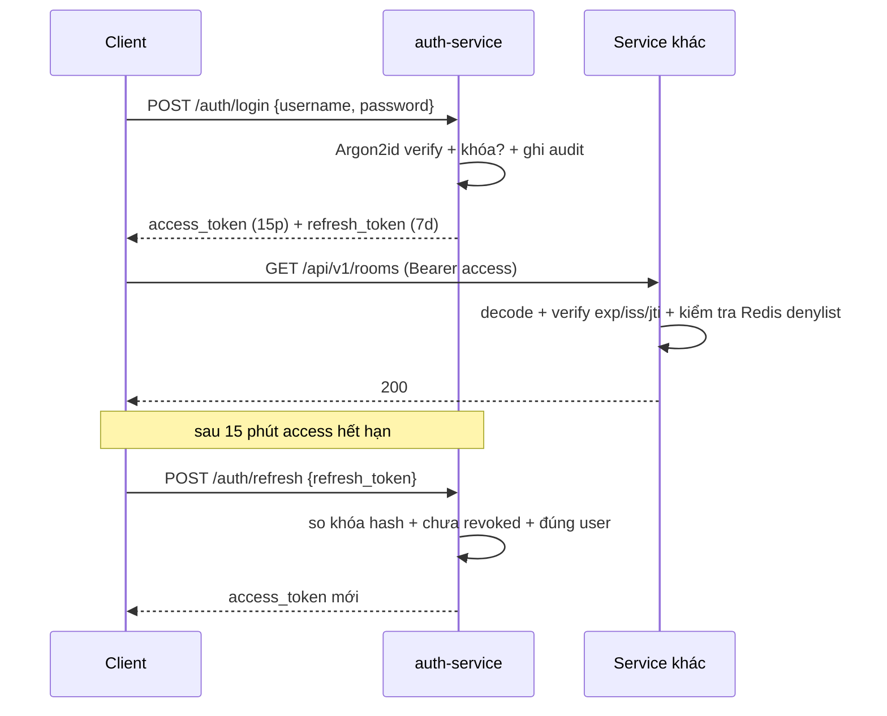
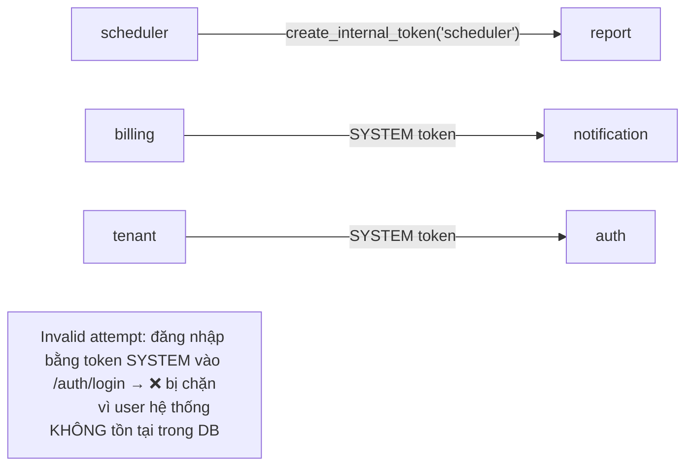
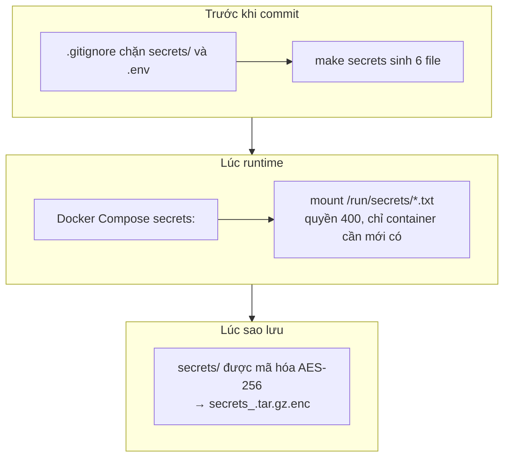

# CHƯƠNG 6 — BẢO MẬT

> Bảo mật trong microservice KHÔNG chỉ là "có mật khẩu". Nó là kỷ luật xuyên
> suốt 8 database, hàng chục endpoint nội bộ, và dữ liệu nhạy cảm nhất của
> người thuê: **số CCCD**. Chương này đi theo mô hình *defense in depth*:
> chặn từ mạng → chặn ở ứng dụng → bảo vệ ngay cả khi DB bị lộ.

---

## 6.1. Mô hình mối đe dọa (Threat Model)

| Kẻ tấn công | Mục tiêu khả dĩ | Vectơ chính |
|---|---|---|
| **Script kiddie** ngoài Internet | Quét cổng, thử payload SQLi/NoSQLi | Cổng public 80/443/3000 |
| **Người thuê tò mò** | Xem hóa đơn/công nợ người khác | Gọi API bằng token của mình, đổi `tenant_id` |
| **Người trong nội bộ** (quản lý cũ, nhân viên) | Trục lợi: xóa nợ, sửa hợp đồng | API có quyền rộng |
| **Kẻ chiếm container** (qua lỗ hổng app) | Đọc DB, đọc bí mật | RCE trong 1 service → leo thang |
| **Kẻ trộm dữ liệu** (DB minh bạch bị lộ) | Đọc CCCD, số điện thoại | Lấy được file dump / ổ cứng |

Từ bảng trên rút ra **3 tuyên bố bảo vệ** mà thiết kế phải đáp ứng:

1. **Attacker không qua được cổng công khai** → nginx + rate limit + WAF-lite.
2. **Attacker chiếm được 1 service cũng không truy cập được DB** → tách mạng.
3. **Attacker lấy được nguyên cả database cũng không đọc được CCCD** →
   mã hóa tầng ứng dụng (mục 6.6).

---

## 6.2. Phòng thủ tầng mạng (đã thiết kế chương 3)

| Lớp | Cơ chế | Chặn được |
|---|---|---|
| Cổng | UFW chỉ mở 80/443/3000 (chương 4) | Quét cổng, tấn công trực tiếp DB |
| Mạng Docker | 3 network `edge/app/data`; data **internal: true** | Container lộ trong app không chạm được PG |
| Gateway | nginx rate limit theo IP + zone (`10 r/s`) | Brute-force login, bơm request |
| TLS | HTTPS bắt buộc, redirect HTTP→HTTPS | Nghe lén, MITM |



---

## 6.3. Xác thực (Authentication)

### 6.3.1. Băm mật khẩu — Argon2id

```python
# services/common/security.py
_hasher = PasswordHasher(
    time_cost=3,         # 3 vòng lặp
    memory_cost=65536,   # 64 MB bộ nhớ — chống tấn công GPU
    parallelism=4,
    hash_len=32, salt_len=16,
)
```

| Thuật toán | Đánh giá | Kết luận |
|---|---|---|
| MD5 / SHA-1 | Băm "nhanh" → GPU brute-force hàng tỷ/s | ❌ Cấm |
| bcrypt | Chậm cố ý, nhưng **giới hạn 72 byte đầu vào** | 🟡 Được, nhưng có giới hạn |
| **Argon2id** | Chậm + chống side-channel + không giới hạn độ dài | ✅ **OWASP khuyến nghị** |

### 6.3.2. Chính sách mật khẩu theo NIST SP 800-63B

| Quy tắc | Áp dụng |
|---|---|
| Độ dài quan trọng hơn độ phức tạp | `≥ 8 ký tự`, có chữ + số (`PASSWORD_PATTERN` trong auth/schemas.py) |
| Không ép đổi mật khẩu định kỳ | Theo NIST: ép đổi định kỳ làm giảm an toàn |
| Khóa tài khoản sau 5 lần sai | `MAX_FAILED_LOGINS=5`, khóa 15 phút (`LOCK_DURATION_MINUTES`) |
| Thông báo lỗi chung chung | "Sai tên đăng nhập hoặc mật khẩu" — **không** tiết lộ username tồn tại |
| Kiểm tra thời lượng brute-force | Đếm số lần thất bại gần đây theo IP tài khoản |

### 6.3.3. JWT — cấu trúc và vòng đời

```
Header  {"alg":"HS256","typ":"JWT"}
Payload {"sub":<uuid>, "username":"admin", "role":"ADMIN",
         "property_id":<uuid>, "jti":<uuid>, "iss":"qlpt",
         "iat":..., "exp":... }
```

| Thuộc tính | Giá trị | Ý nghĩa bảo mật |
|---|---|---|
| `sub` | UUID của user | Không lộ username, chuẩn JWT |
| `role` | ADMIN/MANAGER/TENANT/SYSTEM | Dùng cho RBAC (6.4) |
| `property_id` | UUID cơ sở | **Scope dữ liệu** — quản lý không xem được cơ sở khác |
| `jti` | UUID mỗi token | Thu hồi nhanh qua Redis denylist |
| `exp` | 15 phút (access) | Giảm thiểu hậu quả token bị đánh cắp |
| Refresh token | 7 ngày, **lưu hash** ở DB | Không lưu bản rõ — bị lộ DB không dùng lại được |



> **Tại sao access token ngắn mà không gọi DB mỗi lần?** Microservice
> stateless: service chỉ cần verify chữ ký JWT (nhanh), không cần `SELECT user`.
> Token 15 phút giới hạn "cửa sổ lạm dụng" nếu bị đánh cắp. Logout chủ động
> đưa `jti` vào Redis denylist → vô hiệu **ngay lập tức**, không chờ hết hạn.

---

## 6.4. Phân quyền (Authorization) — RBAC

### 6.4.1. Ma trận vai trò

| Vai trò | Permission tiêu biểu | Ghi chú |
|---|---|---|
| **ADMIN** | `*` (toàn quyền) | Không bị ràng buộc `property_id` |
| **MANAGER** | `room:read/write`, `tenant:read/write`, `contract:*`, `billing:*`, `maintenance:*`, `report:read` | Bị ràng buộc đúng **1 cơ sở** |
| **TENANT** | `own_invoice:read/pay`, `own_contract:read`, `room_available:read`, `incident:create/read_own` | Chỉ dữ liệu **của mình** |
| **SYSTEM** | `*` (chỉ cho job nội bộ) | **Không đăng nhập được** (6.5) |

```python
# auth/schemas.py — quyền khai báo theo vai trò
"MANAGER": ["room:read", "room:write", "tenant:read", "tenant:write", ...],
"TENANT":  ["own_invoice:read", "own_invoice:pay", "own_contract:read", ...],
```

### 6.4.2. Chặn ở hai tầng

```python
# Tầng 1 — vai trò: endpoint yêu cầu đúng role
@room_router.get("", ...)
async def list_rooms(
    user: Annotated[CurrentUser, Depends(require_roles(Role.ADMIN, Role.MANAGER))],
    ...
):
    # Tầng 2 — phạm vi dữ liệu: `effective = _resolve_property(user, property_id)`
    # Manager bấm truy cập cơ sở khác → bị ép về cơ sở của mình (không phải 404
    # để không lộ thông tin về sự tồn tại).
```

| Tầng | Chặn gì | Ví dụ |
|---|---|---|
| **Vai trò** (role) | Gọi endpoint không thuộc quyền | TENANT gọi `GET /rooms` → **403** |
| **Phạm vi** (scope) | Truy cập dữ liệu ngoài phạm vi | MANAGER cơ sở A gọi `?property_id=<B>` → bị ép về A |

> **Điểm hay bị hỏi:** tại sao không chỉ check role rồi cho qua?
> Vì lỗi bảo mật phổ biến nhất trong ứng dụng có khái niệm "đơn vị" (nhà trọ,
> công ty con) là **IDOR** — người dùng hợp lệ đọc dữ liệu của đơn vị khác
> bằng cách đổi ID trong URL. Phải check cả **vai trò** lẫn **phạm vi**.

---

## 6.5. ⭐ Token nội bộ SYSTEM — nút sống của 8 service

### 6.5.1. Bài toán

Database-per-service: hóa đơn nằm ở `db_billing`, báo cáo cần đọc ở `db_report`
mà **không được phép kết nối thẳng** sang database khác. Service gọi nhau qua
API nội bộ (`/internal/v1/...`) — nhưng ai xác thực cho 2 service nói chuyện
với nhau?

### 6.5.2. Giải pháp

```python
def create_internal_token(caller: str | None = None) -> str:
    name = caller or settings.service_name
    return create_access_token(
        user_id=uuid.uuid5(uuid.NAMESPACE_DNS, f"qlpt-service.{name}"),
        username=f"system:{name}",
        role=Role.SYSTEM,
    )
```

| Thiết kế | Lý do |
|---|---|
| `role=SYSTEM` | Endpoint nội bộ yêu cầu `require_roles(Role.SYSTEM)` |
| **`sub` tất định** bằng `uuid5(NAMESPACE_DNS, "qlpt-service.<tên>")` | Cùng service luôn mang cùng `sub` — đọc log biết ngay **ai** gọi; không cần tra bảng |
| Quyền `*` | Scheduler/job nền cần đọc nhiều service |
| **Không tạo user SYSTEM trong DB** | User trong DB = "con đường tấn công" — có mật khẩu, có thể brute-force. Token nội bộ sinh **từ secret chứ không phải từ DB**, không ai đăng nhập bằng nó |



### 6.5.3. Vì sao "SYSTEM không có user trong DB" là quyết định đúng

Bản vẽ ban đầu có tạo bảng user `SYSTEM` trong `db_auth` để "có chủ cho log".
Đã **gỡ bỏ có chủ đích**:

| Cách cũ (user SYSTEM trong DB) | Cách mới (token nội bộ) |
|---|---|
| Có mật khẩu băm trong DB | Không có mật khẩu nào cả |
| Có thể bị brute-force / phish | Không có credential để tấn công |
| Ai có quyền QUẢN LÝ user là có thể khóa/đổi mật khẩu SYSTEM → phá hệ thống | An toàn khỏi mọi thao tác user-level |
| Mỗi service dùng chung 1 user → log không phân biệt được | `sub` tất định → log phân biệt chính xác từng service |

> **Đây là "mặt tấn công không tồn tại"** — một trong những khác biệt kỹ thuật
> tốt nhất để trình bày khi bảo vệ đồ án.

---

## 6.6. ⭐ Mã hóa số CCCD — bảo vệ dữ liệu ở tầng ứng dụng

### 6.6.1. Vì sao mã hóa ngay cả khi DB bị lộ

Luật bảo vệ dữ liệu cá nhân (Việt Nam) coi số CCCD là dữ liệu cá nhân nhạy cảm.
Thiết kế mục tiêu: **kẻ trộm lấy được file dump database vẫn không đọc được
số CCCD** — đây gọi là *defense in depth*: mã hóa không phụ thuộc vào việc
lớp DB có an toàn hay không.

### 6.6.2. Thuật toán — AES-256-GCM trong `common/crypto.py`

```python
# Định dạng lưu:  "v1$" + base64( nonce(12) || ciphertext || tag(16) )
ct = cipher.encrypt(nonce, plaintext.encode("utf-8"), None)
return f"v1${base64.urlsafe_b64encode(nonce + ct).decode('ascii')}"
```

| Quyết định | Lý do |
|---|---|
| **GCM thay vì CBC** | CBC: cùng plaintext + IV cố định → cùng ciphertext → attacker biết "2 người trùng CCCD"; sửa ciphertext vẫn giải mã ra rác. GCM: tag 16 byte → **sửa 1 byte là giải mã thất bại ngay** (toàn vẹn + bí mật) |
| **Nonce ngẫu nhiên 12 byte mỗi lần** | Dùng lại nonce với cùng khóa trong GCM là lỗi nghiêm trọng |
| **Tiền tố phiên bản `v1$`** | Đổi thuật toán/khóa sau này vẫn giải mã dữ liệu cũ (giống `schema_version` của event) |
| **Khóa từ Docker secret `data_encryption_key.txt`** | Không nằm trong code, không nằm trong DB |
| **Thiếu khóa thì FAIL LOUD** | Không âm thầm sinh khóa mới mỗi lần restart — làm vậy là mất luôn dữ liệu cũ |

### 6.6.3. Blind index — vẫn tìm kiếm được trên dữ liệu đã mã hóa

Vấn đề: ciphertext của cùng 1 CCCD **khác nhau mỗi lần mã hóa** (do nonce),
nên `WHERE id_card_enc = ?` không bao giờ khớp → không chống được trùng CCCD.

Giải pháp: thêm cột **blind index** = HMAC-SHA256(khóa tách riêng, CCCD chuẩn hóa).

```python
# models.py — chỉ gán qua setter để không thể quên blind index
def set_id_card(self, plain: str | None) -> None:
    self.id_card_enc  = encrypt(plain)     # ciphertext AES-256-GCM
    self.id_card_bidx = blind_index(plain) # HMAC ngắn gọn để tra cứu
    self.id_card_last4 = plain[-4:]        # hiển thị "****1234"
```

| Cột | Vai trò |
|---|---|
| `id_card_enc` | Bản rõ đã mã hóa — **không ai đọc được nếu không có khóa** |
| `id_card_bidx` | Duy nhất + có index → `WHERE id_card_bidx = ?` nhanh, chống trùng |
| `id_card_last4` | Hiển thị cho người vận hành mà không cần giải mã |

> **Đánh đổi phải nói rõ khi bảo vệ:** blind index làm lộ "2 hàng có cùng
> CCCD" và độ dài plaintext — chấp nhận được vì cần chống trùng CCCD; KHÔNG
> dùng kỹ thuật này cho email (tìm kiếm không chính xác). Đây là phân tích
> trung thực, giám khảo đánh giá cao.

### 6.6.4. Vòng đời khóa

```bash
# Kiểm tra vân tay khóa hiện tại (đối chiếu khi nghi đổi khóa nhầm)
docker compose exec tenant python -c "from common.crypto import key_fingerprint; print(key_fingerprint())"
# a3f1c9e2 — nếu thay đổi mà chưa re-encrypt → CẢNH BÁO dữ liệu cũ không đọc được
```

| Việc | Thao tác | Rủi ro nếu làm sai |
|---|---|---|
| Đổi khóa | Ghi khóa mới vào secret, **viết script re-encrypt toàn bộ** rồi mới swap | Mất luôn dữ liệu đã mã hóa bằng khóa cũ |
| Sao lưu khóa | Nằm trong `secrets/*.tar.gz.enc` của backup (chương 5) | Mất khóa = mất dữ liệu |

---

## 6.7. Quản lý bí mật



| Nguyên tắc | Hiện thực |
|---|---|
| Không đặt bí mật trong image | `secrets:` của Compose mount khi **chạy**, không nằm trong layer image |
| Không đặt bí mật trong git | `.gitignore` cấm `secrets/` + `.env` |
| Chỉ container cần mới có | tenant-service là service duy nhất mount `data_encryption_key` |
| Bí mật nhạy cảm nhất được mã hóa khi sao lưu | `backup_passphrase.txt` + `age`/`openssl enc` (chương 5) |
| Log không in bí mật | Khi log chỉ in 4 ký tự cuối (`***7f41`) |

---

## 6.8. TLS & các header an toàn

```nginx
# infra/nginx/conf.d/app.conf (trích)
server {
    listen 443 ssl;
    http2 on;
    ssl_protocols TLSv1.2 TLSv1.3;
    ssl_ciphers ECDHE-ECDSA-AES128-GCM-SHA256:...;
    ssl_session_cache shared:SSL:10m;
    ssl_stapling on;
    # Chỉ mở cho mạng nội bộ: /docs, /redoc, /openapi.json
    location ~ ^/(docs|redoc|openapi.json)$ {
        allow 127.0.0.1; allow 10.0.0.0/8; allow 192.168.0.0/16; deny all;
        proxy_pass http://api_docs;
    }
}
```

| Biện pháp | Chặn được |
|---|---|
| HTTPS bắt buộc + TLS 1.2/1.3 | Nghe lén, hạ cấp SSL |
| Swagger docs chỉ mở trong mạng nội bộ | Rò rỉ toàn bộ hợp đồng API ra Internet |
| Rate limit từng zone (auth chặt hơn) | Brute-force, bot |
| `X-Request-ID` xuyên service | Truy vết (mục 7.3) |

---

## 6.9. Hardening container (chi tiết ở chương 3)

Tóm tắt 6 mệnh lệnh:
1. Multi-stage build → image nhỏ, không chứa trình biên dịch.
2. Chạy bằng **user thường** (không root).
3. `cap_drop: ALL` + `no-new-privileges: true`.
4. `read_only: true` FS gốc + tmpfs cho /tmp.
5. Giới hạn CPU/RAM — **blast radius** cho 1 container bị chiếm.
6. Quét Trivy hàng tuần, rebuild có CVE.

### 6.9.1. Nhật ký vá CVE (Trivy, image `qlpt-auth`)

Hai thư viện Python có lỗ hổng đã được nâng cấp và rebuild image:

| Thư viện | Trước | Sau | Lỗ hổng đã vá |
|---|---|---|---|
| PyJWT | 2.10.1 | **2.14.0** | CVE-2026-102268 (**CRITICAL**) + 102267/102271/32597/48526 |
| python-multipart | 0.0.20 | **0.0.30** | CVE-2026-24486/42561/53539 (DoS) |

Kết quả sau rebuild: nhóm Python giảm từ **14 HIGH, 1 CRITICAL** xuống
**7 HIGH, 0 CRITICAL**. Phần còn lại là `cryptography` 44.0.0 và `starlette`
0.41.3 — chưa nâng vì `starlette` bị ràng buộc bởi FastAPI 0.115.6, ghi nhận là
hướng khắc phục tiếp theo. Số HIGH của hệ điều hành (Debian base image) là CVE
upstream, xử lý bằng rebuild định kỳ khi base image phát hành bản vá.

---

## 6.10. Chống lạm dụng cấp ứng dụng

| Cơ chế | Nằm ở đâu | Chống gì |
|---|---|---|
| Rate limit nginx theo IP | nginx | Bơm request, brute-force |
| Idempotency (khóa nghiệp vụ + outbox) | common/eventbus | Gửi tin nhắn/đặt cọc lặp lại |
| DLQ + retry có backoff | RabbitMQ | Sự cố thoáng qua, event lỗi |
| Kiểm tra quyền trên **cả 2 tầng** (role + scope) | mọi service | IDOR, leo quyền |
| Audit log (user.logged_in, contract.created…) | mỗi service | Truy vết ai làm gì khi có sự cố |

---

## 6.11. Hộp thoại giả định khi bảo vệ

**Hỏi:** "JWT bị lấy cắp thì sao?"
**Trả lời:** Access token chỉ sống 15 phút, `jti` nằm trong Redis denylist khi
logout. Attacker có ~15 phút cửa sổ — giới hạn thiệt hại. Khi nghi ngờ: xoay
`jwt_secret` → mọi token cũ chết ngay.

**Hỏi:** "Sao không dùng TLS cho nội bộ service-to-service?"
**Trả lời:** Mạng `qlpt-app` là bridge riêng, không có gateway ra Internet
(xem 3.2.3). Bảo mật nội bộ dựa vào cô lập mạng + token SYSTEM. Nếu chạy trên
mạng nhiều tenant, thêm mTLS — ghi chú là hướng mở rộng.

**Hỏi:** "CCCD mã hóa rồi mà vẫn có cột `last4`?"
**Trả lời:** `last4` cố ý — nhân viên cần đối chiếu "đúng người" qua 4 số cuối
mà không phải giải mã từng phiếu. Giá trị 4 số cuối không đủ để giả mạo CCCD
(thông tin nhận diện đầy đủ vẫn mã hóa).

---

## 6.12. Checklist bảo mật & tổng kết

- [ ] UFW chỉ mở 80/443/3000
- [ ] SSH: mật khẩu tắt, root tắt, key ed25519
- [ ] `.gitignore` chặn `secrets/`, `.env` — kiểm tra `git status` trắng
- [ ] `jwt_secret` ≥ 32 ký tự; token access 15 phút
- [ ] Khóa tài khoản sau 5 lần sai; thông báo chung chung
- [ ] RBAC: role + phạm vi property; không IDOR
- [ ] TENANT chỉ thấy dữ liệu của mình; `/rooms` chặn TENANT (smoke test kiểm tra)
- [ ] Endpoint `/internal/*` yêu cầu SYSTEM token
- [ ] CCCD mã hóa AES-256-GCM + blind index; khóa nằm trong secret
- [ ] Backup bí mật mã hóa (`backup_passphrase`)
- [ ] Container non-root, cap_drop, read_only, resource limit
- [ ] Trivy HIGH/CRITICAL = 0

→ Chương tiếp theo: **vận hành, hiệu năng & mở rộng**.