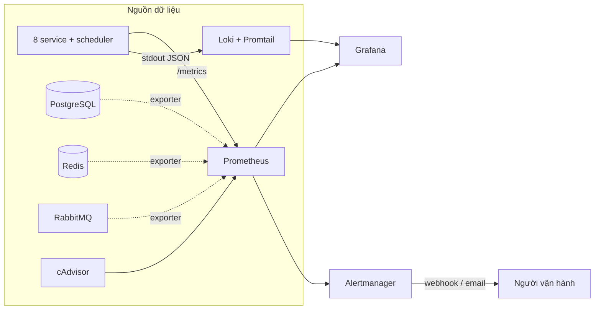
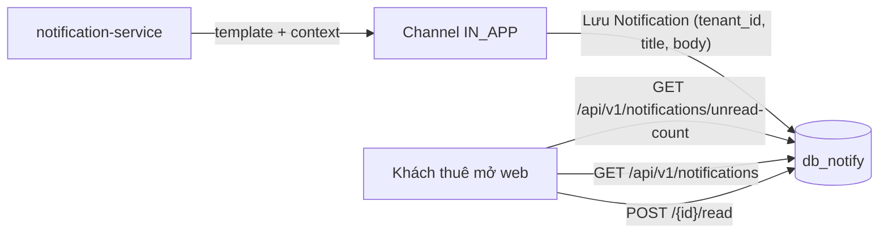

# CHƯƠNG 7 — VẬN HÀNH, HIỆU NĂNG & MỞ RỘNG

> "Xây 21 container là 30% công việc. 70% còn lại là **giữ nó chạy, đo lường
> được, và mở rộng khi cần**." Chương này trả lời 3 câu hỏi:
> ① Làm sao biết hệ thống khỏe? ② Làm sao chứng minh SLA? ③ Mở rộng thế nào?

---

## 7.1. Giám sát 3 tầng: Metric – Log – Trace

### 7.1.1. Bộ ba Prometheus + Grafana + Loki



| Tầng | Công cụ | Trả lời câu hỏi |
|---|---|---|
| **Metric** (số) | Prometheus scrape `/metrics` mỗi 15s | "Bây giờ có bao nhiêu request? p95 bao nhiêu?" |
| **Log** (chữ) | Loki gom stdout JSON | "Lúc 14:32:17 có lỗi gì ở billing?" |
| **Trace** (chuỗi) | `X-Request-ID` xuyên service | "Request X đi qua những service nào, mất bao lâu?" |

> **Dashboard Grafana được provision tự động** (`infra/grafana/provisioning`) —
> mở Grafana là có sẵn dashboard, không cần vẽ tay từng panel. Đây là điểm
> hay khiến giám khảo "bấm vào xem thử" được ngay.

### 7.1.2. Những panel quan trọng nhất

| Panel | Công thức | Ý nghĩa khi bảo vệ |
|---|---|---|
| Số request/giây theo service | `rate(http_requests_total[5m])` | Đỉnh load lúc nào |
| p95 latency | `histogram_quantile(0.95, ...)` | Chứng minh SLA |
| % lỗi 5xx | `rate(http_errors[5m]) / rate(requests[5m])` | Phát hiện thoái hóa |
| Memory/CPU theo container | `container_memory_usage_bytes` | Service nào "ăn" nhiều |
| Công nợ quá hạn | Từ `db_exporter` OR dashboard nghiệp vụ | Cảnh báo doanh thu |

### 7.1.3. Truy vết bằng `X-Request-ID`

```nginx
proxy_set_header X-Request-ID $request_id;   # nginx sinh 1 ID cho mỗi request
```

Log của **mọi service** ghi kèm `request_id` → khi khách phàn nàn "hôm qua tôi
bấm mà không thấy", người vận hành chỉ cần:

```bash
docker compose logs --since 2d | grep "<request_id>"
```

Thấy đúng chuỗi hành trình của request đó qua 3 service trong 0,2 giây.

---

## 7.2. SLO & cảnh báo

| Chỉ số | Mục tiêu (SLO) | Đo ở đâu |
|---|---|---|
| Availability | 99,5% tháng | Healthcheck + Prometheus `up` |
| API đọc | p95 < 300 ms | Prometheus histogram |
| API ghi | p95 < 500 ms | Prometheus histogram |
| Tỷ lệ lỗi | < 1% | Prometheus counters |
| Sao lưu | 100% ngày | Cron log + verify chủ nhật |

**Quy tắc cảnh báo** (`infra/prometheus/rules/`):

| Quy tắc | Ngưỡng | Hành động |
|---|---|---|
| Service chết | `up == 0` trong 1 phút | Alert `P1` — gọi ngay |
| p95 vượt ngưỡng | > 300 ms trong 5 phút | Alert `P2` — xem Grafana |
| Đĩa đầy | < 10 GB còn trống | Alert `P2` — dọn backup |
| Công nợ quá hạn tăng | delta > 0 với kỳ trước | Alert `P3` — nhắc thu tiền |

---

## 7.3. Kiểm thử tải bằng k6 — chứng minh SLA

### 7.3.1. Kịch bản (`k6/smoke.js`)

```bash
make loadtest
# = docker run --rm --network qlpt_app -v $(pwd)/k6:/scripts \
#      grafana/k6 run --vus 50 --duration 2m /scripts/smoke.js
```

| Kịch bản | Tỷ trọng | Ý nghĩa thực tế |
|---|---|---|
| Tra cứu phòng trống | 90% lưu lượng | Trang người thuê xem nhiều nhất |
| Đăng nhập | Thưa | Brute-force bị rate limit |
| Xem hóa đơn | Trung bình | CRUD có xác thực |
| Chạy tính tiền tháng | **1/20 VU** | Mô phỏng ngày mùng 1 — chỉ 1 người bấm |

### 7.3.2. Threshold = tiêu chí nghiệm thu

```javascript
thresholds: {
  'qlpt_read_latency':  ['p(95)<300', 'p(99)<800'],
  'qlpt_write_latency': ['p(95)<500', 'p(99)<1500'],
  'qlpt_error_rate':    ['rate<0.01'],
},
```

> K6 báo `✗` nếu không đạt threshold — đây là bằng chứng **có định lượng**,
> không phải "máy tôi chạy nhanh". In bảng tổng kết k6 ra báo cáo (script đã
> in sẵn `KẾT QUẢ KIỂM THỬ TẢI (K6)`).

### 7.3.3. Ai là người chịu tải giỏi nhất? Cache!

| Tầng cache | Cái gì | Hiệu quả |
|---|---|---|
| nginx `proxy_cache` | `GET /rooms/available` — 30s | Trang được xem nhiều nhất không chạm app |
| Redis | Giá ước tính theo phòng | room-service trả giá **không gọi đồng bộ** billing |
| PostgreSQL | Index + pool 10 conn | Tránh connect/disconnect mỗi request |

---

## 7.4. 🧾 Hộp thư người thuê (IN_APP)

### 7.4.1. Vì sao cần hộp thư trong ứng dụng

Gửi email/SMS có 3 vấn đề với nhà trọ: tốn phí, phụ thuộc nhà cung cấp, và
người thuê hay **không đọc**. Hộp thư trong ứng dụng (kênh `IN_APP`) giải
quyết: miễn phí, hiển thị ngay trong SPA, và có **trạng thái đã đọc** để đo
mức tiếp cận.

### 7.4.2. Kênh IN_APP hoạt động thế nào



| Endpoint | Vai trò |
|---|---|
| `GET /api/v1/notifications?channel=IN_APP` | Danh sách hộp thư |
| `GET /api/v1/notifications/unread-count` | Số chưa đọc — hiện badge trên UI |
| `POST /api/v1/notifications/{id}/read` | Đánh dấu đã đọc |

Các sự kiện nghiệp vụ tự động đưa vào hộp thư: nhắc hóa đơn sắp đến hạn,
nhắc quá hạn, hợp đồng sắp hết hạn, sự cố đã xử lý, chào mừng hợp đồng mới…

### 7.4.3. ⭐ Điểm thiết kế đáng nói

Thông báo vào hộp thư cũng đi qua **event bus + outbox** như mọi channel khác:
`billing` phát event `invoice.created` → notification-service consume → render
template → gửi theo kênh. Sự thống nhất này nghĩa là: thêm kênh mới = thêm 1
adapter, **toàn bộ luồng nghiệp vụ không đổi** (mục 7.5).

---

## 7.5. 📣 Mở rộng kênh thông báo (Adapter Pattern)

### 7.5.1. Hiện trạng — 4 kênh

| Kênh | `Channel` enum | Adapter | Trạng thái |
|---|---|---|---|
| Email | `EMAIL` | `EmailChannel` (SMTP) | Có sẵn |
| Trong ứng dụng | `IN_APP` | `InAppChannel` (DB) | Có sẵn |
| SMS | `SMS` | `SmsChannel` | Khung có sẵn, cần key nhà mạng |
| Zalo | `ZALO` | `ZaloChannel` | Khung có sẵn, cần Zalo OA |

```python
# services/notification/channels.py — PROTOCOL cho mọi kênh
CHANNELS = {"EMAIL": EmailChannel(), "IN_APP": InAppChannel(),
            "SMS": SmsChannel(),     "ZALO": ZaloChannel()}

# ...phần còn lại của hệ thống chỉ biết:
channel.send(notification=..., context=...)
```

### 7.5.2. Thêm kênh Telegram trong 3 bước — không sửa code cũ

```python
# 1. Thêm giá trị enum
class Channel(str, Enum):
    TELEGRAM = "TELEGRAM"

# 2. Thêm 1 adapter mới (kế thừa cùng protocol)
class TelegramChannel(BaseChannel):
    async def send(self, notification, context):
        # gọi bot API, template đã render sẵn
        ...

# 3. Đăng ký 1 dòng
CHANNELS["TELEGRAM"] = TelegramChannel()
```

> **Bài học kiến trúc:** kênh là **chi tiết triển khai**, nghiệp vụ là **cốt
> lõi**. Tách kênh khỏi nghiệp vụ bằng giao diện `send()` đồng nhất — giống
> cách cloud storage trừu tượng hóa S3/MinIO/GCS sau 1 interface.

### 7.5.3. `DRY_RUN` — an toàn khi khai trương

```bash
# Mặc định: BẬT. Adapter chỉ ghi log nội dung 'sẽ gửi', không gửi thật.
NOTIFICATION_DRY_RUN=true

# Muốn gửi thật: tắt ở .env rồi khởi động lại
NOTIFICATION_DRY_RUN=false
```

> Lý do: lần đầu bấm nút gửi, một lỗi template có thể gửi nhầm nội dung cho
> hàng trăm người thuê — gửi xong **không thu hồi được**. DRY_RUN cho phép
> chạy toàn bộ luồng, xem nội dung qua `/api/v1/notifications/preview`, rồi
> mới bật gửi thật.

---

## 7.6. Mở rộng theo hướng (Scalability)

### 7.6.1. Khi nào mở rộng cái gì

| Triệu chứng | Hành động |
|---|---|
| p95 đọc chậm ở `room` | Scale room-service: `make scale S=room N=2` |
| Đỉnh điểm mùng 1 (tính 200 hóa đơn) | Scale billing trước giờ cao điểm + bật cache | 
| Report dashboard chậm | **Không** scale — chạy `make reconcile` thường xuyên hơn (CQRS đã tách đọc/ghi) |
| Notification nghẽn | Scale notification + tăng `RABBITMQ_PREFETCH` |

```bash
make scale S=billing N=3
# → nginx upstream tự cân bằng tải (cấu hình upstream đã có sẵn ở chương 3)
```

### 7.6.2. Giới hạn của 1 host & con đường lên Kubernetes

| Bước | Tác động |
|---|---|
| **1 host → 2 host** (hiện tại) | Chuyển PostgreSQL thành primary + replica |
| **Nhiều host có orchestrator** (K8s/Swarm) | `deploy.replicas` phát huy thật sự, rolling + tự phục hồi |
| DB tách read/write | Billing/report đọc từ replica, ghi vào primary |
| Phân mảnh (sharding) theo cơ sở | Khi > vài nghìn phòng — `property_id` chính là key phân mảnh tự nhiên |

### 7.6.3. Vì sao CQRS giúp mở rộng dễ hơn

```
mermaid
graph LR
    subgraph WRITE["Luồng ghi (mỗi service 1 DB riêng)"]
        B[billing] --> E[(db_billing)]
    end
    subgraph READ["Read model (report)"]
        E -->|"event bus + outbox"| SY[report sync]
        SY --> R[(db_report)]
        D[dashboard] --> R
    end
```

Report-service **không đọc thẳng database người khác** mà tự xây bản sao
(read model) qua event → dashboard đọc local, nhanh; muốn mở rộng chỉ cần
scale report hoặc tăng tần suất sync. Chính là mô hình CQRS trình bày ở
chương 2.

---

## 7.7. Năng lực dự phòng (Capacity Plan)

| Ngưỡng | Dấu hiệu | Hành động |
|---|---|---|
| RAM > 70% ổn định | `docker stats` liên tục vượt | Thêm RAM hoặc giảm replicas thừa |
| CPU > 70% ở billing | Mùng 1 ai cũng chạy tính tiền | Scale billing 2–3 bản trước ngày 1 |
| Đĩa > 85% | Cảnh báo trong backup script | Dọn log, giảm retention, mở rộng ổ (LVM) |
| Minh bạch backup > 2 ngày | `05-verify-backup.sh` cảnh báo | Sửa cron, kiểm tra ổ backup |

---

## 7.8. Tổng kết chương

1. Giám sát **3 tầng** — metric (Prometheus), log (Loki), trace (`X-Request-ID`).
2. **SLO có số** — p95 < 300ms đọc, < 500ms ghi, lỗi < 1%; chứng minh bằng k6.
3. Cache đúng chỗ (nginx + Redis) là "chiến binh" chịu tải rẻ nhất.
4. **Hộp thư người thuê** (IN_APP) = kênh miễn phí, đo được mức tiếp cận.
5. **Adapter pattern** — thêm kênh Telegram/SMS/Zalo chỉ là thêm 1 lớp, nghiệp
   vụ không đổi; `DRY_RUN` bảo vệ lần khai trương.
6. Mở rộng theo dữ liệu, không phải "scale tất cả": CQRS đã tách sẵn đọc/ghi.

→ Chương tiếp theo: **kế hoạch triển khai 6 tuần**.