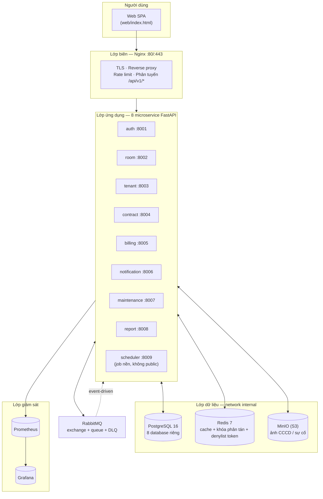
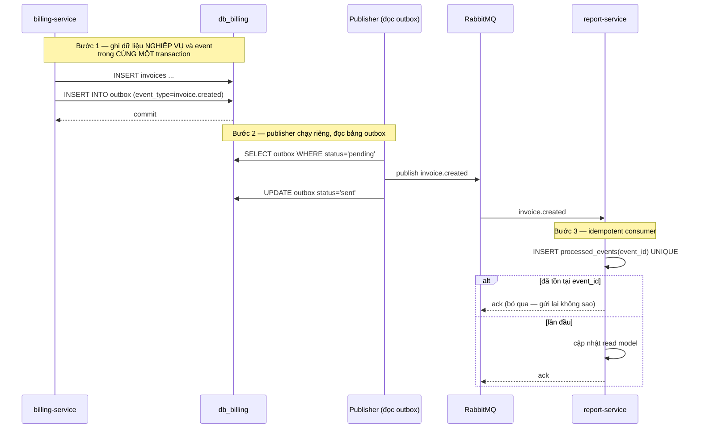

# TỔNG QUAN ĐỒ ÁN — Hệ thống quản lý phòng trọ theo kiến trúc Microservice

> **Tài liệu trình bày dành cho người hướng dẫn** (dựng từ code & hạ tầng thực tế).
> Mọi con số trong tài liệu đều lấy từ hệ thống đang chạy trên máy demo (WSL2 / Docker),
> không phải con số ước tính.
>
> Bản gốc mã nguồn: `ql-phong-tro/` · Bản triển khai thật: `/opt/qlpt` (WSL2 Ubuntu 24.04)

---

## 0. Đọc 1 trang này là đủ (tóm tắt cho người bận rộn)

| Hạng mục | Nội dung |
|---|---|
| **Đề tài** | Quản lý dãy trọ 200–500 phòng, ~2.000 người thuê (thu tiền, hợp đồng, điện nước, sự cố) |
| **Giải pháp** | Đóng vai **private cloud**: 8 microservice (FastAPI, Python 3.12) + 1 scheduler, mỗi service **một database riêng**, giao tiếp **event-driven** qua RabbitMQ |
| **Triển khai** | Docker Compose trên **1 máy duy nhất** — đang chạy thật trên laptop 8 GB (WSL2), **16 container** |
| **Kiến trúc sự kiện** | Transactional **Outbox** → RabbitMQ → **Idempotent Consumer** → **DLQ** + **Saga** + **CQRS** |
| **Bảo mật** | JWT + RBAC nhiều tầng, mã hóa CCCD AES-256-GCM + blind index, token nội bộ SYSTEM, network 4 lớp, container non-root |
| **Kiểm chứng** | Script verify 6 bước → **TẤT CẢ ĐẠT**; smoke test **26/26 PASS**; 9/9 service healthy; 16/16 container chạy |
| **Mã nguồn** | 57 file Python, **≈20.300 dòng**, **133 endpoint**, 26 bộ router API, 10 tài liệu chuyên đề |
| **Hạn chế đã biết** | Chưa có unit test; chưa chạy load test thật trên máy hiện tại; 7 lỗ hổng HIGH còn lại thuộc thư viện bên thứ ba |

---

## 1. Bài toán thực tế

### 1.1. Vấn đề của chủ dãy trọ

Một dãy trọ 200–500 phòng thường vận hành bằng **Excel + Zalo + tiền mặt**:

- Vào ngày 1 hàng tháng phải cộng chỉ số điện/nước cho **hundreds** phòng tay → sai số, mất giờ.
- Không ai trả lời được *"tháng này tôi thu được bao nhiêu, còn bao nhiêu người nợ?"*.
- Khi cần lịch sử "phòng này đã cho ai thuê, giá bao nhiêu" thì tra lại rất vất vả.
- Tin nhắn nhắc tiền gửi tay từng người, dễ quên, dễ gửi trùng.

### 1.2. Yêu cầu chức năng đã triển khai

| Nhóm nghiệp vụ | Chức năng |
|---|---|
| **Danh mục** | Cơ sở → dãy/tầng → phòng → tiện ích; tìm phòng trống theo giá/diện tích/tiện ích |
| **Người thuê** | Hồ sơ, bạn cùng phòng, lịch sử thuê; CCCD **mã hóa** |
| **Hợp đồng** | Ký mới, gia hạn, tiền cọc; hiệu lực, sắp hết hạn |
| **Thu tiền** | Biểu giá bậc thang, chỉ số điện/nước, **tính tiền tự động**, hóa đơn, thanh toán, công nợ |
| **Bảo trì** | Báo sự cố, ảnh đính kèm (MinIO), lịch bảo trì |
| **Thông báo** | Kênh dạng **adapter**: In-app / Email / SMS / Zalo, nhắc hạn & nhắc trả tiền |
| **Báo cáo** | Doanh thu, tỷ lệ lấp đầy, công nợ, dashboard tổng hợp |
| **Định kỳ** | Scheduler chạy nhắc hóa đơn/hợp đồng hằng ngày |

### 1.3. Vì sao chọn Microservice (và vì sao nhiều người chọn sai)

| Nếu làm Monolith | Điều gì xảy ra |
|---|---|
| 1 database chung cho 8 nghiệp vụ | Bảng `invoices` và `rooms` nằm cạnh nhau; bất kỳ thay đổi nào cũng có thể ảnh hưởng service khác |
| Thêm 1 người dùng cùng lúc xem báo cáo | Đọc ghi chung bảng → khóa bảng, báo cáo tháng làm nghẽn giao dịch thu tiền |
| Muốn tách riêng phần thu tiền để tăng tài nguyên | Không tách được vì code dính nhau |

→ Hệ thống này chọn **Database-per-Service** để đánh đổi có chủ đích: **mất JOIN xuyên service**
(bù bằng event + CQRS), đổi lấy **riêng biệt, scale độc lập, sửa không ảnh hưởng nhau**.

---

## 2. Kiến trúc tổng quan



### 2.1. Phân vùng mạng theo nguyên tắc zero-trust

| Network | Thành phần | Đặc điểm |
|---|---|---|
| `qlpt-edge` | nginx, grafana | Lớp ra ngoài |
| `qlpt-app` | 8 service + RabbitMQ + scheduler | **Không public** |
| `qlpt-data` | PostgreSQL, Redis, MinIO | **`internal: true` — không có đường ra Internet** |
| `qlpt-monitor` | Prometheus, Grafana, (Loki/Promtail/cAdvisor/node-exporter) | Giám sát |

> **Điểm đáng chú ý:** cổng của 8 service (`8001–8008`) được ghim `127.0.0.1` — chỉ nginx đi qua được,
> client không gọi thẳng backend được.

---

## 3. Bóc tách 8 microservice + 1 scheduler

| # | Service | Cổng | Database | Trách nhiệm | Số router |
|---|---|---|---|---|---|
| 1 | `auth` | 8001 | `db_auth` | Đăng nhập, JWT, RBAC, refresh token, user | 2 |
| 2 | `room` | 8002 | `db_room` | Cơ sở, dãy, tầng, phòng, tiện ích | 5 |
| 3 | `tenant` | 8003 | `db_tenant` | Hồ sơ người thuê, bạn cùng phòng | 3 |
| 4 | `contract` | 8004 | `db_contract` | Hợp đồng, cọc, gia hạn (**Orchestrator của Saga**) | 2 |
| 5 | `billing` | 8005 | `db_billing` | Biểu giá, chỉ số điện/nước, hóa đơn, thanh toán | 6 |
| 6 | `notification` | 8006 | `db_notify` | Template, thông báo, các kênh gửi | 3 |
| 7 | `maintenance` | 8007 | `db_maintenance` | Sự cố (có ảnh), lịch bảo trì | 3 |
| 8 | `report` | 8008 | `db_report` | **Read model** (CQRS), dashboard, đối chiếu | 2 |
| — | `scheduler` | 8009 | — (không dùng DB) | Job nền: nhắc hóa đơn, nhắc hợp đồng | — |

- **8 database riêng** (`infra/postgres/init/01-create-databases.sql`) — không service nào đọc/ghi DB của service khác.
- **133 endpoint** REST + `/internal/v1/*` (26 bộ `APIRouter`).
- Code dùng chung trong `services/common/` (DB, JWT, event bus, mã hóa, telemetry) — nhưng **chỉ là thư viện**, không phải service dùng chung database.
- Scheduler **cố ý tách riêng**: nếu job nằm trong service và service bị scale lên 3 bản, người thuê sẽ
  nhận **3 tin nhắn nhắc tiền** vào buổi sáng. Tách ra chạy 1 bản + khóa phân tán Redis.

---

## 4. Giao tiếp giữa service — 2 kiểu có chủ đích

| Kiểu | Dùng khi | Ví dụ trong hệ thống |
|---|---|---|
| **Đồng bộ (REST)** | Cần **kết quả ngay** | Đăng nhập, kiểm tra phòng còn trống khi ký hợp đồng |
| **Bất đồng bộ (RabbitMQ)** | Chỉ cần **thông báo**, không chặn request | Hóa đơn sinh ra → báo cáo, thông báo, cập nhật công nợ |

### 4.1. Bốn mẫu đã triển khai thật (có code)



| Mẫu | Ý nghĩa | Vị trí trong code |
|---|---|---|
| **Transactional Outbox** | Ghi event **cùng transaction** với dữ liệu → crash giữa chừng cũng **không mất event** | `services/common/events.py` (bảng `outbox`, `enqueue_outbox`) |
| **Idempotent Consumer** | RabbitMQ gửi lại (retry) → xử lý lại **không sinh trùng** nhờ `UNIQUE(event_id)` | bảng `processed_events` trong `events.py` |
| **DLQ (Dead Letter Queue)** | Event lỗi nhiều lần không làm nghẽn hàng chính | queue `qlpt.dlq` + DLX fanout trong `events.py` |
| **CQRS** | Tách **ghi** (từng service) khỏi **đọc** (report đọc từ read model) | `report-service` + endpoint `/internal/v1/reports/reconcile` |

> **Điểm quan trọng cần nói khi trình bày:** Outbox giải quyết vấn đề *"ghi DB xong mà crash trước khi
> publish"* — đó là lỗi kinh điển khiến dữ liệu và sự kiện lệch nhau, không phải lỗi lý thuyết.

### 4.2. Saga — thay cho transaction phân tán

| Loại | Luồng | Điều phối |
|---|---|---|
| **Orchestration (đồng bộ)** | Ký hợp đồng: **giữ phòng → kích hoạt hợp đồng → tạo khoản cọc** | `contract-service` (xem `services/contract/main.py`, bước 3a/3b/3c) |
| **Choreography (bất đồng bộ)** | Gửi hóa đơn: billing phát event, report + notification tự phản ứng | RabbitMQ |

> Saga **không rollback dữ liệu** mà **bù đắp tác dụng** (compensating action): bước sau thất bại thì
> bước trước được hủy/đảo ngược bằng một thao tác nghiệp vụ tương ứng.

### 4.3. Đối chiếu read model (`make reconcile`)

Vì report chỉ ghi **read model** (không phải nguồn chân lý), hệ thống có endpoint
`POST /internal/v1/reports/reconcile` để **đọc snapshot từ billing rồi ghi đè** read model.
Đây vừa là công cụ vận hành, vừa là **bằng chứng thực thi CQRS**.

---

## 5. Dữ liệu & tính đúng đắn nghiệp vụ

| Vấn đề | Cách xử lý |
|---|---|
| **Tiền tệ** | Dùng `Decimal`, không bao giờ dùng `float` — sai số làm lệch tiền |
| **Múi giờ** | Ứng dụng đặt `Asia/Ho_Chi_Minh`, DB lưu `timestamptz` → "ngày 1 tháng" đúng theo giờ Việt Nam |
| **Biểu giá bậc thang** | Tính tiền điện theo bậc + giá nước + giá phòng, tách thành module `pricing.py` |
| **Dữ liệu seed tất định** | Dùng `uuid5` (băm tất định từ tên) → chạy seed lại vẫn ra đúng bộ dữ liệu, demo lặp lại được |

---

## 6. Bảo mật

### 6.1. Xác thực & phân quyền

- **JWT** (access 15 phút + refresh thu hồi được), hash mật khẩu **Argon2id**.
- **RBAC nhiều tầng**: kiểm tra **role** *và* **phạm vi cơ sở (property_id)** — chống IDOR/leo quyền.
  `TENANT` chỉ thấy được dữ liệu của chính mình (smoke test có kiểm tra điểm này).
- **Token nội bộ SYSTEM**: job nền không có user thật trong bảng login → ký JWT với role SYSTEM,
  mọi lời gọi đều **có định danh** và bị chặn nếu thiếu (xem `create_internal_token` trong
  `services/common/security.py`). Endpoint `/internal/v1/*` bắt buộc token này.

### 6.2. Bảo vệ dữ liệu nhạy cảm

- **CCCD mã hóa AES-256-GCM** + **blind index HMAC** (khóa tách riêng) để vẫn `WHERE` theo CCCD
  được mà không lộ plaintext. **Chỉ `tenant-service` được cấp khóa** (xem `docker-compose.yml`).
- Bí mật nằm trong thư mục `secrets/` và cấp qua Docker Secrets — **không nằm trong `.env` hay compose** (6 bí mật).

### 6.3. Cứng hóa hạ tầng

| Biện pháp | Chi tiết |
|---|---|
| **Container non-root** | User `app` (uid 10001) cho toàn bộ service |
| **Cap drop ALL** + `no-new-privileges` | Không giữ khả năng đặc quyền thừa |
| **`read_only: true`** + tmpfs | Filesystem gốc không ghi được → mã độc không tự cài được |
| **Giới hạn tài nguyên** | Service 0,5 CPU / 512 MB; `billing` 2 CPU / 1 GB; `postgres` 1,5 CPU / 3 GB |
| **Cổng backend ghim 127.0.0.1** | Chỉ nginx đi qua được |
| **Grafana** chỉ `127.0.0.1` | Vào từ xa bằng SSH tunnel |
| **HTTPS** | Chứng chỉ tự ký có SAN = `localhost` + IP LAN thật |
| **Rate limit nginx** | Chống brute-force login, spam API |

### 6.4. Kết quả quét lỗ hổng (Trivy)

| Nhóm | Kết quả |
|---|---|
| **Python (dependency)** | **7 HIGH, 0 CRITICAL** — sau khi nâng `PyJWT 2.10.1 → 2.14.0` (vá CVE CRITICAL) và `python-multipart 0.0.20 → 0.0.30` |
| **Hệ điều hành (Debian base image)** | 54 HIGH — là CVE upstream của base image, xử lý bằng rebuild định kỳ |

Báo cáo đầy đủ: `/opt/qlpt/trivy-auth-after.txt`.

---

## 7. Triển khai trên máy demo (laptop 8 GB / WSL2)

| Thành phần | Bản chạy thật |
|---|---|
| **Số container** | **16** (chế độ laptop: 8 service + scheduler + nginx + postgres + redis + rabbitmq + minio + prometheus + grafana) |
| **Chế độ đầy đủ** | Thêm loki, promtail, cAdvisor, node-exporter (bật bằng `make laptop-monitor`) |
| **Cấu hình RAM** | `.wslconfig`: WSL giới hạn **5 GB RAM + 4 GB swap**, tắt tự tắt VM khi idle |
| **Chạy lại sau khi tắt máy** | 1 lệnh `scripts\start-windows.ps1` (hoặc nhấp đúp `START-QLPT.bat`) |
| **Truy cập LAN** | `scripts\lan-expose-windows.ps1` (firewall chỉ mở cho `LocalSubnet` + portproxy) |

### 7.1. Ba lớp cấu hình Compose (overlay)

| File | Mục đích |
|---|---|
| `docker-compose.yml` | Cấu hình nền tảng (networks, secrets, hardening, resource limit) |
| `docker-compose.prod.yml` | Lớp production: `restart: always` + bảo đảm tài nguyên |
| `docker-compose.laptop.yml` | Lớp demo máy yếu: bỏ bớt container giám sát + hạ trần RAM + Grafana chỉ `127.0.0.1` |

> Compose **gộp** cấu hình từ nhiều file (`-f A -f B`). Đây là cách thêm lớp cấu hình mà **không sửa
> file gốc** — cũng là điểm để trả lời câu hỏi "sao không sửa thẳng vào file chính?".

---

## 8. Giám sát & vận hành

| Hạng mục | Đã làm |
|---|---|
| **Healthcheck** | 9/9 service (`make health`); mỗi service có `/health` để Docker + giám sát dùng chung |
| **Metrics** | Prometheus scrape `/metrics` định kỳ; Grafana **provision sẵn dashboard** (không phải vẽ tay) |
| **Log** | JSON có cấu trúc (`timestamp/level/logger/message/request_id/user`) + giới hạn dung lượng log |
| **Sao lưu** | `make backup` (PostgreSQL + MinIO + cấu hình), `make restore F=<file>`, **`make verify-backup` kiểm chứng hằng tuần** |
| **Kiểm thử tải** | k6, 50 VU, 2 phút, với **ngưỡng nghiệm thu**: p95 đọc `<300 ms`, ghi `<500 ms`, tỷ lệ lỗi `<1%` |
| **Quét bảo mật** | `make security` (Trivy HIGH/CRITICAL) |
| **Kiểm chứng tổng** | `scripts/07-verify-final.sh` — 6 bước trong 1 lệnh |

---

## 9. Kết quả kiểm chứng (bằng chứng, không phải lời hứa)

### 9.1. Script kiểm chứng tổng — `scripts/07-verify-final.sh`

| Bước | Kết quả |
|---|---|
| 1. Container chạy | **16/16** (15 healthy — Prometheus không có healthcheck) |
| 2. `/health` từng service | **9/9** |
| 3. Gateway nginx | `/` → 200; `/api/v1/*` trả `401 application/json` (**không** phải 301/HTML) |
| 4. Đăng nhập qua gateway | `admin` → 200, `khach01` → 200 |
| 5. Smoke test tích hợp | **26/26 PASS** |
| 6. Dữ liệu mẫu | rooms 20 · tenants 12 · contracts 11 · invoices 27 · users 14 |
| **Tổng** | **TẤT CẢ ĐẠT — hệ thống sẵn sàng demo** |

### 9.2. Số liệu nghiệp vụ trên dashboard (môi trường demo, dữ liệu seed)

| Chỉ số | Giá trị |
|---|---|
| Doanh thu tháng | **23.104.800 đ** |
| Tỷ lệ thu | **29,23 %** |
| Tỷ lệ lấp đầy | **45 %** (9/20 phòng) |
| Phòng còn trống | 11 |
| Công nợ phải thu | **30.858.800 đ** |
| Nợ quá hạn | **5.963.200 đ** |
| Hợp đồng hiệu lực | 9 |
| Sự cố đang mở | 0 |

> Các con số này **khớp với nguồn dữ liệu billing** — đây là kết quả sau khi dùng cơ chế
> **reconcile** đối chiếu read model với nguồn chân lý.

---

## 10. Quá trình phát hiện & xử lý sự cố tiêu biểu

> Phần này chứng minh **quá trình làm việc**, không chỉ kết quả. Mỗi lỗi dưới đây đều từng xuất hiện
> thật và đã sửa + kiểm chứng lại.

| # | Hiện tượng | Nguyên nhân | Cách xử lý |
|---|---|---|---|
| 1 | Trình duyệt báo `Failed to fetch` / `ERR_TOO_MANY_REDIRECTS` | `location` của nginx có dấu `/` ở cuối → nginx `301` còn FastAPI `307`, lặp redirect vô hạn | Bỏ dấu `/` cuối trong `infra/nginx/conf.d/app.conf` |
| 2 | Gọi `/api/v1/rooms` trả 301 HTML | nginx route sai prefix (theo tên service thay vì theo "domain") | Cấu hình theo đúng 26 prefix khớp `APIRouter(prefix=…)` |
| 3 | Danh sách trả 422 | `page_size=200` vượt giới hạn `le=100` của service | SPA dùng `page_size=100` |
| 4 | Backend vừa recreate thì `/api/v1/*` trả **502** | nginx cache IP upstream lúc khởi động, IP container đổi | `make reload-nginx` (nạp lại cấu hình) |
| 5 | Dashboard "Tất cả cơ sở" **cộng dồn sai** doanh thu | Read model cộng cả dòng tổng `ALL_PROPERTIES` vào dòng chi tiết | Sửa kiểu đọc: loại trừ dòng tổng (aggregate-on-read) + reconcile ghi đè từ snapshot billing |
| 6 | Biểu đồ doanh thu 30 ngày trống | SPA đọc sai schema trả về của API biểu đồ | Dùng đúng trường `stat_date` / `collected` |
| 7 | Container RabbitMQ báo `unhealthy` dù broker chạy ổn | `rabbitmq-diagnostics` khởi động thêm 1 VM Erlang mới, vượt timeout khi CPU bị giới hạn | Tăng `timeout`/`start_period` cho healthcheck |
| 8 | Container luôn `unhealthy` vì thiếu `/health` | Docker healthcheck bắt buộc endpoint; scheduler ban đầu không có HTTP | Scheduler thêm app HTTP nhỏ với `/health` + `/metrics` |
| 9 | Dependency có lỗ hổng **CRITICAL** | `PyJWT 2.10.1` (CVE-2026-102268) | Nâng `PyJWT 2.14.0` + `python-multipart 0.0.30`, **build lại toàn bộ image**, verify lại 26/26 |

---

## 11. Hạn chế & hướng phát triển (trung thực)

| Hạn chế | Lý do / kế hoạch |
|---|---|
| **Chưa có unit test** | Hiện chỉ có smoke test tích hợp 26 kiểm tra; kế hoạch: viết unit test cho `common/` và `pricing.py` (2 module thuần logic, dễ test nhất) |
| **Load test chưa chạy lại trên máy demo** | Kịch bản + ngưỡng k6 đã đặt sẵn; cần chạy lại để lấy số liệu chính thức (máy 8 GB sẽ cho số khác máy chủ 16 GB) |
| **7 lỗ hổng HIGH còn lại** | `cryptography 44.0.0` và `starlette 0.41.3` — `starlette` bị ràng buộc bởi FastAPI 0.115.6, cần nâng cả FastAPI để xử lý |
| **Chưa có hạ tầng thật** | Chạy 1 host; để lên nhiều host thì chuyển Swarm/K8s (đã phân tích ở chương 7) |
| **Thông báo chưa gửi thật** | Email/SMS/Zalo đang chạy **adapter + cơ chế DRY_RUN**; khung đã sẵn, thiếu key nhà mạng |
| **MinIO phải dùng image Chainguard** | Image `minio/minio` đã bị xóa khỏi Docker Hub (09/2026) → phải pin theo SHA digest |

---

## 12. Cách trình bày demo trong 5 phút (nếu cần chạy thật)

```powershell
# 1. Khởi động hệ thống (~1 phút)
powershell -ExecutionPolicy Bypass -File scripts\start-windows.ps1

# 2. Kiểm chứng toàn hệ thống (1 lệnh, 6 bước)
wsl -u root -e bash -lc "cd /opt/qlpt && bash scripts/07-verify-final.sh"
```

| Bước | Thao tác trên giao diện | Ý nghĩa cần nói |
|---|---|---|
| 1 | Vào `https://localhost/`, đăng nhập `admin` | Ghi nhận access token qua gateway nginx |
| 2 | Xem **Dashboard**: doanh thu, tỷ lệ lấp đầy, công nợ | Dữ liệu đọc từ **read model** (CQRS) |
| 3 | Xem tab **Hóa đơn**, lọc theo tháng | Nguồn chân lý ở `billing-service` |
| 4 | Mở tab **Người thuê**, bấm xem một hồ sơ | CCCD **đã mã hóa AES-256-GCM** |
| 5 | Vào `http://localhost:3000` (Grafana) | Metrics tự thu thập, dashboard tự provision |

> Nếu mạng/sự cố kỹ thuật xảy ra: chuẩn bị sẵn **video 30 giây** quay lại các bước trên.

---

## 13. Một số câu hỏi người hướng dẫn có thể hỏi (rút gọn)

| Câu hỏi | Gợi ý trả lời ngắn |
|---|---|
| **Vì sao 8 service chứ không phải 3?** | Chia theo **bounded context**: mỗi service là 1 lĩnh vực có vòng đời dữ liệu riêng; ít hơn thì gộp domain khác nhau, nhiều hơn thì chi phí giao tiếp vượt lợi ích |
| **Database-per-service lợi hại gì?** | Lợi: schema độc lập, scale riêng; **hại**: mất JOIN xuyên service → phải bù bằng event + CQRS |
| **Outbox để làm gì?** | Ghi dữ liệu và event trong **cùng transaction** → không mất event nếu process chết giữa chừng |
| **Nếu RabbitMQ chết thì sao?** | Event nằm chờ trong bảng outbox, publisher gửi lại khi broker hồi phục; consumer idempotent nên gửi lại không sao |
| **Tiền lưu kiểu gì?** | `Decimal`, không dùng `float` vì sai số |
| **Tài khoản demo là gì?** | `admin` / mật khẩu trong `secrets/admin_password.txt`; người thuê `khach01` / `Tenant@12345` |
| **Vì sao không dùng cloud công cộng?** | Quy mô 1 host, tự host rẻ hơn và dữ liệu không qua bên thứ ba; đã phân tích điều kiện nên lên public cloud ở chương 8 |
| **Cái gì em tự làm, cái gì tham khảo?** | Tham khảo mẫu từ microservices.io/NIST/Fowler; **quyết định thiết kế là của nhóm**: token SYSTEM, blind index, outbox+DLQ, DRY_RUN, seed uuid5 tất định |

---

## 14. Bản đồ tài liệu (đọc thêm khi cần chi tiết)

| Tài liệu | Nội dung |
|---|---|
| `README.md` | Bắt đầu từ đâu, cách chạy, cấu trúc thư mục |
| `docs/01-tong-quan-bai-toan.md` | Bài toán & nghiệp vụ |
| `docs/02-thiet-ke-microservice.md` | Tách domain, hợp đồng API, Saga, CQRS |
| `docs/03-kien-truc-trie-khai-dam-may.md` | Kiến trúc triển khai, ánh xạ sang đặc trưng đám mây |
| `docs/04-docker-tren-ubuntu-server.md` | Cài đặt, Docker, hardening |
| `docs/05-du-lieu-sao-luu.md` | Sao lưu & khôi phục |
| `docs/06-bao-mat.md` | Bảo mật (có mục **6.9.1 Nhật ký vá CVE**) |
| `docs/07-van-hanh-hieu-nang-mo-rong.md` | Giám sát, hiệu năng, mở rộng |
| `docs/08-ke-hoach-trien-khai.md` | Lộ trình 6 tuần |
| `docs/09-slide-thuyet-trinh.md` | Cấu trúc 12 slide + **30 câu hỏi bảo vệ kèm đáp án** |
| `docs/10-tai-lieu-tham-khao.md` | Trích dẫn tài liệu gốc |
| `docs/12-kich-ban-thuyet-trinh-cho-nguoi-huong-dan.md` | Kịch bản thuyết trình đầy chi tiết (slide + demo + 50 câu hỏi) |
| **`docs/11-tong-quan-cho-nguoi-huong-dan.md`** | **Tài liệu bạn đang đọc** |
