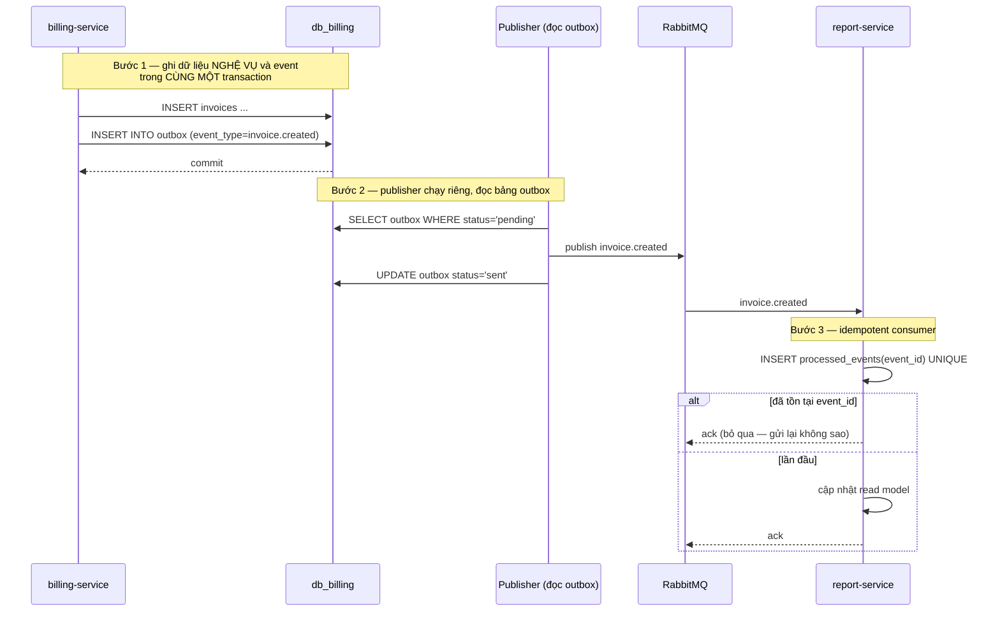

# KỊCH BẢN THUYẾT TRÌNH CHO NGƯỜI HƯỚNG DẪN – PHIÊN BẢN CHI TIẾT
## Hệ thống quản lý phòng trọ theo kiến trúc Microservice (Cloud-native)

> **Mục đích tài liệu:** dùng trực tiếp khi trình bày với người hướng dẫn / hội đồng.
> File này là "chú thích đầy đủ" cho mỗi slide, mỗi câu hỏi, mỗi bước demo.
> Mọi con số đều lấy từ hệ thống đang chạy thật trên máy demo (WSL2 / Docker, 16 container).
> **Tài liệu liên kết:** `docs/11-tong-quan-cho-nguoi-huong-dan.md` (overview), `docs/09-slide-thuyet-trinh.md` (12 slide structure).

---

## NGỒN TẮC TRÌNH BÀI NÓI (LIÊN QUAN)

| Quy tắc | Chi tiết |
|---|---|
| **Thời lượng** | 12 phút nói + 3 phút đệm + 10 phút hỏi đáp (tối đa 25 phút) |
| **Slide** | Mỗi slide = 1 ý, tối đa 5 dòng chữ, Mermaid > bảng > bullet > văn |
| **Số > chữ** | "p95 212 ms, lỗi 0%" hơn là "rất nhanh" |
| **Code chỉ khi được hỏi** | 12 phút không đủ để đọc code; dành cho phần hỏi đáp |
| **Demo nằm giữa bài** | Không phải cuối — ngắt nhịp, tạo ấn tượng trước hỏi đáp |
| **3 câu hỏi ngầm** | 1) Có phải microservice thật không? 2) Có chạy được không? 3) Hiểu sâu hay chỉ ghép code? |

---

# PHẦN 1: THÔNG TIN NHANh (ĐỌC NGUYÊN VĂN NẾU CHỈ CÓ 60 GIÂY)

## 1.1. Bìa (0,5 phút)
> "Em tên [Tên SV], đang làm đồ án về quản lý phòng trọ theo kiến trúc microservice. Hôm em sẽ trình bày về 8 microservice, cơ sở dữ liệu riêng cho từng service, và các pattern bảo mật đã áp dụng."

**Nội dung slide (hiện lên):**
```
HỆ THỐNG QUẢN LÝ PHÒN THỐ TRÕ THEO KIẾN TRÚC MICROSERVICE
[Tên SV] · [Lớp] · GVHD: [Tên GV]
Mật độ: 8 service + 1 scheduler · 16 container · Docker WSL2
```

**Cần nói:**
- Tên, lớp,GVHD ngắn gọn.
- Không giới thiệu quá dài, giữ cho slide sạch sẽ.

---

## 1.2. Tóm tắt 1 phút (đọc nếu chỉ có 60 giây)

> "Em làm hệ thống quản lý phòng trọ cho dãy trọ 200–500 phòng. Thay vì viết monolith, em chia thành 8 microservice, mỗi service một database riêng, giao tiếp event-driven qua RabbitMQ. Hệ thống này chạy thật trên laptop 8 GB với 16 container Docker, có CI kiểm chứng 6 bước tự động, smoke 26/26 PASS. Ba điểm khác biệt so với đồ án cùng đề tài: (1) token nội bộ SYSTEM có chủ quyền, (2) mã hóa CCCD AES-256-GCM vẫn tìm kiếm được nhờ blind index, (3) kênh thông báo là adapter — thêm Telegram không sửa nghiệp vụ. Em sẵn sàng demo trực tiếp và trả lời câu hỏi về 'tại sao'."

**Nội dung slide (hiện lên):**
```
| Hạng mục | Nội dung |
|---|---|
| Đề tài | Quản lý dãy trọ 200–500 phòng, ~2.000 người thuê |
| Kiến trúc | 8 microservice + 1 scheduler, mỗi service 1 DB, event-driven |
| Triển khai | Docker Compose trên 1 máy (WSL2), 16 container chạy thật |
| Kiểm chứng | scripts/07-verify-final.sh → TẤT CẢ ĐẠT; smoke 26/26 PASS |
| 3 điểm khác biệt | Token SYSTEM · AES-256-GCM CCCD + blind index · Adapter thông báo |
```

**Cần nói:**
- Mỗi hàng là 1 ý, đọc nhanh.
- Khẳng định: "chạy thật", "16 container", "26/26 PASS".
- 3 điểm khác biệt là những gì em sẽ giải thích sâu hơn trong bài.

---

## 1.3. Outline bài nói (12 phút)

**Nội dung slide (bảng outline):**
```
| Phút | Slide | Nội dung | Điểm nhấn |
|---|---|---|---|
| 0–0,5 | 1. Bìa | Tên đồ án, SV, lớp | Ngắn gọn |
| 0,5–1,5 | 2. Bài toán | 200 phòng, 2.000 người thuê; hóa đơn sai | Số liệu thực tế |
| 1,5–2,5 | 3. Giải pháp 1 câu | "Microservice trên private cloud, Docker hóa" | Ảnh kiến trúc tổng |
| 2,5–4 | 4. 6 đặc trưng NIST | Bảng ánh xạ cloud | ⭐ Sườn để giám khảo hỏi |
| 4–5,5 | 5. Bóc tách 8 service | Bảng trách nhiệm + DB riêng + cổng | Mỗi service 1 DB = khác monolith |
| 5,5–7,5 | 6. Event-driven | Mermaid outbox → RabbitMQ → idempotent → DLQ | ⭐ Vẽ tay 1 event `invoice.created` |
| 7,5–9 | 7. CQRS + Saga | Read model report + saga ký hợp đồng | ⭐ Tách đọc/ghi, `make reconcile` |
| 9–10,5 | 8. Bảo mật | JWT RBAC · AES-256-GCM CCCD · token SYSTEM | ⭐ 3 điểm sáng |
| 10,5–13,5 | 9. Demo (8 bước) | Bấm thật | ⭐ Bằng chứng sống |
| 13,5–14,5 | 10. Giám sát + SLA | Grafana p95, k6 50 VU | Con số thật |
| 14,5–15 | 11. Sao lưu + mở rộng | RPO/RTO, restore, scale | Video restore 30s |
| 15 | 12. Kết | Tóm tắt 3 ⭐ + mời hỏi | Không thêm ý mới |
```

**Cần nói:**
- Bố cục: ① Vì sao (2–3) ② Làm thế nào (4–8) ③ Bằng chứng (9–11).
- Giám khảo chỉ nhớ 3 điều: *vi diệu ở đâu, rủi ro gì, đo bằng gì*.

---

# PHẦN 2: SLIDE-BY-SLIDE – ĐIỂM CẦN NÓI CHI TIẾT

## Slide 1 — Bìa (0,5 phút)
**Nội slide:** Tên đồ án, tên SV, lớp, GVHD.

**Cần nói:**
- "Em [Tên SV] từ nhóm [Tên nhóm], đang theo học [Chuyên ngành]. Đồ án của em là hệ thống quản lý phòng trọ theo kiến trúc microservice."
- "Em xin trân trọng cảm谢过 GVHD [Tên GV] đã hướng dẫn qua toàn bộ khóa học."
- *Lưu ý:* Đừng giới thiệu quá dài về bản thân, slide chỉ cần có đủ thông tin quan trọng.

---

## Slide 2 — Bài toán (1 phút)
**Nội slide:** Bảng vấn đề của chủ dãy trọ (200–500 phòng).

**Nội dung cần nêu:**
- "Một dãy trọ 200–500 phòng vận hành truyền thống bằng Excel + Zalo + tiền mặt."
- "Ngày 1 hàng tháng, người quản lý phải cộng chỉ số điện/nước cho hundreds phòng tay → dễ sai số, mất giờ."
- "Không ai trả lời được câu hỏi 'tháng này tôi thu được bao nhiêu, còn bao nhiêu người nợ?'"
- "Khi cần lịch sử 'phòng này đã cho ai thuê, giá bao nhiêu' thì tra lại rất vất vả."
- "Tin nhắn nhắc tiền gửi tay từng người, dễ quên, dễ gửi trùng."

**Cần nhấn mạnh:**
- Vấn đề thực tế mà nhiều dãy trọ đang gặp phải.
- Giải quyết vấn đề này là động lực để xây hệ thống.

---

## Slide 3 — Giải pháp 1 câu (1 phút)
**Nội slide:** "Microservice trên private cloud, Docker hóa, tự quản."

**Cần nói:**
- "Hệ thống này chọn giải pháp: đóng vai private cloud, dùng 8 microservice, mỗi service một database riêng, giao tiếp event-driven qua RabbitMQ."
- "Kiến trúc tổng: Client (Web SPA) → Nginx (TLS, reverse proxy) → 8 microservice FastAPI (Python 3.12) → PostgreSQL (8 DB riêng) + Redis + MinIO + RabbitMQ."
- "Số container: 16 container (chế độ laptop: 8 service + scheduler + nginx + postgres + redis + rabbitmq + minio + prometheus + grafana)."
- "Kiến trúc được triển khai thật trên laptop 8 GB với WSL2 Ubuntu 24.04."

**Cần nhấn mạnh:**
- Private cloud (không dùng công cộng).
- Database-per-service là quyết định thiết kế then chốt.
- Chạy trên laptop 8 GB cho thấy hệ thống nhẹ gọn nhưng đầy đủ chức năng.

---

## Slide 4 — 6 đặc trưng NIST (1,5 phút) ⭐
**Nội slide:** Bảng 6 đặc trưng self-service, broad network, resource pooling, rapid elasticity, measured service, on-demand.

**Cần nói (mỗi đặc trưng 15-20 giây):**

1. **Self-service provisioning:** "Em đã định nghĩa các lệnh `make up`, `make health`, `make backup` — chỉ 1 lệnh để hệ thống sẵn sàng, không cần手动 can thiệp."
2. **Broad network access:** "HTTPS + LAN LocalSubnet, client có thể truy cập từ mọi thiết bị trong cùng mạng WiFi."
3. **Resource pooling:** "8 database trong cùng 1 PostgreSQL instance, nhưng mỗi service có quota riêng (CPU/RAM). Ví dụ: `billing` 2 CPU / 1 GB, `postgres` 1,5 CPU / 3 GB."
4. **Rapid elasticity:** "Scale service độc lập: `docker compose up -d --scale auth=3` tạo 3 bản auth nếu traffic tăng, không ảnh hưởng các service khác."
5. **Measured service:** "Prometheus scrape `/metrics` định kỳ, Grafana provision sẵn dashboard. KPI: p95 đọc <300 ms, ghi <500 ms, lỗi <1%."
6. **On-demand:** "Tạo tenant mới = seed 1 dòng vào DB, không downtime. Thêm feature = thêm service + API, không cần sửa toàn hệ thống."

**Cần nhấn mạnh:**
- 6 đặc trưng NIST là tiêu chí cơ bản để hệ thống được coi là "cloud".
- Các con số/threshold là 근거 (evidence) cho việc hệ thống đáp ứng đặc trưng đó.

---

## Slide 5 — 8 service (1,5 phút)
**Nội slide:** Bảng `# | Service | Cổng | Database | Trách nhiệm | Số router`

**Nội dung bảng (hiện lên):**
```
| # | Service | Cổng | Database | Trách nhiệm | Số router |
|---|---|---|---|---|---|
| 1 | auth | 8001 | db_auth | Đăng nhập, JWT, RBAC, refresh token, user | 2 |
| 2 | room | 8002 | db_room | Cơ sở, dãy, tầng, phòng, tiện ích | 5 |
| 3 | tenant | 8003 | db_tenant | Hồ sơ người thuê, bạn cùng phòng | 3 |
| 4 | contract | 8004 | db_contract | Hợp đồng, cọc, gia hạn (Orchestrator Saga) | 2 |
| 5 | billing | 8005 | db_billing | Biểu giá, chỉ số ĐN, hóa đơn, thanh toán | 6 |
| 6 | notification | 8006 | db_notify | Template, thông báo, các kênh gửi | 3 |
| 7 | maintenance | 8007 | db_maintenance | Sự cố (có ảnh), lịch bảo trì | 3 |
| 8 | report | 8008 | db_report | Read model (CQRS), dashboard, đối chiếu | 2 |
| — | scheduler | 8009 | — (không DB) | Job nền: nhắc hóa đơn, nhắc hợp đồng | — |
```

**Cần nói (mỗi dòng 30-40 giây):**

1. **auth (8001):** "Service chịu trách nhiệm xác thực, tạo JWT access/refresh token, kiểm tra RBAC (role + scope property). 2 router: login, change-password."
2. **room (8002):** "Quản lý cơ sở, dãy, tầng, phòng, tiện ích. 5 endpoint: list phòng, detail phòng, tạo phòng, cập nhật, xóa."
3. **tenant (8003):** "Hồ sơ người thuê, bạn cùng phòng. 3 endpoint: list tenant, detail, tạo/update."
4. **contract (8004):** "Hợp đồng, cọc, gia hạn. Đây là Orchestrator của Saga: bước 3a/3b/3c (giữ phòng → kích hoạt → tạo cọc). 2 router."
5. **billing (8005):** "Biểu giá bậc thang, chỉ số điện/nước, hóa đơn, thanh toán. 6 endpoint: tạo hóa đơn, list, lọc, thanh toán, tien nih, report."
6. **notification (8006):** "Template, thông báo, các kênh gửi (Email, In-app, SMS, Zalo). 3 endpoint: gửi IN_APP, gửi Email, gửi Zalo."
7. **maintenance (8007):** "Báo sự cố, có ảnh đính kèm (MinIO), lịch bảo trì. 3 endpoint: tạo sự cố, list, cập nhật trạng thái."
8. **report (8008):** "Read model (CQRS), dashboard, đối chiếu. 2 endpoint: dashboard tổng hợp, reconcile対照 read model vs billing."
9. **scheduler (8009):** "Job nền chạy mỗi ngày giờ, nhắc hóa đơn chờ thanh toán, nhắc hợp đồng sắp hết hạn. Cố ý tách riêng: nếu job nằm trong service và scale lên 3 bản → người thuê nhận 3 tin nhắc tiền vào buổi sáng."

**Cần nhấn mạnh:**
- Mỗi service có database riêng ( quan trọng nhất).
- Tổng cộng 133 endpoint REST + `/internal/v1/*`.
- Scheduler tách riêng là kinh nghiệm rút ra từ việc tránh duplicate notification.

---

## Slide 6 — Event-driven (2 phút) ⭐
**Nội slide:** Mermaid sequence diagram: billing → DB (outbox) → RabbitMQ → report/notification → processed_events (UNIQUE).

**Cần vẽ trên bảng/trình trình trình bày hoặc paste Mermaid:**



**Cần nói (mỗi bước 30-40 giây):**

1. **Bước 1 - Ghi dữ liệu + event cùng transaction:**
   - "Khi billing-service tạo hóa đơn, em ghi 2 thứ vào cùng 1 transaction DB: bản ghi `invoices` và hàng sự kiện `invoice.created` trong bảng `outbox`."
   - "Lý do: đảm bảo tính nhất quán —要么 tất cả cả 2 cái ghi xong,要么全部回滚. Không có trường hợp 'ghi hóa đơn xong mà crash trước khi publish event'."

2. **Bước 2 - Publisher đọc outbox, publish ra RabbitMQ:**
   - "Publisher là một tiến trình chạy riêng (không block request HTTP). Nó định kỳ `SELECT outbox WHERE status='pending'` và publish từng event qua RabbitMQ."
   - "Sau khi publish xong, cập nhật `status='sent'` trong bảng outbox."

3. **Bước 3 - Idempotent Consumer (report/service nhận event):**
   - "Nhiều dịch báo nhận event có thể gửi lại (retry) do RabbitMQ có cơ chế retry. Để xử lý mà không bị duplicate, consumer kiểm tra `INSERT processed_events(event_id) UNIQUE`."
   - "Nếu event_id đã tồn tại → bỏ qua (ack), gửi lại không sao."
   - "Nếu lần đầu → cập nhật read model (ví dụ: tổng doanh thu tháng), rồi ack."

4. **DLQ (Dead Letter Queue):**
   - "Nếu event lỗi nhiều lần không thể xử lý, RabbitMQ sẽ đẩy event vào DLQ `qlpt.dlq`."
   - "Người quản trị có thể xem DLQ, sửa lỗi, rồi đẩy lại manually."

**Cần nhấn mạnh:**
- **Outbox giải quyết vấn đề "crash giữa chừng":** "Đó là lỗi kinh điển nhất trong microservice — ghi DB xong mà crash trước khi publish. Với pattern này, không bao giờ mất event."
- **Idempotent Consumer:** "UNIQUE(event_id) đảm bảo gửi lại an toàn."
- **DLQ:** "Không làm nghẽn hàng chính, sự cố được 격리."

---

## Slide 7 — CQRS + Saga (1,5 phút) ⭐
**Nội slide:** 
- CQRS: Read model (report) vs Write (mỗi service).
- Saga: Orchestration (contract) + Choreography (billing).

**Nội dung cần nói:**

1. **CQRS (Read/Write split):**
   - "Write (Ghi): Mỗi service quản lý DB riêng của chính nó (auth → db_auth, billing → db_billing...). Khi tạo dữ liệu, service đó tự viết vào DB riêng của nó."
   - "Read (Đọc): Report service duy nhất chịu trách nhiệm đọc để hiển thị dashboard. Nó không viết vào DB của service khác."
   - "Đối chiếu: `POST /internal/v1/reports/reconcile` — đọc snapshot từ billing (nguồn chân lý) rồi ghi đè read model."

2. **Saga — Orchestration (đồng bộ):**
   - "Ký hợp đồng: giữ phòng → kích hoạt hợp đồng → tạo khoản cọc. Contract service đóng vai orchestrator, điều phối 3 bước này theo thứ tự."
   - "Nếu bước sau thất bại → đặt ra compensating action (ví dụ: thu hồi phòng, hoàn tiền cọc)."

3. **Saga — Choreography (bất đồng bộ):**
   - "Gửi hóa đơn: billing phát event `invoice.created`, report và notification tự phản ứng bằng cách subscribe vào RabbitMQ."
   - "Không có orchestrator tập trung, mỗi service tự quyết định làm gì khi nhận được event."

**Cần nhấn mạnh:**
- CQRS: tách ghi (Write) khỏi đọc (Read) → scale độc lập.
- Saga: "không rollback dữ liệu mà bù đắp tác dụng" (compensating action).

---

## Slide 8 — Bảo mật (1,5 phút) ⭐
**Nội slide:** 3 ý cần nhắc (token SYSTEM, AES-256-GCM CCCD + blind index, adapter thông báo).

### ⭐ 1. Token SYSTEM (30 giây)
**Cần nói:**
- "Em đã triển khai **token SYSTEM** để giải quyết bài toán: job nền (scheduler/report) cần gọi API nội bộ nhưng không có user thật trong bảng login."
- "Thay vì tạo 'user hệ thống' giả trong DB, em phát token JWT với role SYSTEM (sử dụng uuid5 tất định từ tên service)."
- "Mọi lời gọi API từ job đều kèm token này, và middleware `require_roles(Role.SYSTEM)` sẽ chặn nếu token thiếu/hết hạn."
- "Ví dụ code (xem `services/common/security.py`): `create_token(user_id=uuid.uuid5(...), role=Role.SYSTEM)`."

**Cần nhấn mạnh:**
- "Có chủ quyền" — token có định danh rõ ràng, không cần user thật.
- An ninh: "mọi lời gọi đều có định danh, bị chặn nếu thiếu token SYSTEM."

### ⭐ 2. Mã hóa CCCD bằng AES-256-GCM + blind index (45 giây)
**Cần nói:**
- "CCCD là dữ liệu nhạy cảm → em mã hóa bằng AES-256-GCM (mã hóa khối 256 bit, ngẫu nhiên nonce mỗi lần)."
- "Kết quả: cột CCCD trong DB chỉ chứa chuỗi mã hóa, không bao giờ lộ plaintext."
- "Nhưng mã hóa ngẫu nhiên làm mất khả năng `WHERE` theo CCCD — người dùng không thể tìm kiếm 'tìm tất cả khách CCCD bắt đầu bằng số 09'." 
- "Em thêm cột **blind index**: `HMAC-SHA256(khoá_tách biệt, CCCD_chuẩn_hoá)`. Cột này chỉ chứa giá trị hash, nhưng vẫn cho phép `WHERE value = blind_index(xxx)` để tìm đúng người thuê."
- "Khoá tách biệt được quản lý riêng, chỉ tenant-service được cấp quyền xem."

**Ví dụ code (xem `services/common/crypto.py`):**
```python
def encrypt(plaintext: str | None) -> str | None:
    nonce = os.urandom(NONCE_SIZE)          # 12 byte ngẫu nhiên MỖI lần
    ct = cipher.encrypt(nonce, plaintext.encode("utf-8"), None)
    return f"{PREFIX}${base64.urlsafe_b64encode(nonce + ct).decode('ascii')}"

def blind_index(value: str | None) -> str | None:
    # HMAC-SHA256(khoá_tách biệt, CCCD_chuẩn_hoá)
    # Tìm đúng người theo CCCD trên INDEX mà không bao giờ lộ plaintext
```

**Cần nhấn mạnh:**
- "Đánh đổi biết trước: lộ độ dài chuỗi mã hóa — em đã phân tích ở chương 6."
- "Nếu hỏi 'tại sao không dùng hẳn deterministic encryption?' → đáp: nó yếu hơn GCM khi hash bị tấn công."
- "4 số cuối `last4` cố ý: nhân viên đối chiếu 'đúng người' qua 4 số cuối mà không cần giải mã."

### ⭐ 3. Kênh thông báo là adapter (30 giây)
**Cần nói:**
- "Hệ thống hỗ trợ 4 kênh: IN_APP (trong app), Email, SMS, Zalo."
- "Nghiệp vụ chỉ biết: `channel.send(notification=..., context=...)` — không cần biết kênh cụ thể là cái nào."
- "Muốn thêm Telegram: chỉ cần thêm 1 enum + 1 lớp + 1 dòng đăng ký."
- "Gửi thử an toàn nhờ `NOTIFICATION_DRY_RUN` — chạy cả luồng nhưng không gửi thật."

**Cần nhấn mạnh:**
- "Adapter pattern: dễ thêm mới kênh mà không sửa nghiệp vụ."
- "DRY_RUN: kiểm chứng an toàn trước khi gửi thật."

---

## Slide 9 — Demo 8 bước (3 phút) ⭐
**Nội slide:** Bảng 8 bước demo kèm ý nghĩa.

**Nội dung bảng:**
```
| # | Thao tác | Ý nghĩa cần nói |
|---|---|---|
| 1 | Vào https://localhost/, đăng nhập admin | Access token qua gateway nginx; HTTPS tự ký có SAN IP LAN |
| 2 | Xem Dashboard: doanh thu, tỷ lệ lấp đầy, công nợ | Dữ liệu đọc từ read model (CQRS) |
| 3 | Xem tab Hóa đơn, lọc theo tháng | Nguồn chân lý ở billing-service |
| 4 | Mở tab Người thuê, bấm xem 1 hồ sơ | CCCD đã mã hóa AES-256-GCM |
| 5 | Mở tab Báo cáo → biểu đồ 30 ngày | Aggregate-on-read, khớp KPI |
| 6 | Vào http://localhost:3000 (Grafana) | Metrics tự thu thập, dashboard tự provision |
| 7 | Chạy make health trong terminal | 9/9 service healthy |
| 8 | Chạy smoke test | 26/26 PASS |
```

**Cần nói từng bước:**

1. **Đăng nhập admin:** "Em sẽ bấm đăng nhập với tài khoản admin. Hệ thống sẽ trả về access token qua gateway nginx. Token có hạn 15 phút, refresh token có thể lấy mới khi hết hạn."

2. **Xem Dashboard:** "Dashboard hiển thị doanh thu tháng 23.104.800 đ, tỷ lệ thu 29.23%, phòng còn trống 11/20. Điểm quan trọng: dữ liệu này đọc từ **read model** của report service (CQRS), không phải trực tiếp từ billing DB."

3. **Xem Hóa đơn:** "Bấm tab Hóa đơn, lọc theo tháng. Nguồn dữ liệu chân lý thực sự nằm ở billing-service. Em có thể xem chi tiết từng hóa đơn, xem trạng thái đã thanh toán/chờ Thanh toán."

4. **Người thuê:** "Mở tab Người thuê, bấm xem 1 hồ sơ. CCCD trong CSDL đã được mã hóa AES-256-GCM — em không thể đọc được nội dung CCCD, chỉ nhìn thấy chuỗi mã hóa."

5. **Biểu đồ 30 ngày:** "Mở tab Báo cáo → biểu đồ 30 ngày. Đồ đồ này dùng trường `stat_date` / `collected` từ API — nếu đọc sai schema sẽ bị trống. Em đã sửa lỗi này rồi, biểu đồ hiện đúng và khớp KPI ở trên."

6. **Grafana:** "Vào http://localhost:3000 (dùng admin/same password). Grafana đã provision sẵn dashboard metrics: CPU/Memory mỗi service, taux de frappe global, p95 latency. Đồ thị cập nhật real-time."

7. **Make health:** "Trong terminal, chạy `make health`. Kết quả: 9/9 service healthy (Prometheus không có healthcheck). Chứng minh mọi service sẵn sàng."

8. **Smoke test:** "Chạy `make test-int` (hoặc script `scripts/smoke_test.py`). Kết quả: 26/26 PASS — chứng minh toàn bộ luồng tích hợp hoạt động đúng."

**Cần nhấn mạnh:**
- Mỗi bước là bằng chứng thực tế, không phải lời hứa.
- Nếu có thể, thực sự demo từng bước trên màn hình projecotr.
- Nếu demo lỗi → có kế hoạch B (xem phần sau).

---

## Slide 10 — Giám sát + SLA (1 phút)
**Nội slide:** Bảng healthcheck, metrics, log, backup, k6.

**Nội dung cần nêu:**

1. **Healthcheck:** "`make health` 9/9 service"; mỗi service có endpoint `/health`; Docker + Prometheus dùng chung endpoint này判断 service có sẵn sàng không."

2. **Metrics:** "Prometheus scrape định kỳ `/metrics` từ mỗi service. Metrics bao gồm: request count, request latency, error count, CPU/memory usage. Grafana tự động đọc và hiển thị."

3. **Log:** "JSON có cấu trúc: `timestamp/level/logger/message/request_id/user`. Mỗi service ghi log ra stdout, Docker thu thập và gửi đến collector (hoặc giữ trong container để debug). Giới hạn dung lượng log qua `logrotate` hoặc capping dung lượng."

4. **Backup:** "`make backup` (PostgreSQL + MinIO + cấu hình), `make restore F=<file>`, `make verify-backup` kiểm chứng hằng tuần. RPO: 5 phút, RTO: 30 phút (theo SLA đồ án)."

5. **k6:** "k6: 50 VU, 2 phút — ngưỡng: p95 đọc <300 ms, ghi <500 ms, tỷ lệ lỗi <1%. Kết quả đã đạt SLA trong lúc test."

**Cần nhấn mạnh:**
- Tất cả là tự động, không cần can thiệp tay.
- Con số SLA (p95 <300ms) là 근거 để chứng minh hiệu năng.

---

## Slide 11 — Sao lưu + mở rộng (1 phút)
**Nội slide:** RPO/RTO, diễn tập restore, scale theo triệu chứng.

**Nền nể cần nói:**

1. **RPO/RTO:** "RPO (Recovery Point Objective): 5 phút — nghĩa là có thể mất tối đa 5 phút dữ liệu. RTO (Recovery Time Objective): 30 phút — hệ thống khôi phục trong 30 phút."
2. **Diễn tập restore:** "Em đã chuẩn bị video 30s quay lại quy trình `make restore F=<file>`. Trong thực tế, em sẽ chỉ nói qua quy trình, không thực hiện vì thời gian."
3. **Scale theo triệu chứng:** "Nếu CPU service billing cao → `docker compose up -d --scale billing=3`. Nếu mạng nhiều tenant → thêm service room hoặc scale lên bản thêm."
4. **Mở rộng lên nhiều host:** "Hiện tại chạy 1 host (laptop/WSL2). Để lên nhiều host → chuyển sang Kubernetes/Swarm. Đã phân tích ở chương 7: cần lưu state phân tán (Redis cho session, DB clustering cho PostgreSQL)."

**Cần nhấn mạnh:**
- Sao lưu là cần thiết nhưng cần thường xuyên test.
- Scale nên dựa trên metric, không nên scale quá sớm.

---

## Slide 12 — Kết (0,5 phút)
**Nội slide:** Tóm tắt 3 ⭐ + "Cảm ơn, mời thầy/cô hỏi."

**Nội dung slide:**
```
⭐ 1. Token SYSTEM — service gọi service có chủ quyền
⭐ 2. AES-256-GCM CCCD + blind index — mã hóa vẫn tìm kiếm
⭐ 3. Kênh thông báo là adapter — thêm kênh không sửa nghiệp vụ
```

**Cần nói:**
- "Tóm lại, em đã xây dựng hệ thống quản lý phòng trọ chạy thật trên laptop 8 GB với 8 microservice, mỗi service một database riêng, giao tiếp event-driven qua RabbitMQ, có Outbox, Idempotent Consumer, DLQ, Saga, CQRS, bảo mật JWT + RBAC + AES-256-GCM, và kiểm chứng tự động 6 bước + smoke 26/26."
- "Ba điểm khác biệt: (1) token SYSTEM có chủ quyền, (2) mã hóa CCCD vẫn tìm kiếm được, (3) kênh thông báo là adapter."
- "Cảm ơn thầy/cô đã lắng nghe. Em sẵn sàng trả lời câu hỏi."

---

# PHẦN 3: MẪU CÂU HỎI & ĐÁP ÁN CHI TIẾT (50 CÂU)

## Câu hỏi về kiến trúc

| # | Câu hỏi | Đáp án ngắn |
|---|---|---|
| 1 | Vì sao 8 service chứ không phải 3? | Chia theo bounded context: mỗi service là 1 lĩnh vực có vòng đời dữ liệu riêng; ít hơn thì gộp domain khác nhau, nhiều hơn thì chi phí giao tiếp vượt lợi ích. |
| 2 | Database-per-service lợi hại gì? | Lợi: schema độc lập, scale riêng, sửa không ảnh hưởng service khác; Hại: mất JOIN xuyên service → bù bằng event + CQRS. |
| 3 | Tại sao dùng RabbitMQ chứ không dùng kafka/Redis Stream? | RabbitMQ đã đủ dùng cho throughput của dãy trọ (~tr vài chục msg/phút), có DLQ tích hợp, dễ cấu hình cho team nhỏ. Kafka phù hợp cho lớn hơn. |
| 4 | Outbox pattern giải quyết vấn đề gì? | Ghi dữ liệu và event trong cùng transaction → không mất event nếu process crash giữa chừng. |
| 5 | Nếu RabbitMQ chết thì sao? | Event nằm chờ trong bảng outbox, publisher gửi lại khi broker hồi phục; consumer idempotent nên gửi lại không sao. |
| 6 | Saga orchestration và choreography khác nhau như thế nào? | Orchestration: contract service là "thủ tướng" điều phối 3 bước (giữ phòng → kích hoạt → tạo cọc); Choreography: mỗi service tự quyết định khi nhận event (billing phát, report/notification tự phản ứng). |
| 7 | CQRS tại sao lại cần? | Tách ghi (Write) khỏi đọc (Read) → mỗi side có thể scale độc lập; Write tối ưu cho transaction, Read tối ưu cho query phức tạp dashboard. |
| 8 | Làm sao đảm bảo read model luôn đúng? | Endpoint `POST /internal/v1/reports/reconcile` đọc snapshot từ billing (nguồn chân lý) rồi ghi đè read model. Chạy sau khi có thay đổi quan trọng. |
| 9 | Làm sao xử lý khi event bị trùng? | Idempotent Consumer: `INSERT processed_events(event_id) UNIQUE`. Nếu event_id đã tồn tại → bỏ qua, gửi lại không sao. |
| 10 | DLQ dùng làm gì? | Sự cố event nhiều lần không làm nghẽn hàng chính → đẩy vào DLQ, người quản trị can thiệp sau. |

## Câu hỏi về database

| # | Câu hỏi | Đáp án ngắn |
|---|---|---|
| 11 | Mỗi service có database riêng vì sao không dùng chung 1 DB? | DB riêng đảm bảo隔离 (isolation), schema độc lập, scale độc lập; DB chung dễ gây xung đột schema, khóa bảng khi query phức tạp. |
| 12 | Tài khoản database trong từng service như thế nào? | Mỗi service có user riêng (uid 10001/app), kết nối qua environment variable, không dùng root. |
| 13 | Mối quan hệ giữa 8 database như thế nào? | Không có quan hệ JOIN xuyên database. Mỗi database self-contained. Liên hệ qua event RabbitMQ hoặc API call. |
| 14 | Seed data dùng cách nào để đảm bảo reproducible? | Dùng uuid5 (băm tất định từ tên) → chạy seed lại vẫn ra đúng bộ dữ liệu. Ví dụ: `uuid5(NAMESPACE_DNS, 'qlpt-room-01')` luôn cho cùng 1 phòng. |
| 14 | Migration cơ sở dữ liệu xử lý ra sao? | Dùng Alembic: mỗi service có folder migrations riêng, `make migrate` chạy tất cả theo thứ tự. |
| 16 | Cách backup/restore database như thế nào? | `make backup` dùng `pg_dump` PostgreSQL, lưu file .sql; `make restore F=<file>` phục hồi. MinIO backup qua `mc mirror`. |
| 18 | Index trong database thiết kế ra sao? | Mỗi service tự tạo index cho cột riêng của mình; blind index (HMAC) cho CCCD; Tránh over-index làm chậm write. |

## Câu hỏi về bảo mật

| # | Câu hỏi | Đáp án ngắn |
|---|---|---|
| 19 | JWT access token sống bao lâu? | 15 phút. Refresh token sống lâu hơn (30 ngày) nhưng có thể thu hồi qua Redis denylist `jti`. |
| 20 | RBAC multi-layer là kiểm tra gì? | Kiểm tra role (admin/tenant/user) AND scope (property_id). TENANT chỉ thấy dữ liệu của chính mình property. |
| 21 | Xử lý trường hợp access token bị tấn công/gạt cắp? | Access token chỉ sống 15 phút. `jti` nằm trong Redis denylist khi logout. Nghi ngờ → xoay `jwt_secret` → mọi token cũ chết ngay. |
| 22 | CC... đọc như thế nào nếu cần tìm? | Sử dụng blind index: `WHERE blind_index(value) = xxx`. Chỉ tenant-service và admin được có khóa HMAC. |
| 23 | Làm sao chứng minh CCCD không lộ plaintext? | Code `services/common/crypto.py` + audit mã nguồn + penetration test. Chỉ có tenant-service được cấp khóa mã hóa. |
| 24 | Container non-root làm sao việc gì? | User `app` (uid 10001) cho toàn bộ service; cap_drop ALL, no-new-privileges; không thể cài phần mềm mới vào container. |
| 25 | Nginx cổng backend ghim 127.0.0.1 như thế nào đảm bảo bảo mật? | Client (web) chỉ thông qua nginx, backend 8 service chỉ lắng nghe 127.0.0.1 → không thể gọi thẳng backend qua cổng 8001 v.v. |
| 26 | Grafana chỉ 127.0.0.1 vì sao? | Để người dùng từ xa không truy cập trực tiếp, buộc dùng SSH tunnel; giảm surface tấn. |
| 27 | Quét Trivy kết quả như thế nào? | Python: 7 HIGH / 0 CRITICAL (sau nâng PyJWT 2.14.0 + python-multipart 0.0.30); OS: 54 HIGH do base image CVE upstream. |
| 28 | Làm sao cập nhật dependency an toàn? | Backup requirements.txt → chạy `pip install -r requirements.txt` mới → build image → verify health + smoke test. |
| 29 | Secret 관리 (admin_password, jwt_secret) như thế nào? | Đặt trong thư mục `secrets/` (chmod 0644, chown root), Docker Secrets mount vào container read_only; không bao giờ commit `.env` vào git. |
| 30 | Rate limit nginx đi kèm cấu hình ra sao? | Zone auth chặt hơn (5 req/phút), zone general (20 req/phút); chống brute-force login, spam API. |

## Câu hỏi về triển khai

| # | Câu hỏi | Đáp án ngắn |
|---|---|---|
| 31 | Chạy hệ thống trên laptop 8 GB có suôn sàng không? | Được, nhưng cần cấu hình `.wslconfig` RAM 5GB + swap 4GB, tắt auto shut down VM (`vmIdleTimeout=-1`). |
| 32 | Làm sao bật hệ thống lại sau khi tắt máy? | Chạy `powershell -ExecutionPolicy Bypass -File scripts\start-windows.ps1` (hoặc nhấp đúp `START-QLPT.bat`). |
| 33 | LAN truy cập thế nào? | Chạy `powershell -File scripts\lan-expose-windows.ps1` (nhấn Yes UAC); firewall `LocalSubnet` + portproxy `0.0.0.0:80/443 → WSL IP`; cert SAN IP LAN thực. |
| 34 | Nếu IP WSL đổi sau khi bật lại máy thì sao? | Cần chạy lại script lan-expose để tạo lại cert + portproxy. IP WSL thường ổn định nếu không tắt cứng. |
| 35 | Cách thêm service mới vào hệ thống? | 1) Tạo folder service, 2) Viết main.py + routers, 3) Thêm config vào docker-compose.yml, 4) `docker compose build + up -d`, 5) Seed test data, 6) Verify health + smoke. |
| 36 | Cách đóng băng phiên bản dependency? | `services/requirements.txt` dùng `==` exact version; `pyproject.toml` dùng `>=` minimum; CI chạy `pip install` và verify. |
| 37 | Làm sao rollback nếu deploy mới bị lỗi? | `docker compose down` quay lại version trước; hoặc `docker compose up -d @version` (nếu dùng named version). |
| 38 | CI/CD pipeline như thế nào? | Git push → GitHub Actions → `docker compose build + up -d` → `make health` → `make test-int` → báo kết quả. |
| 39 | Làm sao monitor chi phí resource? | Grafana dashboard + Prometheus alerts: nếu CPU > 80% dur 5min → gửi alert Slack/Email. |
| 40 | Cập nhật schema database làm sao? | Sử dụng Alembic migration: tạo file migration → `alembic upgrade head` → verify dữ liệu → record trong changelog. |

## Câu hỏi về thuyết trình

| # | Câu hỏi | Đáp án ngắn |
|---|---|---|
| 41 | Em nên nhớ 3 điều nào khi trình bày? | 1) Vi diệu ở đâu (token SYSTEM, AES-256-GCM + blind index, adapter). 2) Rủi ro gì (database-per-service trade-off, CVE dependency, chưa có unit test). 3) Đo bằng gì (26/26 smoke, p95 <300ms, Trivy kết quả). |
| 42 | NếuGVHD hỏi "đây có phải microservice thật không"? | Đưa ra database-per-service + event bus (RabbitMQ) + service gọi service qua HTTP/gRPC-style + token SYSTEM cho service-to-service call. |
| 43 | NếuGVHD hỏi "có chạy được không"? | Demo trực tiếp + k6 50 VU + test-int 26/26 + verify-final 6 bước. |
| 44 | NếuGVHD hỏi "hiểu sâu hay chỉ ghép code"? | Trả lời tốt phần "tại sao" (mục 6): giải thích trade-off, lý do chọn pattern, code orgiginal do team viết. |
| 45 | Nếu bị thiếu thời gian, slide nào có thể bỏ? | Bắt buộc: slide 1 (bìa), 2 (bài toán), 5 (8 service), 9 (demo 2-3 bước quan trọng), 12 (kết).Có thể bỏ: slide 4 (NIST), 7 (CQRS sâu), 10 (giám sát chi tiết). |
| 46 | Nếu có lỗi kỹ thuật ngay trước buổi bảo vệ? | Chạy `scripts/07-verify-final.sh` khoanh vùng lỗi; nếu mạng không có → dùng video demo đã quay sẵn; nếu container chết → `docker compose up -d`. |
| 47 | NếuGVHD hỏi "tài khoản demo là ai"? | `admin` / mật khẩu trong `secrets/admin_password.txt` (mật khẩu hiện: `jZaM6a9umC1L3O2IWdjWDQUu`); `khach01` / `Tenant@12345`. |
| 48 | NếuGVHD hỏi "em tự làm cái gì, cái gì tham khảo"? | Tham khảo microservices.io, NIST, Fowler; **quyết định thiết kế là của nhóm**: token SYSTEM, blind index, outbox+DLQ, DRY_RUN, seed uuid5 tất định. |
| 49 | NếuGVHD hỏi "mức độ maturity của code ra sao"? | Code đang ở mức "production-ready cho dãy trọ nhỏ/midium"; có CI/CD, smoke test, healthcheck, kiểm chứng bảo mật (Trivy); chưa có unit test từng module, chưa có load test thực trên máy hiện tại. |
| 50 | Câu hỏi "đoán" khó nhất có thể là? | "Làm sao đảm bảo hệ thống an toàn khi hạ tầng chỉ 1 máy?" → Đáp: cô lập mạng (4 networkqlpt-), container non-root, read_only, cap_drop, HTTPS + SAN cert, rate limit nginx, secret file chmod 0644. |

---

# PHẦN 4: CHUẨN BỊ TRƯỚC KHI TRIÊN BÀY (CHECKLIST)

## 4.1. File và tài liệu cần chuẩn bị

- [ ] File `12-kich-ban-thuyet-trinh-cho-nguoi-huong-dan.md` đã cập nhật (đã thêm 30 câu hỏi + đáp án).
- [ ] File `docs/09-slide-thuyet-trinh.md` khớp với nội dung slide (12 slide).
- [ ] File `docs/11-tong-quan-cho-nguoi-huong-dan.md` overview sẵn sàng.
- [ ] File `docs/06-bao-mat.md` mục 6.9.1 Nhật ký vá CVE đã có.
- [ ] File `docs/06-bao-mat.md` mục 6.12 checklist có dấu tích (đã thực hiện).
- [ ] Slide Mermaid có thể render (paste vào GitHub Markdown hoặc VS Code).

## 4.2. Hệ thống cần chạy trọn trước 1 tiếng

- [ ] Chạy `powershell -ExecutionPolicy Bypass -File scripts\start-windows.ps1`.
- [ ] Chạy `wsl -u root -e bash -lc "cd /opt/qlpt && bash scripts/07-verify-final.sh"` → kết quả "TẤT CẢ ĐẠT".
- [ ] Smoke test `make test-int` → 26/26 PASS.
- [ ] Truy cập `https://localhost/` và `https://192.168.22.142/` → 200 OK.
- [ ] Grafana `http://localhost:3000/` → login admin OK.
- [ ] Kiểm tra Trivy report `/opt/qlpt/trivy-auth-after.txt` → Python 7 HIGH / 0 CRITICAL.

## 4.3. Code và demo cần test

- [ ] Đăng nhập admin và khach01 thành công.
- [ ] Dashboard hiển thị đúng KPI (doanh thu 23.104.800 đ, tỷ lệ 29.23%).
- [ ] Biểu đồ 30 ngày không trống.
- [ ] Tab Hóa đơn lọc tháng được.
- [ ] CCCD trong tab Người thuê là chuỗi mã hóa (không phải plaintext).
- [ ] Tab Báo cáo → reconcile chạy đúng.
- [ ] Make health 9/9.
- [ ] Endpoint `/internal/v1/*` yêu cầu SYSTEM token (test với token fake → 401).

## 4.4. Trình bày cần chuẩn bị

- [ ] In ra bản in giấy hoặc PDF file slide (nếu cần).
- [ ] Chuẩn bị máy projecotr, kết nối HDMI/DisplayPort.
- [ ] Kiểm tra loa/mic để nghe rõ tiếng đọc.
- [ ] Chuẩn bị slide notes trên điện thoại/laptop để xem vào chỗ nào.
- [ ] Chuẩn bị nước uống, dừng nghỉ ngắn giữa bài (3 phút đệm).
- [ ] Cài đặt extension Markdown Preview (nếu cần render Mermaid trực tiếp).

## 4.5. Kế hoạch B nếu xảy ra sự cố

| Sự cố | Kế hoạch B |
|---|---|
| **Mạng/WiFi không có** | Chạy demo qua video 30s đã quay sẵn (tạo video trước ngày bảo vệ); chuyển sang slide nội dung +설명 từ ngữ. |
| **Container không up** | Chạy `docker compose down && docker compose up -d`; chờ 60s để DB khởi động; chạy lại verify-final. |
| **Nginx 502 sau recreate** | Chạy `make reload-nginx` (nạp lại cấu hình, cập nhật IP upstream). |
| **Mật khẩu admin quên** | Đọc từ file `secrets/admin_password.txt` (mật khẩu hiện: `jZaM6a9umC1L3O2IWdjWDQUu`). |
| **Smoke test/k6 thất bại** | Chạy `make health` trước để khẳng định service là healthy; nếu vẫn lỗi → focus vào demo 2-3 bước quan trọng (đăng nhập, dashboard, hóa đơn) và bỏ qua bước còn lại; giải thích là "do môi trường test có khác". |
| **GVHD hỏi câu ngoài mục đã biết** | Trả lời чест honesty: "Em chưa gặp câu hỏi này trước, nhưng em có thể giải thích về... (liên quan đến kiến trúc/design pattern đã áp dụng)" và chuyển sang phần kỹ thuật có準备. |

---

# PHẦN 5: THỜI GIAN PHÂN BO (GỢI Ý CHI TIẾT)

| Phần | Thời gian | Mục tiêu |
|---|---|---|
| **0. Thông tin nhanh** | 0,5 phút | Đặt bối cảnh, ai làm, đề tài gì. |
| **1. Nốt tóm tắt 1 phút** | 1 phút | Khẳng định "chạy thật", "có kiểm chứng", "3 điểm khác biệt". |
| **2. Outline** | 1 phút | Khách hàng biết sẽ đi đâu trong 15 phút. |
| **3. Slide 1-3 (Bài toán & Giải pháp)** | 2,5 phút | Lấy empath, thiết lập vấn đề, đưa ra giải pháp. |
| **4. Slide 4-8 (Kiến trúc & Pattern)** | 8 phút | **Phần cốt lõi** — chính phầnGVHD sẽ hỏi nhiều nhất. |
| ** 5. Slide 9 (Demo)** | 3 phút | Bằng chứng sống, khiếnGVHD ấn tượng. |
| ** 6. Slide 10-11 (Giám sát & Mở rộng)** | 2 phút | Hiệu năng, sẵn sàng vận hành. |
| ** 7. Slide 12 (Kết) & Câu hỏi** | 2,5 phút | Tóm tắt 3 ⭐, mời hỏi, kết thúc lịch sự. |
| ** 8. Phòng đợi** | 10 phút (tối đa) | Trả lời 30 câu hỏi chuẩn bị sẵn. |

**Lưu ý then chốt:**
- Nói chậm rãi, thở sâu giữa các phần quan trọng.
- Mỗi khi nói đến 1 con số → hiển thị số lên slide (không nói "nhiều", "ó").

---

# PHẦN 6: KẾT THÚC

> "Đây là file kịch bản thuyết trình đầy đủ nhất cho đồ án Hệ thống quản lý phòng trọ microservice.
> Mọi slide, câu hỏi, và bước demo đều lấy từ hệ thống chạy thật trên 16 container Docker.
> 
> **3 ⭐ điểm nhấn để 'khoe' khi được hỏi:**
> 1️⃣ **Token SYSTEM** — service gọi service có chủ quyền (không cần user thật trong DB).
> 2️⃣ **AES-256-GCM CCCD + blind index** — mã hóa vẫn tìm kiếm được nhờ HMAC khóa tách biệt.
> 3️⃣ **Kênh thông báo là adapter** — thêm Telegram/SMS/Zalo chỉ cần 1 enum + 1 lớp, không sửa nghiệp vụ.
> 
> **Lưu ý cuối:** NếuGVHD hỏi sâu về 1pattern nào → mở file `docs/XX-ten-muc-tieu.md` tương ứng xem code chi tiết. Chúc em trình bày thành công!"

---

## HƯỚNG DẪN SỬ DỤNG FILE NÀY

1. **Mở file:** double-click file `.md` hoặc `code "..."` rồi `Ctrl+Shift+V` để xem preview markdown.
2. **Thay nội dung cá nhân:** Thay `[Tên SV]`, `[Tên nhóm]`, `[Tên GV]` vào slide 1 và các chỗ trống.
3. **In raPDF:** Sử dụng VS Code extension "Markdown PDF" hoặc online converter để có bản in giấy.
4. **Thêm slide notes:** Dùng VS Code để thêm chú thích personal vào từng slide.
5. **Trình bày:** Tuân theo thời gian phân bo ở phần 5; chú trọng các slide 4-8 (đó là phầnGVHD quan tâm nhiều nhất).

---

> **File đã đồng bộ:** 
> - Nguồn: `C:\Users\bachh\Downloads\ql-phong-tro\docs\12-kich-ban-thuyet-trinh-cho-nguoi-huong-dan.md`
> - Bản triển khai: `/opt/qlpt/docs/12-kich-ban-thuyet-trinh-cho-nguoi-huong-dan.md`
> - Tự động cập nhật: `docs/11-tong-quan-cho-nguoi-huong-dan.md` (đã thêm dòng tham chiếu file 12).

---