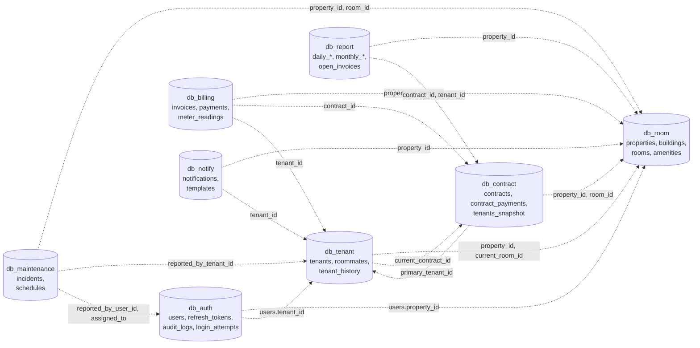
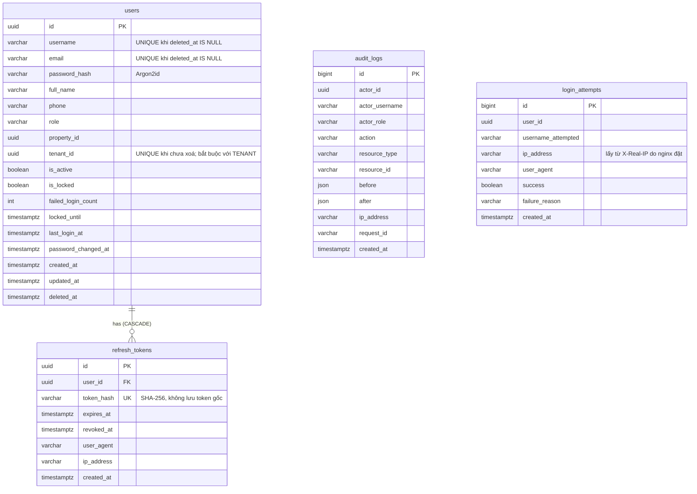
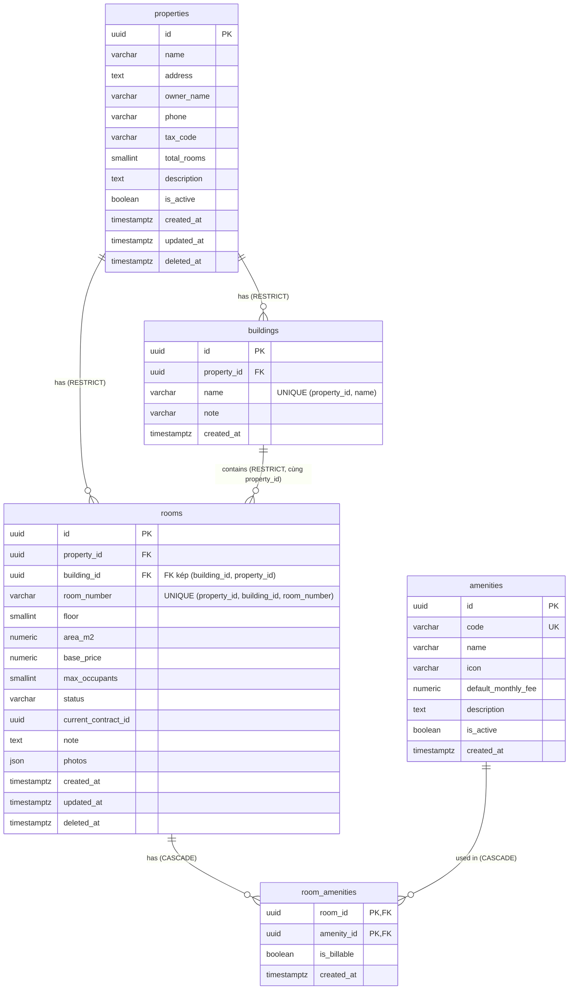
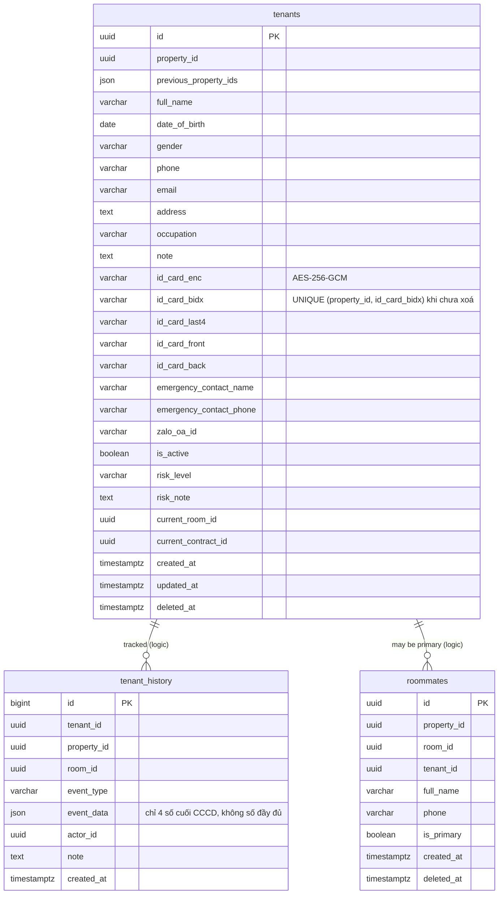
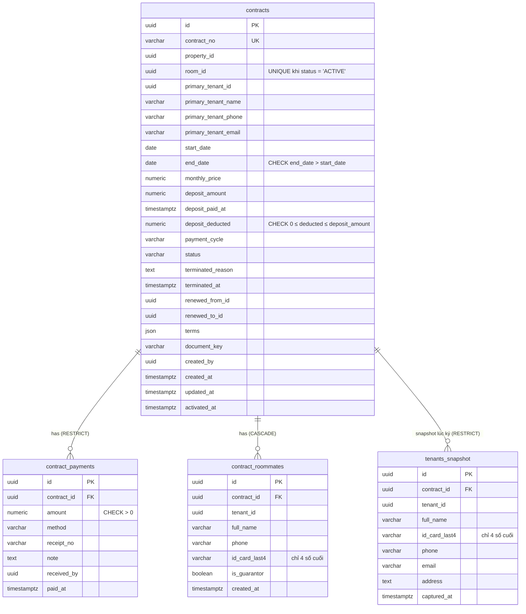
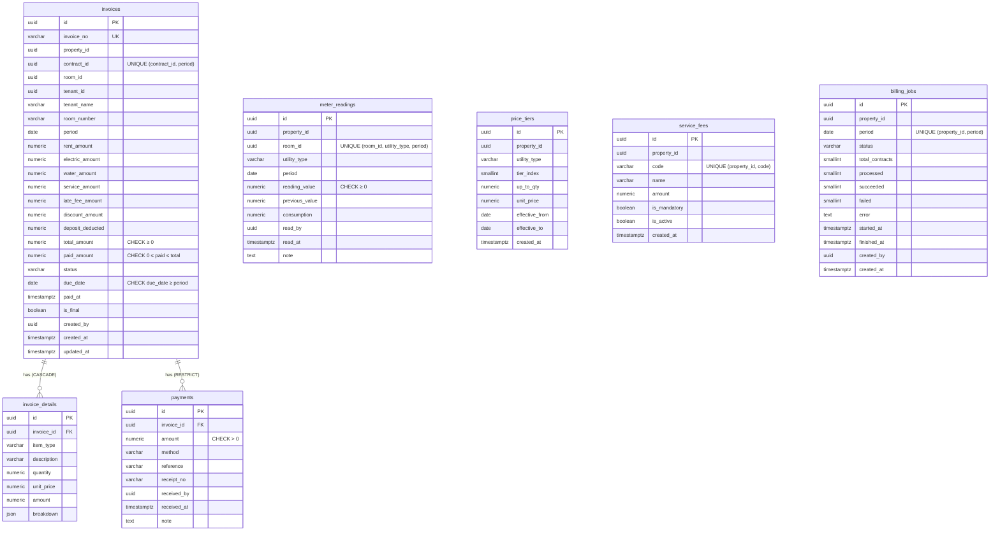
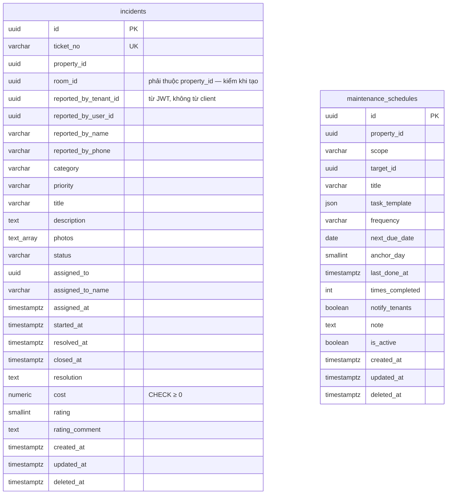
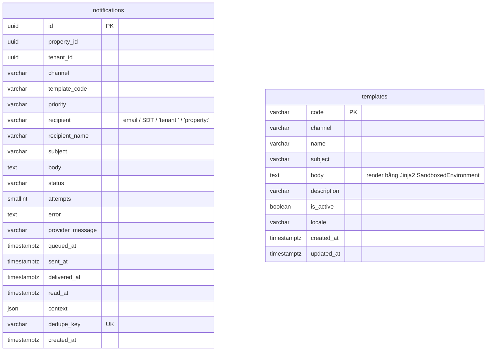
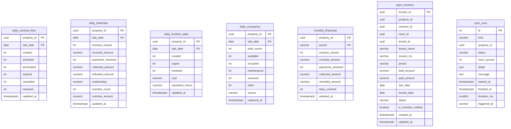
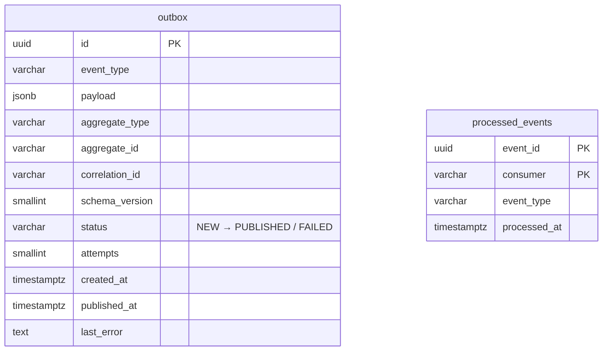

# Sơ đồ cơ sở dữ liệu — Hệ thống quản lý phòng trọ (Microservice)

> 8 database độc lập (database-per-service). Trong mỗi DB, các bảng liên kết bằng **Foreign Key thật**. Giữa các DB **không có FK** — chỉ tham chiếu logic qua UUID.
>
> **Mỗi service một role PostgreSQL riêng** (`svc_auth`, `svc_room`, …), không phải superuser, chỉ `CONNECT` được đúng database của mình. Superuser `qlpt` chỉ dùng cho postgres container và sao lưu. Xem `infra/postgres/init/01-roles-and-databases.sh` (cài mới) và `scripts/08-harden-db.sh` (nâng cấp hệ thống đang chạy).

## 1. Tổng quan quan hệ giữa các service (tham chiếu logic)

> `users.tenant_id` là liên kết duy nhất giữa tài khoản đăng nhập và hồ sơ người thuê. auth-service đưa nó vào JWT (claim `tenant_id`); các service khác lọc dữ liệu "của tôi" theo claim này, **không bao giờ** theo tham số client gửi lên.

---

## 2. db_auth — Xác thực & phân quyền

> Giữ dữ liệu: `login_attempts` 90 ngày; `refresh_tokens` đã thu hồi/hết hạn 30 ngày (auth-service tự dọn).

---

## 3. db_room — Cơ sở, tòa nhà, phòng

> **FK kép** `rooms(building_id, property_id) → buildings(id, property_id)`: DB tự bảo đảm phòng và tòa nhà của nó cùng một cơ sở, kể cả khi ai đó ghi thẳng vào DB.
>
> Cơ sở chỉ **xoá mềm**. Xoá cứng một cơ sở còn tòa/phòng bị RESTRICT chặn — trước đây CASCADE từ `properties` mâu thuẫn với RESTRICT từ `buildings → rooms`.

---

## 4. db_tenant — Người thuê & người ở cùng

> `tenant-service` là **service duy nhất** giữ số CCCD đầy đủ (mã hoá) và là service duy nhất được cấp khoá `data_encryption_key`.
>
> CCCD duy nhất **trong từng cơ sở** (không toàn hệ thống): UNIQUE toàn hệ thống cho phép quản lý cơ sở A thử số CCCD để biết người đó có thuê ở cơ sở B không.
>
> **Hai danh sách bạn cùng phòng, hai mục đích khác nhau:** `tenant.roommates` = ai đang **thực sự ở** trong phòng (thay đổi theo thời gian); `contract.contract_roommates` = ai **ký tên** trên hợp đồng (đóng băng lúc ký). Không đồng bộ hai bảng với nhau.

---

## 5. db_contract — Hợp đồng & tiền cọc

> **`uq_contract_active_room`** (partial unique index): mỗi phòng tối đa **một** hợp đồng ACTIVE — ép ở DB, không chỉ ở code.
>
> `tenants_snapshot.contract_id` NULL chỉ còn ở bản ghi cũ không suy ra chắc chắn được hợp đồng.

---

## 6. db_billing — Hóa đơn, thanh toán, điện nước

> Thanh toán là **chứng từ tài chính**: xoá hóa đơn còn thanh toán bị RESTRICT chặn. Ghi nhận thanh toán khoá dòng hóa đơn (`SELECT … FOR UPDATE`) để hai người ghi cùng lúc không thu vượt; CHECK `paid_amount ≤ total_amount` là chốt chặn cuối ở DB.

---

## 7. db_maintenance — Sự cố & bảo trì định kỳ

> `room_id` khác DB nên không có FK; maintenance-service hỏi room-service để chắc phòng thuộc đúng cơ sở của người báo. room-service kiểm thêm lần nữa khi nhận `incident.urgent` (phòng thủ hai lớp).

---

## 8. db_notify — Thông báo & mẫu tin

> Mẫu tin lưu trong DB và sửa được qua API, nên **bắt buộc** render trong sandbox: với `Environment` thường, ai ghi được vào `templates` là chạy được lệnh shell trong container.

---

## 9. db_report — Read model (CQRS)

> report-service **không** đọc trực tiếp DB của service khác — chỉ nhận event và gọi API nội bộ. Nhờ vậy role `svc_report` chỉ cần quyền trên `db_report`.

---

## 10. Bảng hạ tầng (có ở MỌI database)

| Bảng | Mục đích | Giữ lại |
|---|---|---|
| `outbox` | Ghi event cùng transaction nghiệp vụ, publisher đẩy lên RabbitMQ — không mất event khi service chết | PUBLISHED: 7 ngày |
| `processed_events` | Consumer bỏ qua event đã xử lý (idempotent). Khoá **(event_id, consumer)** để nhiều consumer trong cùng service không chặn nhau | 30 ngày (> TTL message 7 ngày của RabbitMQ) |

---

## 11. Toàn bộ khoá ngoại thật (trong cùng database)

| DB | Bảng con → bảng cha | ON DELETE | Lý do |
|---|---|---|---|
| db_auth | refresh_tokens → users | CASCADE | Token không có ý nghĩa khi không còn user |
| db_room | buildings → properties | RESTRICT | Cơ sở chỉ xoá mềm |
| db_room | rooms → properties | RESTRICT | Phòng là đích tham chiếu của HĐ/hóa đơn |
| db_room | rooms → buildings | RESTRICT | |
| db_room | rooms(building_id, property_id) → buildings(id, property_id) | RESTRICT | Phòng và tòa cùng cơ sở |
| db_room | room_amenities → rooms / amenities | CASCADE | Bảng nối thuần |
| db_contract | contract_payments → contracts | RESTRICT | Chứng từ thu cọc |
| db_contract | contract_roommates → contracts | CASCADE | Một phần của hợp đồng |
| db_contract | tenants_snapshot → contracts | RESTRICT | Bằng chứng lúc ký |
| db_billing | invoice_details → invoices | CASCADE | Một phần của hóa đơn |
| db_billing | payments → invoices | RESTRICT | Chứng từ tài chính |

## 12. Ràng buộc nghiệp vụ ép ở tầng DB

| Ràng buộc | Bảng | Ý nghĩa |
|---|---|---|
| `uq_contract_active_room` (partial unique) | contracts | Mỗi phòng tối đa 1 hợp đồng ACTIVE |
| `chk_contract_deposit_not_over_used` | contracts | Không trừ cọc quá số đã đặt |
| `uq_invoice_contract_period` | invoices | Mỗi hợp đồng 1 hóa đơn/kỳ — bấm "tính tiền" 2 lần không ra 2 hóa đơn |
| `chk_invoice_paid_not_over_total` | invoices | Không thu vượt |
| UNIQUE (room, utility_type, period) | meter_readings | Mỗi kỳ nhập chỉ số 1 lần |
| `uq_tenant_property_id_card` (partial) | tenants | CCCD duy nhất trong cơ sở, bỏ qua hồ sơ đã xoá |
| `uq_users_*_live` (partial) | users | Username/email/hồ sơ người thuê duy nhất trong tài khoản đang dùng |

---

## 📌 Cách xem sơ đồ

- **GitHub / GitLab**: render Mermaid tự động trong file `.md`.
- **VS Code**: cài extension "Markdown Preview Mermaid Support".
- **Online**: paste vào [mermaid.live](https://mermaid.live).
